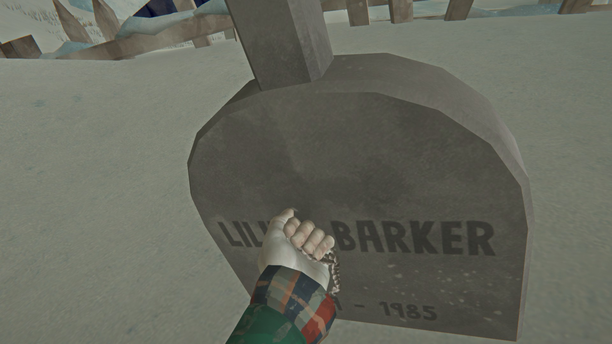

# One Last Thing

**Categories:** Episode 1, Pages with update history · **Source:** [Fandom](https://thelongdark.fandom.com/wiki/One_Last_Thing)

**Contents**

- [Official description](#official-description)
- [Overview](#overview)
- [Delivering the pearls](#delivering-the-pearls)
- [Rewards](#rewards)
- [Update history](#update-history)

**One Last Thing**

_Grey Mother asks you to deliver [Grey Mother's Pearls](./Grey%20Mother%27s%20Pearls.md) to the grave of [Lilith Barker](./Lilith%20Barker.md)_

**Episode:** [Episode 1](./Episode%201%20-%20Do%20Not%20Go%20Gentle.md)\|-

**Current:** One Last Thing

**Region:** [Mountain Town](./Mountain%20Town.md)

**Spoiler Warning:****This page may contain spoilers from the [story](./Wintermute.md) of The Long Dark.**

**One Last Thing** is a side mission started in [Episode 1](./Episode%201%20-%20Do%20Not%20Go%20Gentle.md) of the [story](./Wintermute.md). In the mission, [Will Mackenzie](./Will%20Mackenzie.md) delivers [Grey Mother's Pearls](./Grey%20Mother%27s%20Pearls.md) to the gravesite of [Lilith Barker](./Lilith%20Barker.md) at the [Graveyard](./Graveyard.md) across from [St. Christopher's Church](./St.%20Christopher%27s%20Church.md) outside [Milton](./Milton.md). The mission can only be completed in [Episode 1](./Episode%201%20-%20Do%20Not%20Go%20Gentle.md), prior to the survivor [leaving Milton](./Paradise%20Lost.md).

## Official description

> “**Grey Mother has one final request from you.**”

## Overview

To start the mission, the survivor has to find complete the main mission:

- [The Grey Mother](./The%20Grey%20Mother.md)

Talk to [Grey Mother](./Grey%20Mother.md), who will request Mackenzie to go deliver the pearls to the gravesite of [Lilith Barker](./Lilith%20Barker.md). Mackenzie is shocked that "Lily" is here in Milton, only for him to finally understand what Grey Mother has wanted this whole time when he arrives at the Graveyard.

## Delivering the pearls

_The gravestone of Lilith Barker._ Take [Grey Mother's Pearls](./Grey%20Mother%27s%20Pearls.md) and head out of [Milton House (Grey Mother's)](./Milton%20House%20%28Grey%20Mother%27s%29.md). Turn right, and follow the road towards St. Christopher's Church. Across the road from the church is a Graveyard. Locate the grave of Lilith Barker in the back of the gravesite, and place the pearls on the headstone.

Return to Grey Mother and inform her that the pearls have been delivered and the mission will be completed.

## Rewards

- [Mountaineering Boots](./Mountaineering%20Boots.md)

## Update history

\* UPDATE **17 December 2018 ([Update](./The%20Long%20Dark%20%E2%80%94%20Changelog.md#1.41)):**

- Added to game.
