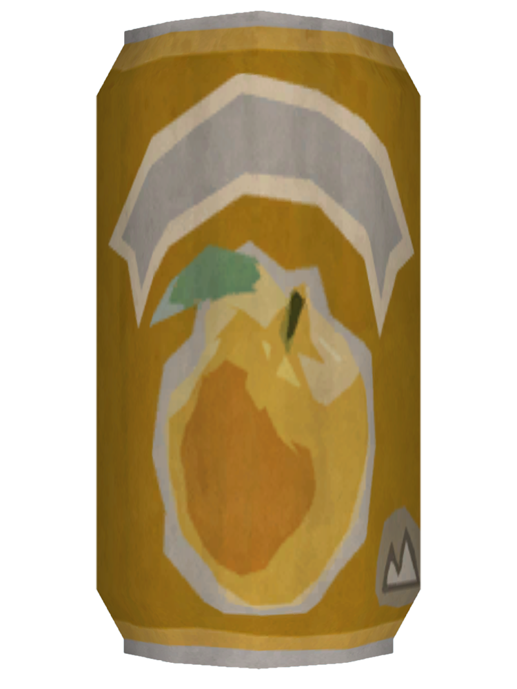

# Orange Soda

**Categories:** Food And Drink, Pages with update history · **Source:** [Fandom](https://thelongdark.fandom.com/wiki/Orange_Soda)

**Contents**

- [Overview](#overview)
- [Trivia](#trivia)
- [Gallery](#gallery)
- [Update history](#update-history)

_For other sodas, see [Soda (disambiguation)](./Soda%20%28disambiguation%29.md)._

**Orange Soda**

_Orange\_Soda\_icon.png_

**Release:** [22 September 2014](./The%20Long%20Dark%20%E2%80%94%20Changelog.md#0.117)

**Wintermute:** No

**Properties**

**Item type:** [Food And Drink](./Food%20And%20Drink.md)\|-

**Stackable:** No

**Examine:** Sweet carbonated drink. Full of high-fructose corn syrup.

**Values**

**Calories:** 250 kcal

**Hydration:** 30%

**Weight:** 0.25 kg (0.55 lbs)

**Advanced data**

**Item key:** GAMEPLAY\_OrangeSoda

**Orange Soda** is a packaged [food](./Food%20And%20Drink.md) item in [_The Long Dark_](./The%20Long%20Dark.md).

## Overview

It can be consumed to restore 250 [calories](./Hunger.md) as well as 30% [hydration](./Thirst.md), the equivalent of 0.20 litres of [water](./Water%20%28Potable%29.md). They are found commonly inside all types of structures, [vehicles](./Vehicle.md), and on [frozen corpses](./Frozen%20Corpse.md).

There are two other kinds of soda, [Summit Soda](./Summit%20Soda.md) and [Stacy's Grape Soda](./Stacy%27s%20Grape%20Soda.md). All three types of soda share the same calories and hydration.

Orange Soda never causes [Food Poisoning](./Food%20Poisoning.md).

## Trivia

- Orange Soda is packaged as a product named "_Snappy Orange Pop",_ possibly a reference to the real-world soda company "Fanta."
- "Pop" is a dialectical term for soda in some parts of English-speaking North America.
- The back of an Orange Soda lists "Ingredients: Carbonated Water, High Fructose Corn Syrup, Natural Flavours, Citric Acid, Yellow 6, Red 40."

## Gallery

_old model_

## Update history

- UPDATE **22 September 2014 ([Update](./The%20Long%20Dark%20%E2%80%94%20Early%20Access%20Changelog.md#0.117)):**
  - Added to game.
