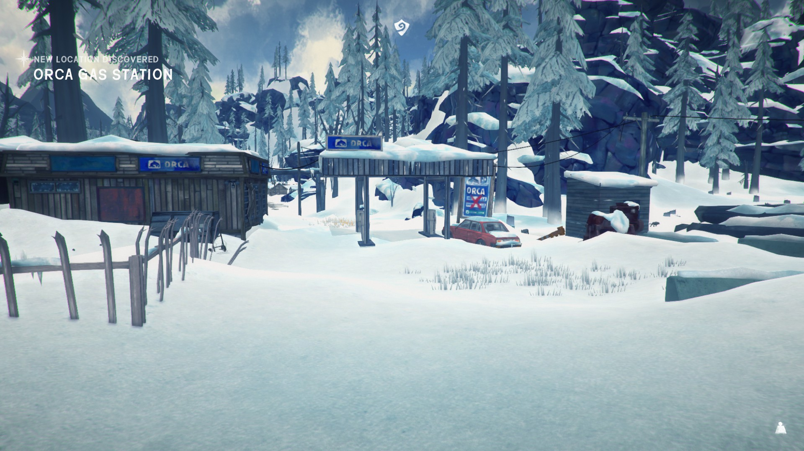
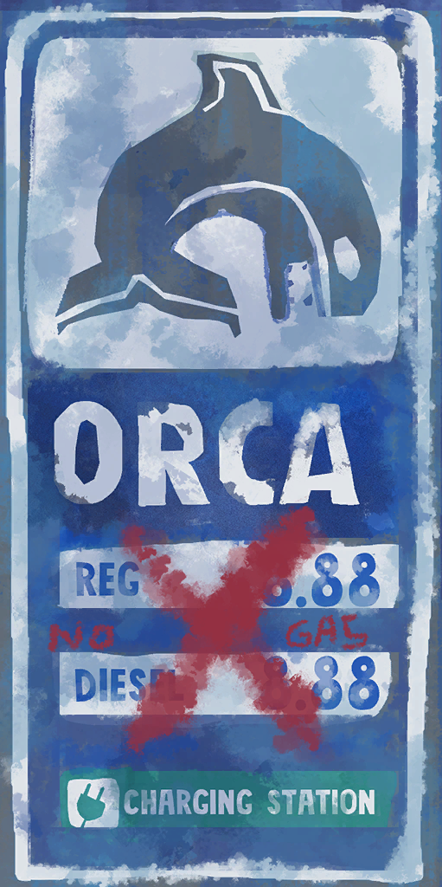

# Orca Gas Station

**Categories:** Indoor locations, Locations, Locations in Mountain Town, Store locations · **Source:** [Fandom](https://thelongdark.fandom.com/wiki/Orca_Gas_Station)

**Contents**

- [Overview](#overview)
- [Safehouse](#safehouse)
- [Wintermute](#wintermute)
- [Gallery](#gallery)

**Orca Gas Station**

[SS MT Orca 04](../assets/SS-MT-Orca-04.jpg)

**Location**

[Orca Gas Station Location](../assets/Orca_Gas_Station_Location.png)

**Region:** [Mountain Town](./Mountain%20Town.md)

**Description:** An abandoned gas station

**General**

**Type:** Store

Has an interior

**Missions:** [Episode 1](./Episode%201%20-%20Do%20Not%20Go%20Gentle.md)

**Characters:** [Methuselah](./Methuselah.md)

**Template:spoiler**The **Orca Gas Station** is a location just outside [Milton](./Milton.md) in the [Mountain Town](./Mountain%20Town.md) region. The gas station lies at a junction outside Milton, with one road leading up to [Milton Park](./Milton%20Park.md), one to the town itself, and the last leading past the [Wood Lot](./Wood%20Lot.md) to a [Crashed Prison Transport Bus](./Crashed%20Prison%20Transport%20Bus.md). When breaking into the store, the store itself is labeled [Convenience Store](./Convenience%20Store.md).

## Overview

The station has a front and rear door, both of which are locked in [Survival Mode](./Survival%20Mode.md), and must be forced open with a [prybar](./Prybar.md). In Story mode neither door is locked, and entering the building will introduce you to [Methuselah](./Methuselah.md).

Inside of the building there is a reasonable supply of food, tools, and clothes, as well as a bed and a [computer](./Computer.md) that becomes active during the [Aurora](./Aurora.md).

## Safehouse

The Building can serve as a safehouse for Milton, as it offers a bed and two entrances. even with the constant threat of predators [Mountain Town](./Mountain%20Town.md) is notorious for, this location is comfortably away from [wolf](./Wolf.md) patrols that center around the middle of town. However, players should beware of wolves patrolling outside in the Wood Lot.

Additionally, there is a [Rabbit](./Rabbit.md) grove nearby (in the [Milton Park](./Milton%20Park.md) area), with the occasional [Deer](./Deer.md) passing through, and the building is reasonably close to the climbing rope area that will take you out of Milton.

## Wintermute

Upon meeting [Grey Mother](./Grey%20Mother.md) she will suggest to [Will Mackenzie](./Will%20Mackenzie.md) to visit the local gas station for supplies.

The gas station also serves as a prime example of the already dire situation of the people of Great Bear prior to the [First Flare](./First%20Flare.md). Gas prices appear to have been extremely high, and, ultimately, gasoline seems to have run out entirely based on the red X's on the gas station sign. Comments from characters and notes/signs throughout the store and other buildings in town (mostly in Story mode) also suggest cash had been depleted and that even staples such as milk were hard to come by. The island seem to have suffered some of the worst effects of the wider economic crisis in _The Long Dark_ universe.

## Gallery

_The Gas Station, looking towards [Milton](./Milton.md)_

