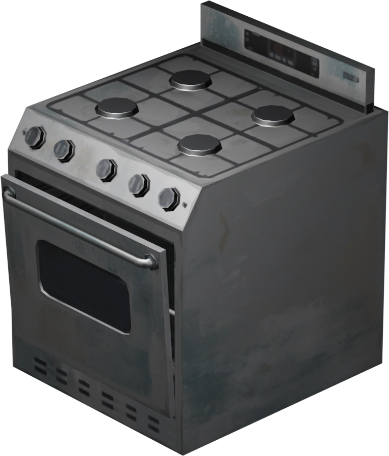

# Oven

**Categories:** Interactable Objects · **Source:** [Fandom](https://thelongdark.fandom.com/wiki/Oven)

**Oven**

**Release:** 12 June 2014

**Update:** [0.01](./The%20Long%20Dark%20%E2%80%94%20Changelog.md#0.01)

**Story item:** No

**Container**

**Capacity:** 40.00 kg(88 lbs)

An **Oven** is a storage container that can be found in many homes. Being an electrical appliance, it no longer functions thanks to the [Aurora](./Aurora.md). They often contain cooked or raw meats inside when searched, and sometimes have a [Cooking Pot](./Cooking%20Pot.md) or [Cooking Skillet](./Cooking%20Skillet.md) on top.
