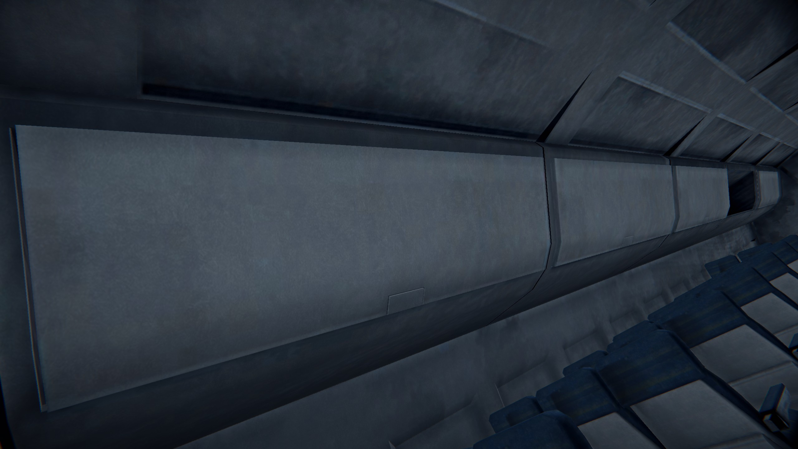

# Overhead Locker

**Overhead Locker**

| Property | Details |
| --- | --- |
|  |  / *Overhead\_Locker.jpg* |
| Story item | Yes |
| **Container** |  |
| Capacity | 30.00 kg(66 lbs) |

**Overhead Lockers** are unique lockers found inside the ruined plane at the [Crash Site (Pleasant Valley)](./Crash%20Site%20%28Pleasant%20Valley%29.md). They are found inside the main body of the plane, with 10 of them being above the seats.

Bafflingly, they do not contain loot in [Survival Mode](./Survival%20Mode.md). in [Wintermute](./Wintermute.md) [Episode 3: Crossroads Elegy](./Episode%203%20-%20Crossroads%20Elegy.md), the lockers contain loot such as food and clothing.**Lua execution error in Module:Navbox function navbox**
