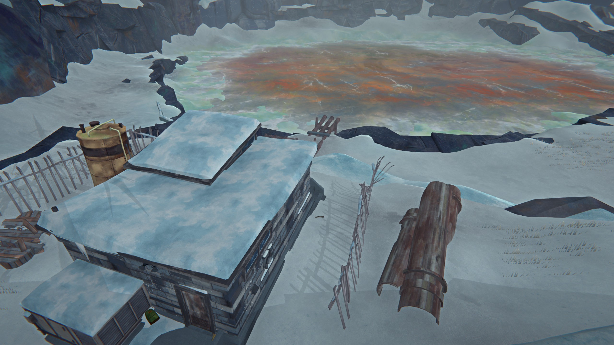
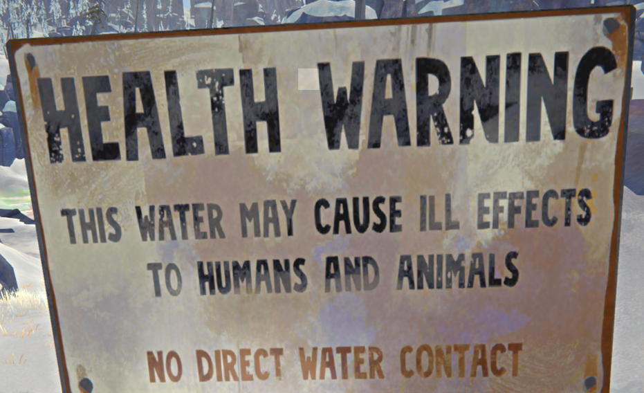

# Overladen Pond

**Overladen Pond**

| Property | Details |
| --- | --- |
|  |  / *Overladen\_Pond.jpg* |
| **Location** |  |
|  |  / *Overladen\_Pond\_Location.png* |
| Region | [Zone of Contamination](./Zone%20of%20Contamination.md)\|- |
| **General** |  |
|  | Has no shelter\|} / The **Overladen Pond** is an incredibly toxic pond created as a result of the nearby [Pump House](./Pump%20House.md) dumping toxic underground gases and chemicals into the pond. The pond's ice is thick enough to prevent a [Weak Ice](./Weak%20Ice.md) hazard, but simply walking on or around the pond risks [Chemical Poisoning](./Chemical%20Poisoning.md). This [Affliction](./Afflictions.md) can be escaped by entering the [Pump House](./Pump%20House.md) building if quick enough. / \|  / *The Pump House and Overladen Pond as viewed from a nearby cliff* \|  / *The nearby sign leading to the Pump House* \| / \| --- \| --- \| / **Lua execution error in Module:Navbox function navbox****Lua execution error in Module:Navbox function navbox** |
|  / *The Pump House and Overladen Pond as viewed from a nearby cliff* |  / *The nearby sign leading to the Pump House* |
