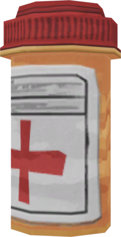

# Painkillers

**Contents**

- [Overview](#Overview)
- [Tips](#Tips)
- [Gallery](#Gallery)
- [Trivia](#Trivia)

<table class="infobox">
<caption>Painkillers</caption>
<colgroup>
<col style="width: 50%" />
<col style="width: 50%" />
</colgroup>
<tbody>
<tr>
<td colspan="2"><figure>

<figcaption>Painkillers_icon.png</figcaption>
</figure></td>
</tr>
<tr>
<td colspan="2" class="section">
<strong>General</strong>
</td>
</tr>
<tr>
<td>
Item Type
</td>
<td>
<a href="./First%20Aid.md" class="wikilink" title="First Aid">First Aid</a>
</td>
</tr>
<tr>
<td>
Renewable
</td>
<td>
Yes (<a href="./Beachcombing.md" class="wikilink" title="Beachcombing">Beachcombing</a>, <a href="./Trader.md" class="wikilink" title="Trader">Trader</a>)
</td>
</tr>
<tr>
<td colspan="2" class="section">
<strong>Statistics</strong>
</td>
</tr>
<tr>
<td>
Unit weight
</td>
<td>
0.02 kg/dose(0.04 lbs/dose)
</td>
</tr>
<tr>
<td>
Weight
</td>
<td>
0.10 kg(0.22 lbs)
</td>
</tr>
<tr>
<td>
Unit count
</td>
<td>
6 doses
</td>
</tr>
</tbody>
</table>

<table>
<colgroup>
<col style="width: 33%" />
<col style="width: 33%" />
<col style="width: 33%" />
</colgroup>
<tbody>
<tr>
<td style="vertical-align: top; font-size: 3em; color: #5d5980; padding-right: 10px">
“
</td>
<td>
A bottle of Painkillers. Take it to reduce pain from injuries.

&#10;

In-game description

</td>
<td style="vertical-align: bottom; font-size: 3em; color: #5d5980; padding-left: 10px">
”
</td>
</tr>
</tbody>
</table>

**Painkillers** are an artificial medical item used to treat <a href="./Afflictions.md" class="wikilink" title="Afflictions">Afflictions</a> in *The Long Dark*.

## Overview

Painkillers are commonly found inside of first aid kits and medicine cabinets, but may be found indoors, outside (usually at campfires or near <a href="./Frozen%20Corpse.md" class="wikilink" title="Frozen Corpses">Frozen Corpses</a>) or in containers. They are usually found in groups of 6 pills, though more or less may be found; they are always found in multiples of 2.

Painkillers are used to treat the following Afflictions:

- <a href="./Pain.md" class="wikilink" title="Pain">Pain</a> (1 dose, or 4 hours if untreated)
- <a href="./Burns.md" class="wikilink" title="Burns">Burns</a> (1 dose, or 30 hours if untreated)
- <a href="./Broken%20Ribs.md" class="wikilink" title="Broken Ribs">Broken Ribs</a> (2 doses and 2 <a href="./Bandage.md" class="wikilink" title="Bandages">Bandages</a>, and 120 hours of Recovery Time)

One dose of Painkillers consists of 2 Painkiller pills. A single pill cannot be used, therefore they should be carried in multiples of 2.

The effect of painkillers is not generalized throughout the body, and each dose will only treat one injury, and should be applied to the injuring requiring them as treatment (e.g. "Pain" from a Sprained Wrist and Sprained Ankle will display as two instances of Pain, and each requires one dose to treat the pain from the given injury).

## Tips

- Pain has minimal effect on gameplay (blurry vision and slightly distorted hearing) with it's only limitation being an inability to read <a href="./Research%20Book.md" class="wikilink" title="Research Books">Research Books</a> while afflicted, and since Pain will subsides automatically with time, treating Pain is not generally a concern. This generally makes treating Pain usually a wasteful decision, since this requires the weight of carrying Painkillers and since they are also required to treat <a href="./Broken%20Ribs.md" class="wikilink" title="Broken Ribs">Broken Ribs</a> or accelerate the healing of <a href="./Burns.md" class="wikilink" title="Burns">Burns</a>.
- Painkillers cannot be crafted and Rose Hips do not regrow; however Painkillers are renewable via <a href="./Beachcombing.md" class="wikilink" title="Beachcombing">Beachcombing</a> and <a href="./Trader.md" class="wikilink" title="Trading">Trading</a>.
- The condition of Painkillers <a href="./Decay.md" class="wikilink" title="decays">decays</a> slowly over time (based on <a href="./Survival%20Mode.md" class="wikilink" title="Survival Mode">Survival Mode</a>). Upon reaching 0% Condition, they will disappear if inside of a container. Ruined 0% Painkillers can still be used through the Radial Menu, although this will consume all 6 pills at once. It is therefore advisable to drop the other four pills on the floor first, before consuming Ruined Painkillers.

## Gallery

<table class="gallery">
<colgroup>
<col style="width: 100%" />
</colgroup>
<tbody>
<tr>
<td><figure>

<figcaption>old model</figcaption>
</figure></td>
</tr>
</tbody>
</table>

## Trivia

- The exact medication Painkillers represent is unknown, though the "Rx" on their label states it is a prescribed drug.
- It is not possible to overdose on or become addicted to Painkillers in The Long Dark.
- In *The Long Dark*, Painkillers must be applied directly to treat a specific injury (similar to a Bandage), unlike real-world orally-taken drugs which become generally distributed throughout the body.**Lua execution error in Module:Navbox function navbox**

<a href="ru:%D0%9E%D0%B1%D0%B5%D0%B7%D0%B1%D0%BE%D0%BB%D0%B8%D0%B2%D0%B0%D1%8E%D1%89%D0%B5%D0%B5" class="wikilink" title="ru:Обезболивающее">ru:Обезболивающее</a>

