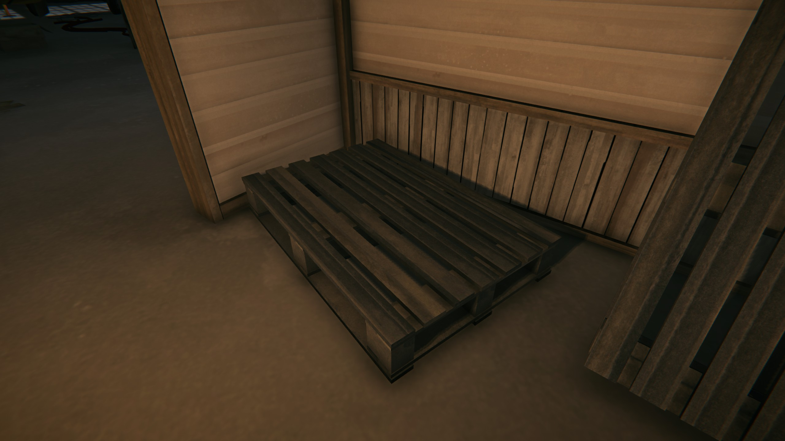

# Pallet

**Categories:** Interactable Objects · **Source:** [Fandom](https://thelongdark.fandom.com/wiki/Pallet)

**Pallet**

_Pallet.jpg_

**General**

**Item Type:** Item

**Wintermute:** No

**Statistics**

**Harvest:** 3 × [Reclaimed Wood](./Reclaimed%20Wood.md)

_For a stack of Pallets, see [Pallets](./Pallets.md)._

A '''Pallet''' is a wooden harvestable item in _The Long Dark_. It may be broken down with a Hatchet to yield Reclaimed Wood.

Pallets yield 3 Reclaimed Wood, and take 22 minutes to break down. This makes them an easily available firewood source.

Pallets are commonly found in industrial areas, such as the [Maintenance Yard](./Maintenance%20Yard.md) in [Broken Railroad](./Broken%20Railroad.md), or the [Carter Hydro Dam](./Carter%20Hydro%20Dam.md) in [Mystery Lake](./Mystery%20Lake%20%28region%29.md).

| Object | Reclaimed Wood | Time | Calories | Condition of Tool |
| --- | --- | --- | --- | --- |
| Pallet | 3 | 22 minutes | 68 | -2% Hatchet |
| Pallet | 3 | 29 minutes | 88 | -3% Improvised Hatchet |
| Pallet | 3 | 34 minutes | 101 | -0.5% Heavy Hammer |
