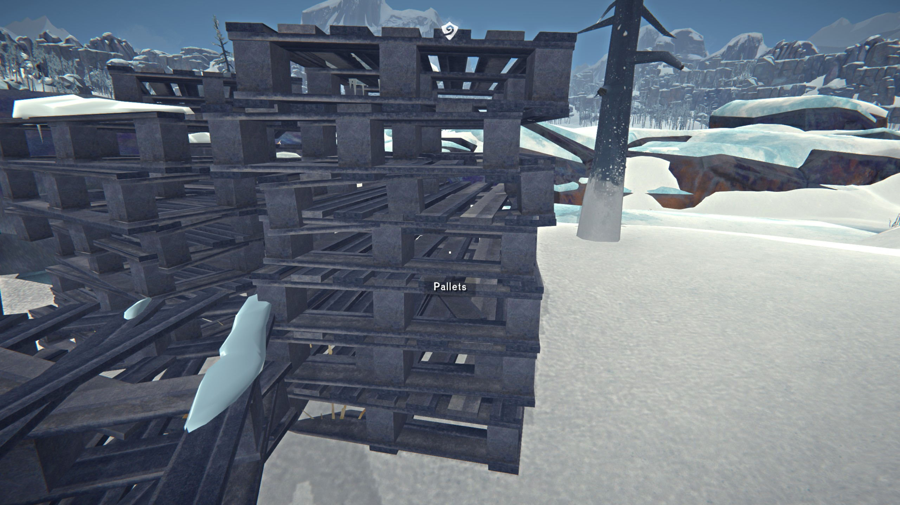

# Pallets

**Categories:** Interactable Objects, Story items · **Source:** [Fandom](https://thelongdark.fandom.com/wiki/Pallets)

**Pallets**

| Property | Details |
| --- | --- |
| \[\[File: /  / _Stacked_ /  / _Piled_ | 250px\]\] |
|  / _Stacked_ |  / _Piled_ |
| **General** |  |
| Item Type | Item |

| Reclaimed Wood | Time / Calories / Condition of Tool |
| 16 | 2 hours / 360 / -2% Hatchet |
| 16 | 2 hours 36 minutes / 468 / -3% Improvised Hatchet |
| 16 | 3 hours / 540 / -0.5% Heavy Hammer |
| Reclaimed Wood | Time / Calories / Condition of Tool |
| 12 | 1 hour 30 minutes / 270 / -2% Hatchet |
| 12 | 1 hour 57 minutes / 351 / -3% Improvised Hatchet |
| 12 | 2 hours 15 minutes / 405 / -0.5% Heavy Hammer |
