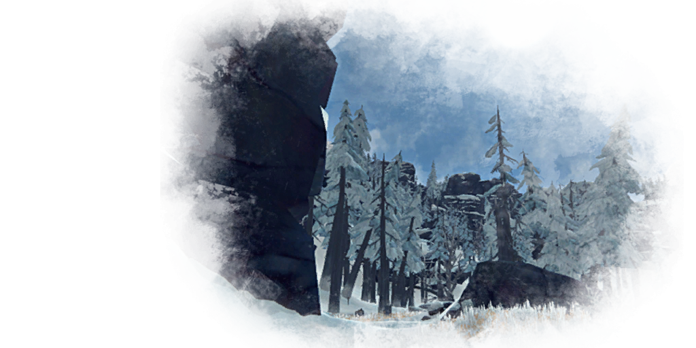

# Paradise Lost/Transcript

<table class="infobox">
<caption>Paradise Lost/Transcript</caption>
<colgroup>
<col style="width: 50%" />
<col style="width: 50%" />
</colgroup>
<tbody>
<tr>
<td colspan="2"><figure>

<figcaption>Paradise_Lost.png</figcaption>
</figure></td>
</tr>
<tr>
<td>
Episode
</td>
<td>
<a href="./Episode%201%20-%20Do%20Not%20Go%20Gentle.md" class="wikilink" title="Episode 1">Episode 1</a>|-
</td>
</tr>
<tr>
<td>
Previous
</td>
<td>
<a href="./The%20Grey%20Mother%20%E2%80%94%20Transcript.md" class="wikilink" title="The Grey Mother/Transcript">The Grey Mother/Transcript</a>
</td>
</tr>
<tr>
<td>
Current
</td>
<td>
Paradise Lost/Transcript
</td>
</tr>
<tr>
<td>
Next
</td>
<td>
<a href="./The%20Wounded%20Trapper%20%E2%80%94%20Transcript.md" class="wikilink" title="The Wounded Trapper/Transcript">The Wounded Trapper/Transcript</a>
</td>
</tr>
<tr>
<td>
Region
</td>
<td>
<a href="./Mountain%20Town.md" class="wikilink" title="Mountain Town">Mountain Town</a>
</td>
</tr>
<tr>
<td>
Characters
</td>
<td>
<a href="./Will%20Mackenzie.md" class="wikilink" title="Will Mackenzie">Will Mackenzie</a> 
<a href="./Grey%20Mother.md" class="wikilink" title="Grey Mother">Grey Mother</a> 
<a href="./Methuselah.md" class="wikilink" title="Methuselah">Methuselah</a> 
<a href="./Jeremiah.md" class="wikilink" title="Jeremiah">Jeremiah</a> 
<a href="./Old%20Bear.md" class="wikilink" title="Old Bear">Old Bear</a>
</td>
</tr>
</tbody>
</table>

This is the mission transcript for mission 4 <a href="./Paradise%20Lost.md" class="wikilink" title="Paradise Lost">Paradise Lost</a> of <a href="./Episode%201%20-%20Do%20Not%20Go%20Gentle.md" class="wikilink" title="Episode 1: Do Not Go Gentle">Episode 1: Do Not Go Gentle</a>.

## Transcript

CHAPTER FOUR

PARADISE LOST

*After receiving <a href="./Lily%27s%20Trunk%20Key.md" class="wikilink" title="Lily&#39;s Trunk Key">Lily's Trunk Key</a>, Mackenzie still has the ability to speak with Grey Mother, starting the mission <a href="./One%20Last%20Thing.md" class="wikilink" title="One Last Thing">One Last Thing</a>.*

**Blue Dialogue**

- Memories

<a href="./Will%20Mackenzie.md" class="wikilink" title="Will Mackenzie">Will Mackenzie</a>: "Lily...who was she?"

<a href="./Grey%20Mother.md" class="wikilink" title="Grey Mother">Grey Mother</a>: "You want to understand Lily's story, man who fell from the sky?"

Will Mackenzie: "I think I know enough about loss to understand why you wanted her pearls."

Grey Mother: "Then take them...to Lily."

Will Mackenzie: "Lily's still here, in Milton? Why didn't you say so?"

*Grey Mother reaches behind her for the pearls and hands them to Mackenzie*

Grey Mother: "Go find her. Take the pearls and give them to Lily. And then I can rest in peace."

*Mackenzie then makes his way to the <a href="./Graveyard.md" class="wikilink" title="Graveyard">Graveyard</a>, but does not find Lily anywhere. That is until he sees a grave. Lilith Barker. He places the pearls on the tombstone, then silently makes his way back to Grey Mother.*

Will Mackenzie: "I found Lily. Your...daughter. She has her pearls now."

Grey Mother: "They were the last gift I gave her...on her 16th birthday. She wanted to leave Milton. To be free. She had grown up here in the mountains...a climber. She wanted to leave to summit all the tallest peaks on Great Bear. I was afraid to let her go. We fought bitterly. And she left. She died out there...in the mountains. In the wilderness."

Will Mackenzie: "Losing a child is..."

Grey Mother: "It's like losing your own life. You have a kind heart, Mackenzie. But it is a heavy one. Go...find your friend. Use Lily's climbing gear and her map. And maybe then her death won't feel so empty."

Will Mackenzie: "Thank you. I'll come back for you..."

Grey Mother: "You've done a lot for me Mackenzie. I won't forget you."

### Leave Milton

*Mackenzie goes to the second floor of the house and retrieves <a href="./Lilith%20Barker.md" class="wikilink" title="Lilith Barker&#39;s">Lilith Barker's</a> climbing equipment, then heads to <a href="./Milton%20Park.md" class="wikilink" title="Milton Park">Milton Park</a> by following <a href="./Lily%27s%20Map.md" class="wikilink" title="Lily&#39;s Map">Lily's Map</a>. He ties the <a href="./Mountaineering%20Rope.md" class="wikilink" title="Mountaineering Rope">Mountaineering Rope</a> to a rock, but before he leaves Milton behind, Mackenzie says:*

Will Mackenzie: "I have a bad feeling that I'm never going to see this place again."

*Mackenzie eventually uses the rope climb and begins climbing down, but the rope begins to fail two-thirds of the way down the climb and then snaps.*

Will Mackenzie: "What the hell...I guess that rope was older than it looked."

*With the rope broken and no way back up to Milton, Mackenzie travels further into the mountains. Upon traveling a bit further away from the climbing spot, a campfire can be seen, along with a familiar face poking at the fire. The campsite has a walking stick planted firmly in the snow, with a plate holding some cooked rabbit meat. A Recycled Can is in the snow at the man's feet, as he sits in on a metal pipe in the shadow of a ruined building. A Cup of Coffee is next to him.*

<a href="./Methuselah.md" class="wikilink" title="Methuselah">Methuselah</a>: "So, we meet again."

Will Mackenzie: "This what you do? Hang around campfires and share wisdom?"

Methuselah: "These are confusing times. Let me see if I can help you make sense of them. I'm an old man. I've seen many things. Some would say, too many. I've seen this happen before. We've sinned, now we're paying the price."

Will Mackenzie: "Are you talking about religion?"

Methuselah: "Not religion. Redemption."

Will Mackenzie: "Is this about the lights in the sky?"

Methuselah: "The lights in the sky are a reckoning. The wonder of humanity and all its creations, laid bare. Her warnings went unheeded."

Will Mackenzie: "Whose warnings?"

Methuselah: "Mother Nature's. The signs were there, for those willing to see them. This has all happened before. Soon we'll all be tested. We'll all have to choose how far we'll go to survive."

Will Mackenzie: "What do you mean, this has happened before?"

Methuselah: "Big change is coming. Are you ready to face it?"

Will Mackenzie: "I'm no hero. I'm just looking for someone. Doing my best to survive in the meantime."

*Depending on what choice was made regarding <a href="./Hobbs.md" class="wikilink" title="Hobbs">Hobbs</a>, Methuselah has different responses to Mackenzie's previous statement:*

<table>
<colgroup>
<col style="width: 50%" />
<col style="width: 50%" />
</colgroup>
<tbody>
<tr>
<td>
Pull Knife
</td>
<td>
Push Knife
</td>
</tr>
<tr>
<td>
Methuselah: "The end of Milton's story is a sad one. Too many people lost, after already too much suffering. You chose to take mercy, to save a life that probably didn't deserve to be saved." Will Mackenzie: "You mean the...convict? How'd you know about that?"

Methuselah: "Whispers in the wind."

Will Mackenzie: "That bastard deserved to die alright, but it's not for me to pass judgment on that."

Methuselah: "Let's hope you hold onto your merciful ways, and the new world doesn't just grind you to dust."

Will Mackenzie: "Look...my friend is out there. I'm going to find her, then we're going to get out of here. The power's going to come back, they'll get the roads opened, Milton will recover...everything will go back to being the way it's supposed to be."

Methuselah: "How do you know this isn't how things are supposed to be?"
</td>
<td>
Methuselah: "Perhaps. Yet you take the role of the avenging angel, choosing who will live and who will die." Will Mackenzie: "Avenging ange...wha...you talking about the convict? How do you know about that?"

Methuselah: "Was it easier to do it, thinking nobody would ever know?"

Will Mackenzie: "That guy was a killer. If I let him go, he'd have killed again. Or worse. I did the world a favour by putting him down."

Methuselah: "You might have. But "Die by the sword" could be a tough philosophy for a civilization that's just been undone."

Will Mackenzie: "Look...we've lived through lots of power outages and the thing is...the lights always come back on."

Methuselah: "You might dispel the darkness at times, but the light is never coming back."
</td>
</tr>
</tbody>
</table>

Will Mackenzie: "Good luck, old man. Enjoy your apocalypse."

Methuselah: "You keep your luck, stranger. I have a feeling, you're going to be needing it."

*The player is free to take the man's belongings or leave him be. After finishing up by the campfire, Mackenzie climbs another rope climb into the mountains, traveling over a frozen river and into a cave opening. Looking to the view to his left, he sees the road on the other side of the collapsed tunnel leaving Milton, then passes through the mountains.*

*Upon making it to the other side, he sees a man in a fur coat being chased by a <a href="./Old%20Bear.md" class="wikilink" title="bear">bear</a>, which quickly overwhelms him and causes his gun to fly through the air at the pilot's feet. Mackenzie quickly picks it up as the bear begins to maul the stranger.*

<a href="./Jeremiah.md" class="wikilink" title="Jeremiah">Jeremiah</a>: "Shoot the damn Bear!!"

*The pilot picks up the rifle, checks to see if it is loaded, then aims at the bear before the screen turns black. A gunshot is heard, and the credits roll.*

The story continues in <a href="./Episode%202%20-%20Luminance%20Fugue.md" class="wikilink" title="Episode 2: Luminance Fugue">Episode 2: Luminance Fugue</a>, in <a href="./The%20Wounded%20Trapper%20%E2%80%94%20Transcript.md" class="wikilink" title="The Wounded Trapper">The Wounded Trapper</a>. **Lua execution error in Module:Navbox function navbox**

