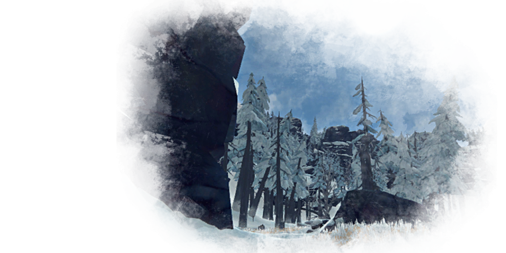

# Paradise Lost

**Contents**

- [Objectives](#Objectives)
- [Walkthrough](#Walkthrough)
- [Transcript](#Transcript)
- [Trivia](#Trivia)

<table class="infobox">
<caption>Paradise Lost</caption>
<colgroup>
<col style="width: 50%" />
<col style="width: 50%" />
</colgroup>
<tbody>
<tr>
<td colspan="2"><figure>

<figcaption>Paradise_Lost.png</figcaption>
</figure></td>
</tr>
<tr>
<td>
Episode
</td>
<td>
<a href="./Episode%201%20-%20Do%20Not%20Go%20Gentle.md" class="wikilink" title="Episode 1">Episode 1</a>|-
</td>
</tr>
<tr>
<td>
Previous
</td>
<td>
<a href="./The%20Grey%20Mother.md" class="wikilink" title="The Grey Mother">The Grey Mother</a>
</td>
</tr>
<tr>
<td>
Current
</td>
<td>
Paradise Lost
</td>
</tr>
<tr>
<td>
Next
</td>
<td>
<a href="./The%20Wounded%20Trapper.md" class="wikilink" title="The Wounded Trapper">The Wounded Trapper</a>
</td>
</tr>
<tr>
<td>
Region
</td>
<td>
<a href="./Mountain%20Town.md" class="wikilink" title="Mountain Town">Mountain Town</a>
</td>
</tr>
<tr>
<td>
Characters
</td>
<td>
<a href="./Will%20Mackenzie.md" class="wikilink" title="Will Mackenzie">Will Mackenzie</a> 
<a href="./Grey%20Mother.md" class="wikilink" title="Grey Mother">Grey Mother</a> 
<a href="./Methuselah.md" class="wikilink" title="Methuselah">Methuselah</a> 
<a href="./Jeremiah.md" class="wikilink" title="Jeremiah">Jeremiah</a> 
<a href="./Old%20Bear.md" class="wikilink" title="Old Bear">Old Bear</a>
</td>
</tr>
</tbody>
</table>

**Template:spoiler**

<table>
<colgroup>
<col style="width: 33%" />
<col style="width: 33%" />
<col style="width: 33%" />
</colgroup>
<tbody>
<tr>
<td style="vertical-align: top; font-size: 3em; color: #5d5980; padding-right: 10px">
“
</td>
<td>
It Looks like Astrid made it out of Milton. Continue your search beyond the town's borders.

&#10;

In-game description

</td>
<td style="vertical-align: bottom; font-size: 3em; color: #5d5980; padding-left: 10px">
”
</td>
</tr>
</tbody>
</table>

**Paradise Lost** is the fourth and final mission in <a href="./Episode%201%20-%20Do%20Not%20Go%20Gentle.md" class="wikilink" title="Episode 1">Episode 1</a> of <a href="./Wintermute.md" class="wikilink" title="Wintermute">Wintermute</a>. In this mission, <a href="./Will%20Mackenzie.md" class="wikilink" title="Mackenzie">Mackenzie</a> leaves <a href="./Milton.md" class="wikilink" title="Milton">Milton</a> and finds a way through the mountains to bypass the <a href="./Crashed%20Prison%20Transport%20Bus.md" class="wikilink" title="tunnel collapse">tunnel collapse</a> in his continuous search for <a href="./Astrid%20Greenwood.md" class="wikilink" title="Astrid">Astrid</a>.

## Objectives

- Retrieve the climbing gear from Lily's trunk.
- Find the climbing area on the outskirts of Milton.
- Find your way through the mountains.

## Walkthrough

Lily's rock climbing gear is now accessible from the trunk upstairs in her bedroom, it will be required to traverse beyond <a href="./Milton%20Park.md" class="wikilink" title="Milton Park">Milton Park</a>. The map will mark a location in the <a href="./Picnic%20Area.md" class="wikilink" title="Picnic Area">Picnic Area</a>, where there is a rope attachment area on a large bolder near the ledge. Using the area will deploy the <a href="./Mountaineering%20Rope.md" class="wikilink" title="mountaineering rope">mountaineering rope</a> that can be used to climb down the ledge. Using the rope will drain stamina, more so depending on encumbrance, and the player cannot climb down while over-encumbered. A good rest beforehand will ensure maximum weight capacity. As Will descends the rope, it snaps and drops him down the last few meters. The game may display minor injuries that immediately disappear.

At the bottom, the player will encounter <a href="./Methuselah.md" class="wikilink" title="Methuselah">Methuselah</a>. His dialogue will change depending on the choice made with <a href="./Hobbs.md" class="wikilink" title="Hobbs">Hobbs</a>.

Continue exploring and find a rope going back up another rock wall on the other side of the valley. Further exploration will lead to a cave that tunnels through the mountains. The cave is dark, but fairly linear. Upon exiting the cave, a short cutscene will start. Will immediately sees a <a href="./Jeremiah.md" class="wikilink" title="man">man</a> being attacked by a <a href="./Old%20Bear.md" class="wikilink" title="bear">bear</a>, and a hunting rifle that has dropped to the ground. He picks it up, aims and fires, ending Episode 1.

## Transcript

<a href="./Paradise%20Lost%20%E2%80%94%20Transcript.md" class="wikilink" title="Paradise Lost/Transcript">Paradise Lost/Transcript</a>

## Trivia

- The title "Paradise Lost" is a reference to the epic poem of the same name by John Milton, and thus a play on the name of the town the episode mostly takes place in.

**Lua execution error in Module:Navbox function navboxLua execution error in Module:Navbox function navbox** <a href="ru:%D0%A0%D0%B5%D0%B6%D0%B8%D0%BC_%D0%B8%D1%81%D1%82%D0%BE%D1%80%D0%B8%D0%B8:_%D1%8D%D0%BF%D0%B8%D0%B7%D0%BE%D0%B4_1#%D0%93%D0%BB%D0%B0%D0%B2%D0%B0_4._%D0%9F%D0%BE%D1%82%D0%B5%D1%80%D1%8F%D0%BD%D0%BD%D1%8B%D0%B9_%D1%80%D0%B0%D0%B9" class="wikilink" title="ru:Режим истории: эпизод 1#Глава 4. Потерянный рай">ru:Режим истории: эпизод 1#Глава 4. Потерянный рай</a>

