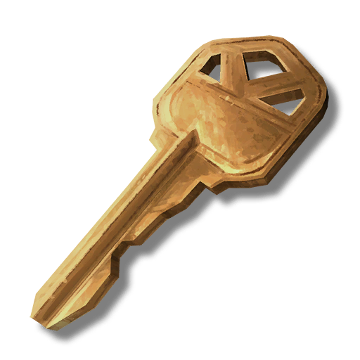

# Paradise Meadows Farm Key

<table class="infobox">
<caption>Paradise Meadows Farm Key</caption>
<colgroup>
<col style="width: 50%" />
<col style="width: 50%" />
</colgroup>
<tbody>
<tr>
<td colspan="2"><figure>

<figcaption>Paradise_Meadows_Farm_Key_icon.png</figcaption>
</figure></td>
</tr>
<tr>
<td colspan="2" class="section">
<strong>Properties</strong>
</td>
</tr>
<tr>
<td>
Item type
</td>
<td>
<a href="./Collectibles.md" class="wikilink" title="Collectibles">Collectibles</a>|-
</td>
</tr>
<tr>
<td>
Stackable
</td>
<td>
No
</td>
</tr>
<tr>
<td>
Examine
</td>
<td>
A key to the farm house on the outskirts of Milton.
</td>
</tr>
<tr>
<td colspan="2" class="section">
<strong>Values</strong>
</td>
</tr>
<tr>
<td>
Weight
</td>
<td>
0.00 kg (0 lbs)
</td>
</tr>
<tr>
<td colspan="2" class="section">
<strong>Actions</strong>
</td>
</tr>
<tr>
<td>
Backpack
</td>
<td>
Examine
</td>
</tr>
<tr>
<td>
On ground
</td>
<td>
Take It, Leave It
</td>
</tr>
</tbody>
</table>

**Paradise Meadows Farm Key** is a <a href="./Collectibles.md" class="wikilink" title="Collectible">Collectible</a> found in <a href="./Survival%20Mode.md" class="wikilink" title="Survival Mode">Survival Mode</a>. It is used to open the front door of the farmhouse, and is found in one of 4 places around <a href="./Paradise%20Meadows%20Farm.md" class="wikilink" title="Paradise Meadows Farm">Paradise Meadows Farm</a>:

- On the dashboard inside the blue <a href="./Truck.md" class="wikilink" title="Truck">Truck</a>
- Inside the <a href="./Tractor.md" class="wikilink" title="Tractor">Tractor</a> next to the barn
- On the <a href="./Frozen%20Corpse.md" class="wikilink" title="Frozen Corpse">Frozen Corpse</a> of <a href="./Martin%20Barker.md" class="wikilink" title="Martin Barker">Martin Barker</a> in the barn
- On the <a href="./Frozen%20Corpse.md" class="wikilink" title="Frozen Corpse">Frozen Corpse</a> of <a href="./Martin%20Barker.md" class="wikilink" title="Martin Barker">Martin Barker</a> behind the farmhouse

## Update history

- UPDATE **1 August 2017 (<a href="./The%20Long%20Dark%20%E2%80%94%20Changelog.md#1.00" class="wikilink" title="Update">Update</a>):**
  - Added to game
- UPDATE **7 December 2017 (<a href="./The%20Long%20Dark%20%E2%80%94%20Changelog.md#1.16" class="wikilink" title="Update">Update</a>):**
  - Added to Survival Mode with Mountain Town.
- UPDATE **17 December 2018 (<a href="./The%20Long%20Dark%20%E2%80%94%20Changelog.md#1.41" class="wikilink" title="Update">Update</a>):**
  - Removed from Episode 1 as part of the Redux edition update.

**Lua execution error in Module:Navbox function navbox**

<a href="ru:%D0%9A%D0%BB%D1%8E%D1%87_%D0%BE%D1%82_%D0%A4%D0%B5%D1%80%D0%BC%D1%8B_%22%D0%A0%D0%B0%D0%B9%D1%81%D0%BA%D0%B8%D0%B5_%D0%BB%D1%83%D0%B3%D0%B0%22" class="wikilink" title="ru:Ключ от Фермы &quot;Райские луга&quot;">ru:Ключ от Фермы "Райские луга"</a>

