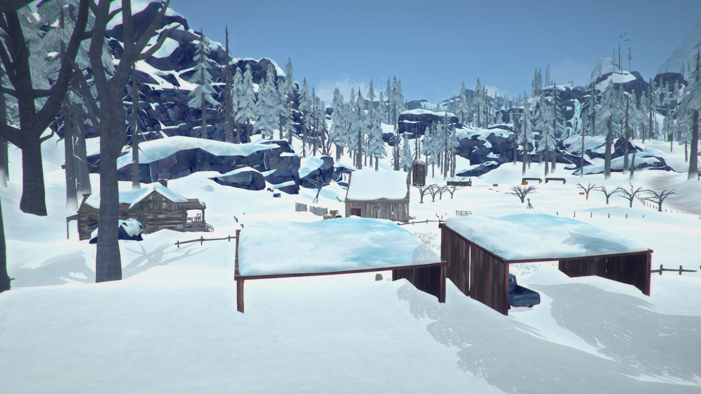
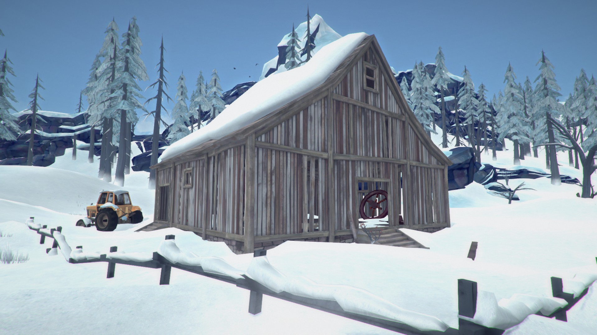
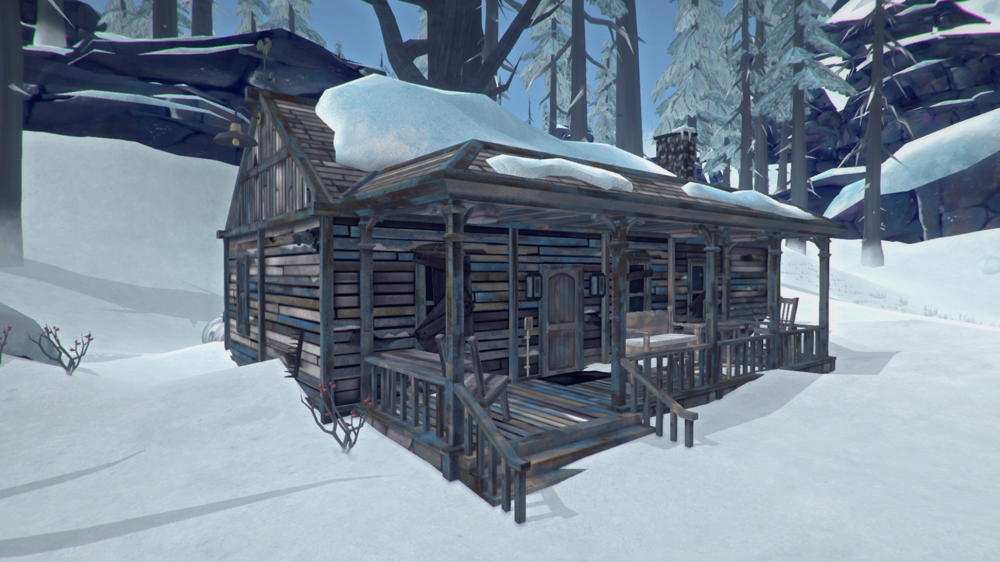
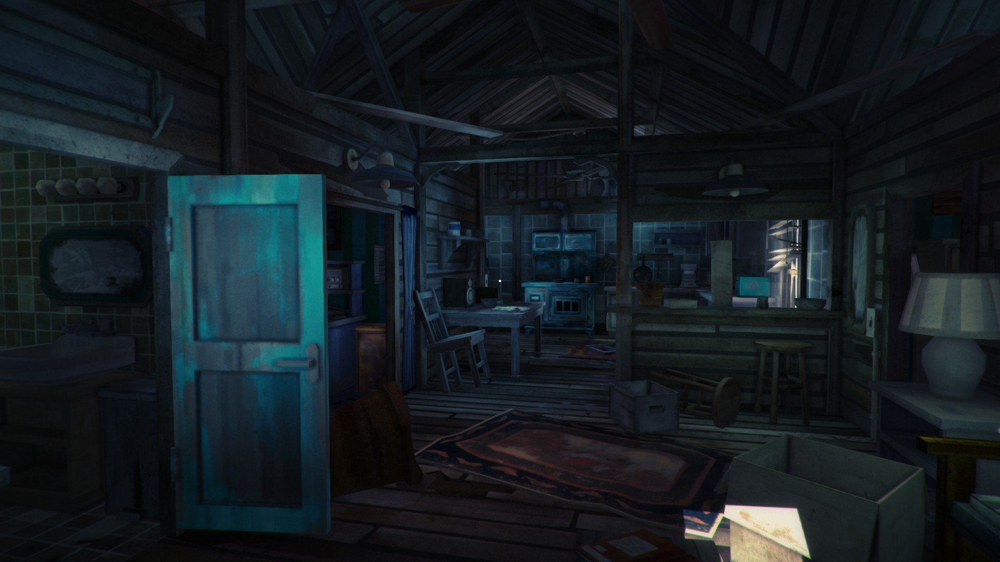
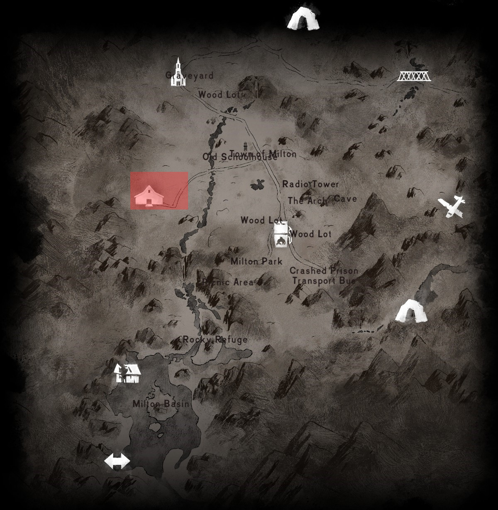
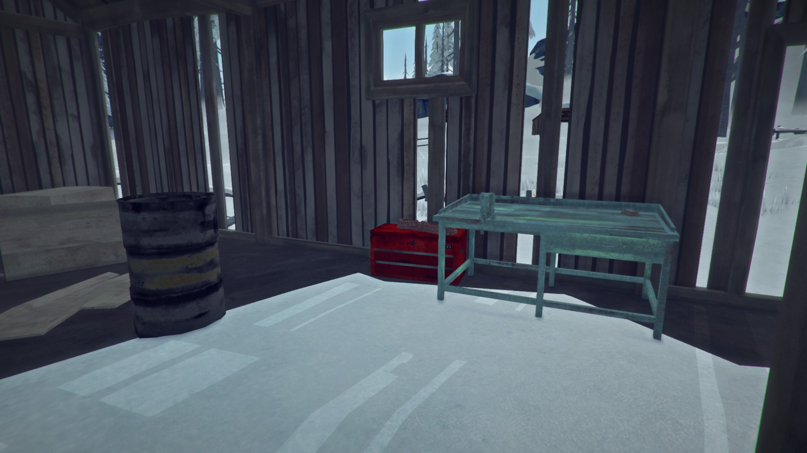
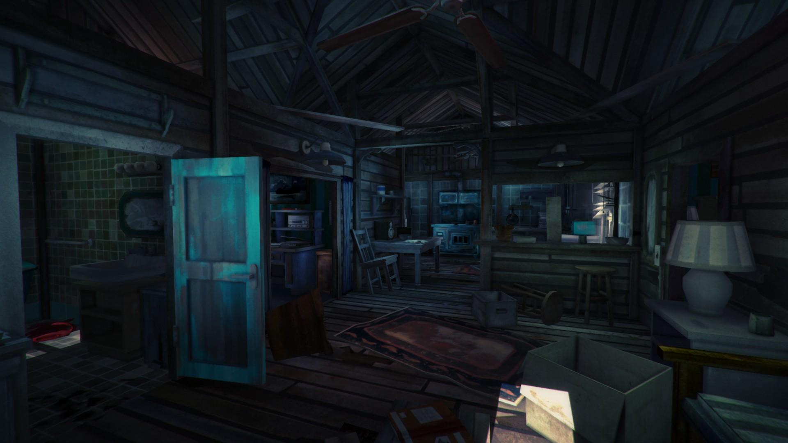
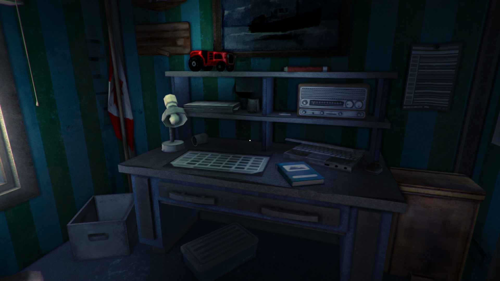
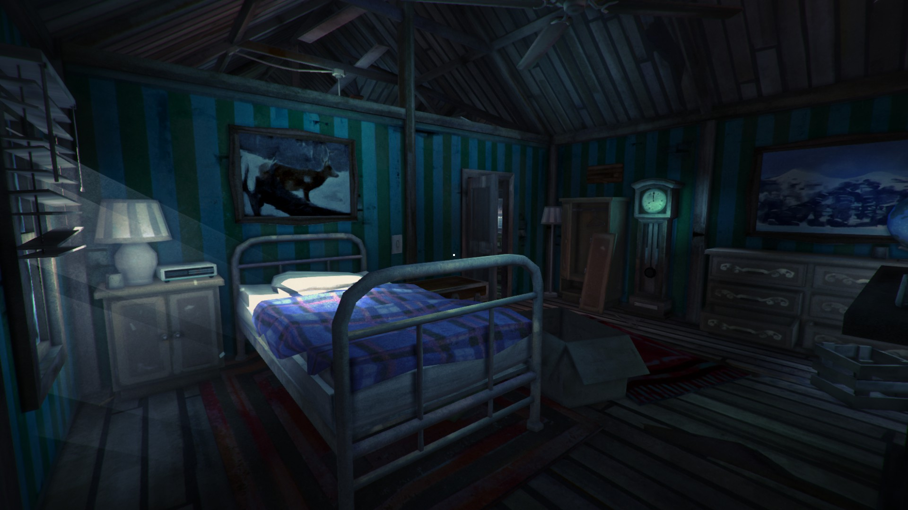

# Paradise Meadows Farm

**Categories:** Indoor locations, Locations, Locations in Mountain Town, Locations with a workbench, Residential locations, Safe Houses · **Source:** [Fandom](https://thelongdark.fandom.com/wiki/Paradise_Meadows_Farm)

**Contents**

- [Description of location](#description-of-location)
- [Farmhouse](#farmhouse)
- [Barn](#barn)
- [Additional outbuildings](#additional-outbuildings)
- [Story Mode](#story-mode)
- [Survival Mode](#survival-mode)
- [Wildlife](#wildlife)
- [Key to the farm](#key-to-the-farm)
- [Loot](#loot)
- [Gallery](#gallery)

[1](https://thelongdark.fandom.com/wiki/Stove?so=search)

**Paradise Meadows Farm**

\[\[File:

250px\]\]

**Location**

Region

[Mountain Town](./Mountain%20Town.md)|-

Location

Description

A farmhouse and several outbuildings

**General**

Type

Residential|-

Firebox

Has a bed

Has a workbench|-

Missions

[Episode 1: Chapter 3](./Episode%201%20-%20Do%20Not%20Go%20Gentle.md#Chapter_3)

**Spoiler Warning:****This page may contain spoilers from the [story](./Wintermute.md) of The Long Dark.**

**Paradise Meadows Farm** or **The Barker Farm** is a location a short distance from [Milton](./Milton.md) in the [Mountain Town](./Mountain%20Town.md) region. It was home to farmer [Martin Barker](./Martin%20Barker.md).

The farmstead buildings include a decently sized, very cluttered house; a couple of open carpark/shed structures; as well as an open barn building that has both a workbench and a fire barrel.

The farmstead was featured as an important story location in [Wintermute](./Wintermute.md), and, since [the Rugged Sentinel Update](./The%20Long%20Dark%20%E2%80%94%20Changelog%20%E2%80%94%20Archive%201.md#1.16) it can also be accessed in [Survival Mode](./Survival%20Mode.md), along with the rest of the Mountain Town map.

## Description of location

### **Farmhouse**

A single-story farmhouse may require a key to get into and is the only building with an interior in this location. It consists of a living room, kitchen bathroom, office, bedroom, and small storage room. The house also has a [stove](./Stove.md) (one of the few 6-slot stoves in the game) in the kitchen and a fireplace in the bedroom.

The house offers a good amount of storage space, as well as a lot of open areas to cure hides. The front porch may be used to store meat to prevent it from spoiling, however the player must remember that the porch itself isn't safe from wildlife.

### **Barn**

The barn is a wooden shell of a building without an actual interior. It offers poor protection from the elements (i.e., some wind protection, depending on wind direction), and it isn't entirely safe from the wildlife. The barn also has a [workbench](./Work%20Bench.md) and a [fire barrel](./Fire%20Barrel.md) located conveniently close, making prolonged crafting sessions easier. There are some planks and cardboard to break down for resources, and dead body may occasionally spawn inside the barn. A [tractor](./Tractor.md) is situated near the barn.

### **Additional outbuildings**

There are the remnants of a couple sheds on the opposite sides of the farm. They contain little and offer almost no protection from weather or from wolves that may patrol around the farm, however, a [truck](./Truck.md) can be found sitting underneath one of the dilapidated structures.

## Story Mode

As of the [REDUX](./The%20Long%20Dark%20%E2%80%94%20Changelog%20%E2%80%94%20Archive%201.md#1.41) update, the farmhouse in _Wintermute_ is no longer accessible prior to receiving the objective "**Something precious was stolen from**[GREY MOTHER](./Grey%20Mother.md)**. Find it, and return it to her.**" If the player visits this location beforehand, the door is locked, with no key spawning in the vicinity. After the start of the objective, however, bloodstains can be seen leading across the yard up to the door, which is now marked with a bloody red handprint. The door is now unlocked, and the home can be accessed without the use of a key.

Upon entering the homestead for the first time, a cutscene begins wherein Mackenzie meets a severely wounded [Hobbs](./Hobbs.md), an escapee of the [Crashed Prison Transport Bus](./Crashed%20Prison%20Transport%20Bus.md) and recognizes the scarf the other man is using to bandage his arm as [Astrid](./Astrid%20Greenwood.md)'s. Hobbs reveals that he, along with fellow prisoners who escaped the transport van, took several residents of [Milton](./Milton.md) hostage and locked them within the [Old Schoolhouse](./Old%20Schoolhouse.md). Tragically, the electrical phenomena accompanying the [aurora](./Aurora.md) started a fire in the building and it burned down with everyone still trapped inside. Hobbs initially makes it sound like he burned it on purpose, but further dialogue opens the possibility that the fire was accidental and the criminals were just unable or unwilling to free their captives in time, although Astrid apparently tried to help but was too late.

Afterwards, an encounter with Astrid left one of the criminals dead and Hobbs with a knife in his side before she escaped through the collapsed tunnel behind the [Crashed Prison Transport Bus](./Crashed%20Prison%20Transport%20Bus.md). With his other companions dead as well, Hobbs sought out shelter within the farmhouse and slumps onto the couch, too weak from pain and blood loss to react with any violence or ill intent upon the player's arrival.

This interaction culminates with a choice. Pull the knife out of Hobbs's gut in order to try and save him; or push the weapon in deeper and end his life. The _[Bank Deposit Box Key #15](./Milton%20Safety%20Deposit%20Box%20Keys.md)_is found in a container next to where Hobbs is sitting, and can be obtained after his dialogue finishes.

## Survival Mode

### **Wildlife**

A few [wolves ](./Wolf.md)can roam the fields from time to time, though generally only two or three wolves come close to the house itself. It means that one should always take caution entering the yard in front of the farmhouse, since it is rarely safe.

A few [rabbits ](./Rabbit.md)​​​​​can be found hopping around the side and the back of the farmhouse. Usually no more than 2 or 3.

In the field to the north of the farm itself, near the silo, there is usually herd of a deer roaming around. Their presence in an open field with scattered snowdrifts (behind which a player can crouch) make for an excellent hunting location.

Be aware that neither the porch of the house nor the open barn are safe from [wildlife](./Wildlife.md).

### **Key to the farm**

In Survival mode, the [Paradise Meadows Farm Key](./Paradise%20Meadows%20Farm%20Key.md) to the farmhouse may be found at various locations around the property, including (but not limited to) the dashboard of the pickup truck, tractor's floor, or a [Frozen Corpse](./Frozen%20Corpse.md), either behind the farmhouse or inside the barn.

### **Loot**

On all experience levels, the farmhouse offers decent loot (by the standards of the difficulty level). There is plenty of furniture inside to break down for reclaimed wood, and multiple containers can hold mid- to high level items. It is an excellent source of [books](./Book.md), containing up to 25 on voyageur. Most notably, a rifle and/or a [revolver](./Revolver.md) and possibly some ammunition may be found inside. Birch saplings may be found behind the farmhouse. This farm is the last interior location in Mountain Town region before reaching [Forlorn Muskeg](./Forlorn%20Muskeg.md) and its forge (through [Milton Basin](./Milton%20Basin.md)). These facts can make the farm possible location to go forging arrowheads from.

## Gallery

