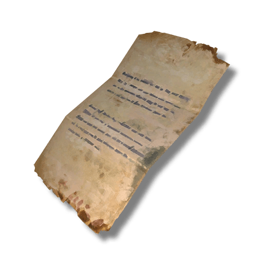

# Park Warning Notice

<table class="infobox">
<caption>Park Warning Notice</caption>
<colgroup>
<col style="width: 50%" />
<col style="width: 50%" />
</colgroup>
<tbody>
<tr>
<td colspan="2"><figure>

<figcaption>Park_Warning_Notice_icon.png</figcaption>
</figure></td>
</tr>
<tr>
<td>
Release
</td>
<td>
<a href="./The%20Long%20Dark%20%E2%80%94%20Early%20Access%20Changelog.md#1.00" class="wikilink" title="1 August 2017">1 August 2017</a>
</td>
</tr>
<tr>
<td>
Wintermute
</td>
<td>
<a href="./Episode%201%20-%20Do%20Not%20Go%20Gentle.md" class="wikilink" title="Episode 1">Episode 1</a>
</td>
</tr>
<tr>
<td colspan="2" class="section">
<strong>Properties</strong>
</td>
</tr>
<tr>
<td>
Item type
</td>
<td>
<a href="./Collectibles.md" class="wikilink" title="Collectibles">Collectibles</a>|-
</td>
</tr>
<tr>
<td>
Stackable
</td>
<td>
No
</td>
</tr>
<tr>
<td>
Examine
</td>
<td>
A weathered-looking Milton &amp; Area Parks Board Notice, pinned to the board. Looks like it's been here a while.
</td>
</tr>
<tr>
<td colspan="2" class="section">
<strong>Values</strong>
</td>
</tr>
<tr>
<td>
Weight
</td>
<td>
0.00 kg (0 lbs)
</td>
</tr>
<tr>
<td colspan="2" class="section">
<strong>Actions</strong>
</td>
</tr>
<tr>
<td>
Backpack
</td>
<td>
Examine
</td>
</tr>
</tbody>
</table>

**Park Warning Notice** is a note found in <a href="./Episode%201%20-%20Do%20Not%20Go%20Gentle.md" class="wikilink" title="Episode 1: Do Not Go Gentle">Episode 1: Do Not Go Gentle</a> in <a href="./Wintermute.md" class="wikilink" title="Wintermute">Wintermute</a>. It is located on an information board when following the path into <a href="./Milton%20Park.md" class="wikilink" title="Milton Park">Milton Park</a>.

## Transcript

The following text is transcribed from **Park Warning Notice**

Due to the unfortunate accident, the Milton & Area Parks Board can no longer condone the use of the climbing area within the park boundaries. Additionally, recent seismic activity has brought the safety of several some (sic) common routes and climbing sections into question. We are reviewing safety policies and will publish findings as soon as possible. Until then, please refrain from using designated climbing areas in the Park. - Signed, M. Antonides, Milton & Area parks Board.

## Update history

- UPDATE **1 August 2017 (<a href="./The%20Long%20Dark%20%E2%80%94%20Changelog.md#1.00" class="wikilink" title="Update">Update</a>):**
  - Added to game.

**Lua execution error in Module:Navbox function navbox**

