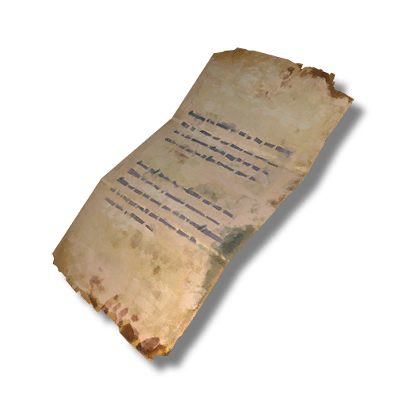

# Passenger Manifest

<table class="infobox">
<caption>Passenger Manifest</caption>
<colgroup>
<col style="width: 50%" />
<col style="width: 50%" />
</colgroup>
<tbody>
<tr>
<td colspan="2"><figure>

<figcaption>Passenger_Manifest_icon.png</figcaption>
</figure></td>
</tr>
<tr>
<td>
Release
</td>
<td>
<a href="./The%20Long%20Dark%20%E2%80%94%20Changelog.md#1.60" class="wikilink" title="22 October 2019">22 October 2019</a>
</td>
</tr>
<tr>
<td>
Wintermute
</td>
<td>
<a href="./Episode%203%20-%20Crossroads%20Elegy.md" class="wikilink" title="Episode 3">Episode 3</a> - <a href="./Fallen%20Star.md" class="wikilink" title="Fallen Star">Fallen Star</a>
</td>
</tr>
<tr>
<td colspan="2" class="section">
<strong>Properties</strong>
</td>
</tr>
<tr>
<td>
Item type
</td>
<td>
<a href="./Collectibles.md" class="wikilink" title="Collectibles">Collectibles</a>|-
</td>
</tr>
<tr>
<td>
Stackable
</td>
<td>
No
</td>
</tr>
<tr>
<td>
Examine
</td>
<td>
A list of all passengers on the plane.
</td>
</tr>
<tr>
<td colspan="2" class="section">
<strong>Values</strong>
</td>
</tr>
<tr>
<td>
Weight
</td>
<td>
0.00 kg (0 lbs)
</td>
</tr>
<tr>
<td colspan="2" class="section">
<strong>Actions</strong>
</td>
</tr>
<tr>
<td>
Backpack
</td>
<td>
Examine
</td>
</tr>
<tr>
<td>
On ground
</td>
<td>
Take It, Read Text, Leave It
</td>
</tr>
<tr>
<td colspan="2" class="section">
<strong>Advanced data</strong>
</td>
</tr>
<tr>
<td>
Item key
</td>
<td>
STORY_Collectible_PassengerManifest
</td>
</tr>
</tbody>
</table>

**Passenger Manifest** is a <a href="./Collectibles.md" class="wikilink" title="Collectible">Collectible</a> item found in <a href="./Episode%203%20-%20Crossroads%20Elegy.md" class="wikilink" title="Episode 3">Episode 3</a> of the <a href="./Wintermute.md" class="wikilink" title="Wintermute">Wintermute</a> story mode as a part of the <a href="./Fallen%20Star.md" class="wikilink" title="Fallen Star">Fallen Star</a> mission.

During the course of the mission, Astrid finds the *Passenger Manifest* on the <a href="./Frozen%20Corpse.md" class="wikilink" title="Frozen Corpse">Frozen Corpse</a> of <a href="./ID%20-%20V.%20Singh.md" class="wikilink" title="ID - V. Singh">ID - V. Singh</a> at the <a href="./Crash%20Site%20%28Pleasant%20Valley%29.md" class="wikilink" title="Crash Site (Pleasant Valley)">Crash Site (Pleasant Valley)</a>.

## Transcript

The following text is transcribed from **Passenger Manifest**

\[piece of torn paper, barely legible\]

North Star Charters Flight 7030 Passenger Manifest

D. Belanger\
T. Chan\
S. Gagne\
...\
O. Gould\
W. Jones\
F. Leblanc\
...\
L. Lee\
...\
A. Lewis\
K. Morrison\
G. Russell\
...\
V. Singh\
...\
A. Roy\
R. Tan

## Update history

- UPDATE **22 October 2019 (<a href="./The%20Long%20Dark%20%E2%80%94%20Changelog.md#1.60" class="wikilink" title="Update">Update</a>):**
  - Added to game.

**Lua execution error in Module:Navbox function navbox**

