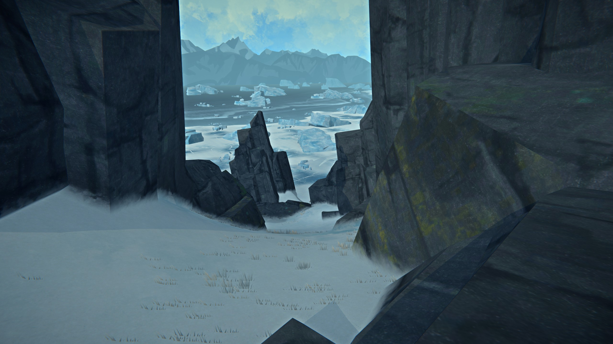
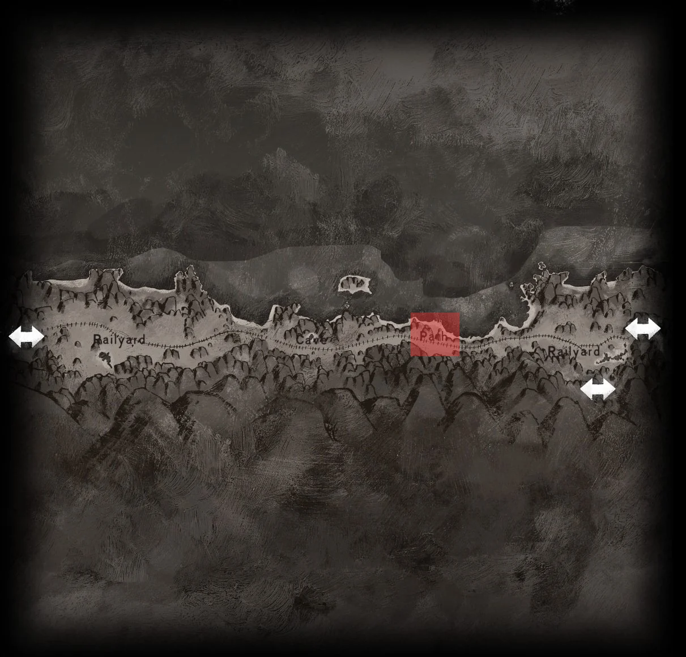

# Path \(Track Section 5\)

**Categories:** DLC Content, Locations, Locations in Anna Island -- Track Section 5, Outdoor locations · **Source:** [Fandom](https://thelongdark.fandom.com/wiki/Path_%28Track_Section_5%29)

**DLC-Exclusive content.** This content requires the [Iron Road](./Iron%20Road.md) addon to be installed before it can be seen or used in regular gameplay.

 **Path (Track Section 5)**  **Location**  **Region:** [Anna Island -- Track Section 5](./Anna%20Island%20--%20Track%20Section%205.md)\\|- **Description:** A pathway that leads to the surrounding ice flats **General** Has no shelter\ **Path** is a location in [Anna Island -- Track Section 5](./Anna%20Island%20--%20Track%20Section%205.md).

## Overview
