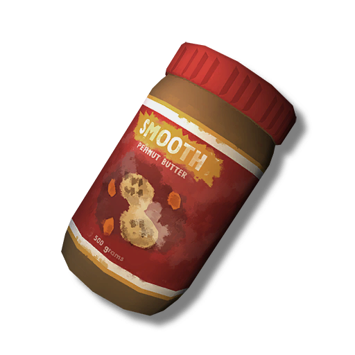
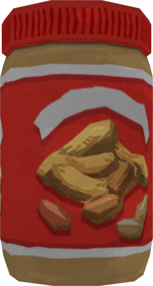

# Peanut Butter

**Contents**

- [Overview](#Overview)
- [Trivia](#Trivia)
- [Gallery](#Gallery)
- [Update history](#Update_history)

<table class="infobox">
<caption>Peanut Butter</caption>
<colgroup>
<col style="width: 50%" />
<col style="width: 50%" />
</colgroup>
<tbody>
<tr>
<td colspan="2"><figure>

<figcaption>Peanut_Butter_icon.png</figcaption>
</figure></td>
</tr>
<tr>
<td>
Release
</td>
<td>
<a href="./The%20Long%20Dark%20%E2%80%94%20Changelog.md#0.117" class="wikilink" title="22 September 2014">22 September 2014</a>
</td>
</tr>
<tr>
<td>
Wintermute
</td>
<td>
No
</td>
</tr>
<tr>
<td colspan="2" class="section">
<strong>Properties</strong>
</td>
</tr>
<tr>
<td>
Item type
</td>
<td>
<a href="./Food%20And%20Drink.md" class="wikilink" title="Food And Drink">Food And Drink</a>|-
</td>
</tr>
<tr>
<td>
Stackable
</td>
<td>
No
</td>
</tr>
<tr>
<td>
Examine
</td>
<td>
Jar of creamy peanut butter. Good source of energy.
</td>
</tr>
<tr>
<td colspan="2" class="section">
<strong>Values</strong>
</td>
</tr>
<tr>
<td>
Calories
</td>
<td>
900 kcal
</td>
</tr>
<tr>
<td>
Hydration
</td>
<td>
-5%
</td>
</tr>
<tr>
<td>
Weight
</td>
<td>
0.50 kg (1.1 lbs)
</td>
</tr>
<tr>
<td colspan="2" class="section">
<strong>Advanced data</strong>
</td>
</tr>
<tr>
<td>
Item key
</td>
<td>
GAMEPLAY_PeanutButter
</td>
</tr>
</tbody>
</table>

**Peanut Butter** is a packaged <a href="./Food%20And%20Drink.md" class="wikilink" title="food">food</a> item in <a href="./The%20Long%20Dark.md" class="wikilink" title="The Long Dark"><em>The Long Dark</em></a>.

## Overview

Consuming Peanut Butter provides up to 900 calories of <a href="./Hunger.md" class="wikilink" title="energy">energy</a>, at the cost of 5% loss in <a href="./Thirst.md" class="wikilink" title="hydration">hydration</a>. They can be found uncommonly in all regions, usually inside cabinets, houses, stores and <a href="./Vehicle.md" class="wikilink" title="vehicles">vehicles</a>. Peanut Butter has a weight of 0.50 kg and provides modest energy density to weight.

Peanut Butter <a href="./Decay.md" class="wikilink" title="decays">decays</a> more slowly when outdoors.

## Trivia

- Peanut Butter does not spawn on Interloper mode.
- Peanut Butter are packaged as a product called "*SMOOTH Peanut Butter"*, possibly a play on the real-life peanut butter brand "Jif".
- In real life, a 16 oz/1 lb jar of peanut butter would have well over 2000 kcals. The in-game value is likely less for balancing reasons.
- The ingredients on the back list: "Roasted Peanuts, Canola Oil, Sugar, Salt." and that it is a "Product Of Canada."

## Gallery

<table class="gallery">
<colgroup>
<col style="width: 100%" />
</colgroup>
<tbody>
<tr>
<td><figure>

<figcaption>Old model.</figcaption>
</figure></td>
</tr>
</tbody>
</table>

## Update history

- UPDATE **22 September 2014 (<a href="./The%20Long%20Dark%20%E2%80%94%20Early%20Access%20Changelog.md#0.117" class="wikilink" title="Update">Update</a>):**
  - Added to game.

**Lua execution error in Module:Navbox function navbox** <a href="ru:%D0%90%D1%80%D0%B0%D1%85%D0%B8%D1%81%D0%BE%D0%B2%D0%B0%D1%8F_%D0%BF%D0%B0%D1%81%D1%82%D0%B0" class="wikilink" title="ru:Арахисовая паста">ru:Арахисовая паста</a>

