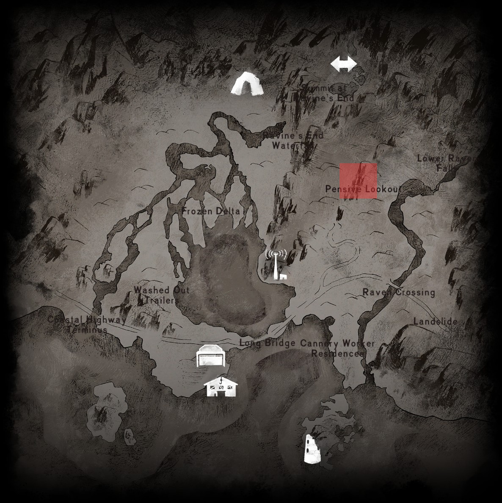
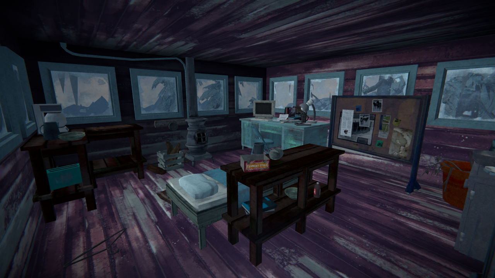
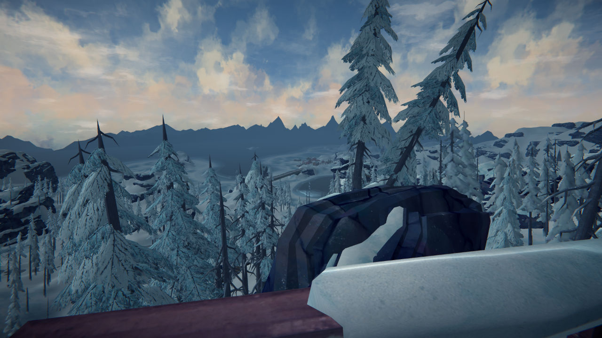
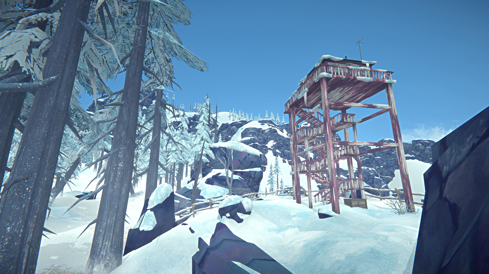
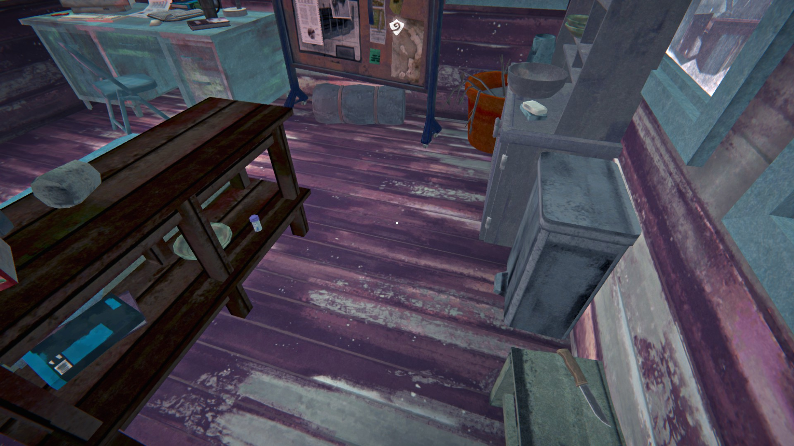
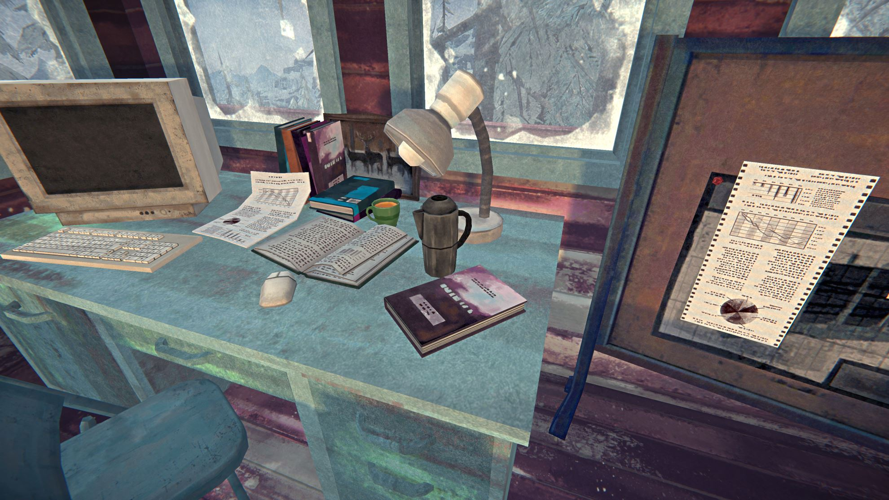

# Pensive Lookout

**Pensive Lookout**

| Property | Details |
| --- | --- |
|  |  / *Screen\_8fe81024-1225-4d19-8ee2-cab3a9a3a50c\_hi.jpg* |
| **Location** |  |
|  |  / *Pensive\_Lookout\_Location.png* |
| Region | [Bleak Inlet](./Bleak%20Inlet.md)\|- |
| Description | An abandoned fire lookout |
| **General** |  |
| Type | Military/Sporting\|- |
|  / *bed\_icon.png* | Has a bed |
|  | Provides some shelter\|} Pensive Lookout is the third intact fire lookout tower in the game, preceded by the [Forestry Lookout](./Forestry%20Lookout.md) and [Abandoned Lookout](./Abandoned%20Lookout.md). Other than bearing more weathered paint, it is nearly identical to the other towers from the outside. Also like the others, Pensive Lookout does not present a loading screen upon entering. / ## Overview / Pensive Lookout is an abandoned fire lookout tower in [Bleak Inlet](./Bleak%20Inlet.md). It is positioned on the east edge of the plateau and has a climbing rope area for the player to travel between the upper and lower sections of the region, although there may not be a [Mountaineering Rope](./Mountaineering%20Rope.md) supplied (the player could find it hanging on the side of the building). Inside the lookout, the player may find a [Hunting Knife](./Hunting%20Knife.md) or [hatchet](./Hatchet.md), plenty of tables as well as some stray firewood. [Dusting Sulfur](./Dusting%20Sulfur.md), [Stump Remover](./Stump%20Remover.md), or even a [Bear Skin Bedroll](./Bear%20Skin%20Bedroll.md) may spawn as well. / ## Safehouse / Players may find that the lookout makes a good safehouse, as the plateau is relatively safe from the predatory wildlife below. / Although travel between the two sections of the map may be tricky, the lookout offers a few unique advantages as a safehouse, serving as a good position to shoot game from while protecting from [wolves](./Wolf.md) and [timberwolves](./Timberwolf.md) (while they *can* climb the stairs, their pathfinding AI tends to struggle with it). It also provides 'immunity' to [Cabin Fever](./Cabin%20Fever.md), plenty of secure cold storage for food, and a large supply bin at the base of the structure. / Disadvantages include a slightly lower indoor temperature, a considerably longer hike to good resources, and a relatively inefficient cooking situation, as the lookout boasts only a 1-slot [Pot Belly Stove](./Pot%20Belly%20Stove.md), unless the player is willing to risk contact with wildlife by cooking at the base of the tower. / \| Column 1 \| Column 2 \| Column 3 \| Column 4 \| / \| --- \| --- \| --- \| --- \| / \|  / *Pensive Lookout from the path below* \|  / *Inside the pensive lookout* \|  / *The somewhat obscured view from pensive lookout* \|  / *Pensive lookout* \| / \|  / *Pensive lookout and rope* \|  / *Pensive lookout and rope* \|  / *Pensive lookout and rope* \|  / *Rope* \| / \|  / *Bear skin bedroll* \|  / *Desk* \|  / *No buffer memory in PC* \|  \| / **Lua execution error in Module:Navbox function navbox** |
|  / *Pensive Lookout from the path below* |  / *Inside the pensive lookout* /  / *The somewhat obscured view from pensive lookout* /  / *Pensive lookout* |
|  / *Pensive lookout and rope* |  / *Pensive lookout and rope* /  / *Pensive lookout and rope* /  / *Rope* |
|  / *Bear skin bedroll* |  / *Desk* /  / *No buffer memory in PC* |
