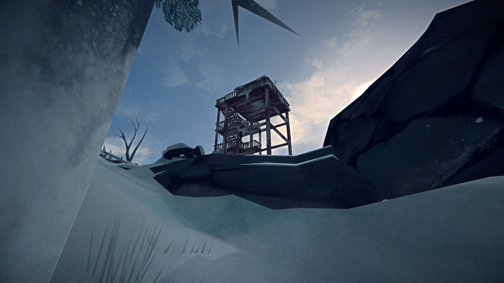
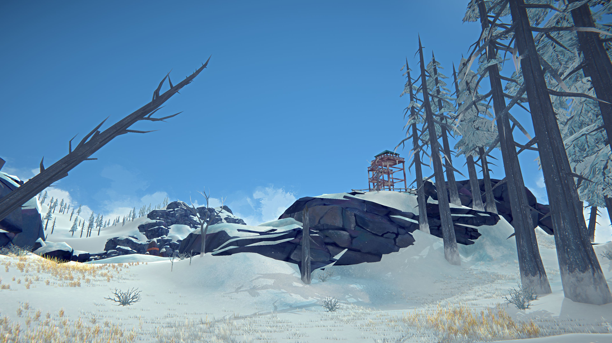
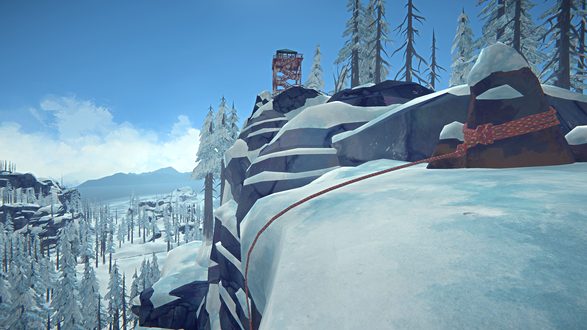
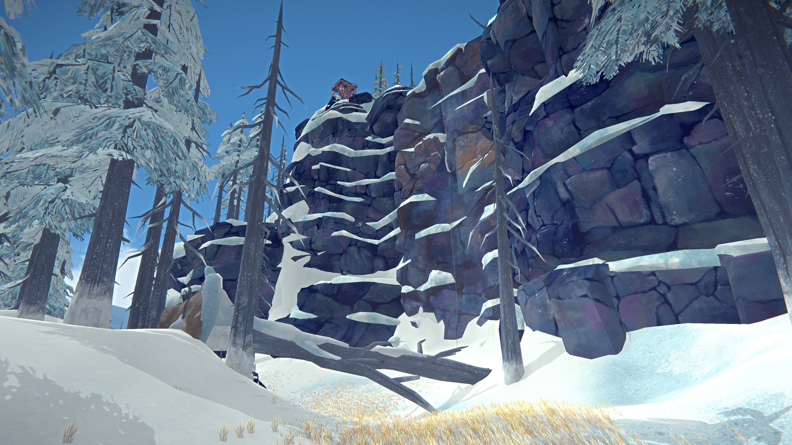
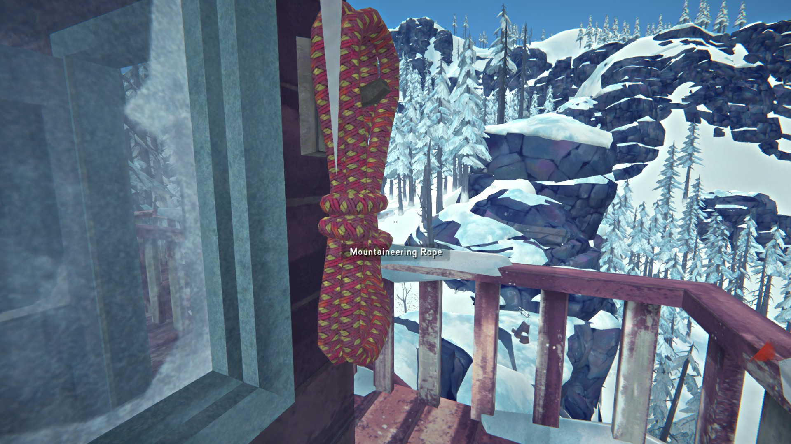
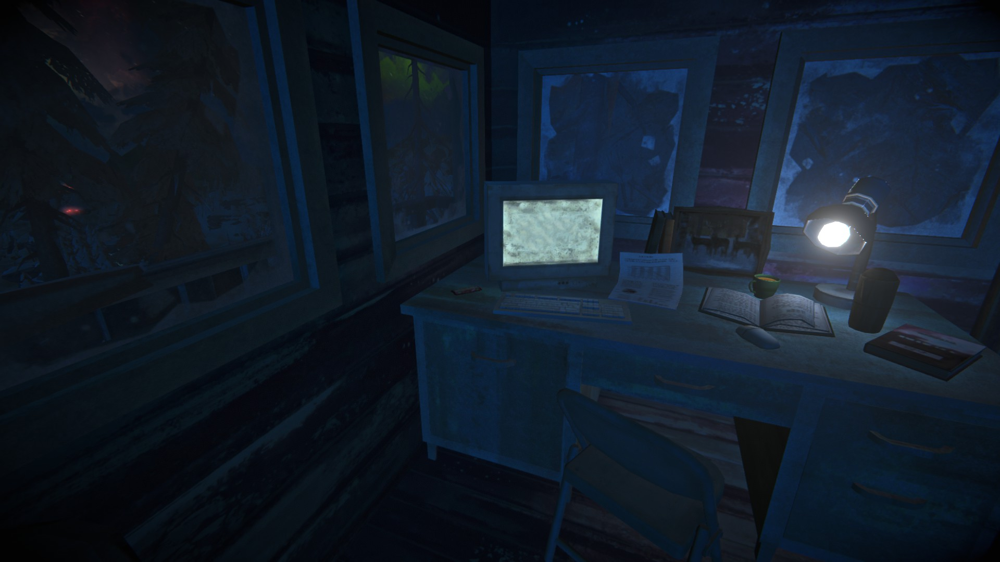

# Pensive Lookout

**Categories:** Locations, Locations in Bleak Inlet, Lookout towers, Military/Sporting locations, Sheltered locations · **Source:** [Fandom](https://thelongdark.fandom.com/wiki/Pensive_Lookout)

**Pensive Lookout**

| Property | Details |
| --- | --- |
|  |  / _Screen\_8fe81024-1225-4d19-8ee2-cab3a9a3a50c\_hi.jpg_ |
| **Location** |  |
|  |  / _Pensive\_Lookout\_Location.png_ |
| Region | [Bleak Inlet](./Bleak%20Inlet.md)\|- |
| Description | An abandoned fire lookout |
| **General** |  |
| Type | Military/Sporting\|- |
|  / _bed\_icon.png_ | Has a bed |

|  / _Pensive Lookout from the path below_ |  / _Inside the pensive lookout_ /  / _The somewhat obscured view from pensive lookout_ /  / _Pensive lookout_ |
|  / _Pensive lookout and rope_ |  / _Pensive lookout and rope_ /  / _Pensive lookout and rope_ /  / _Rope_ |
|  / _Bear skin bedroll_ |  / _Desk_ /  / _No buffer memory in PC_ |
