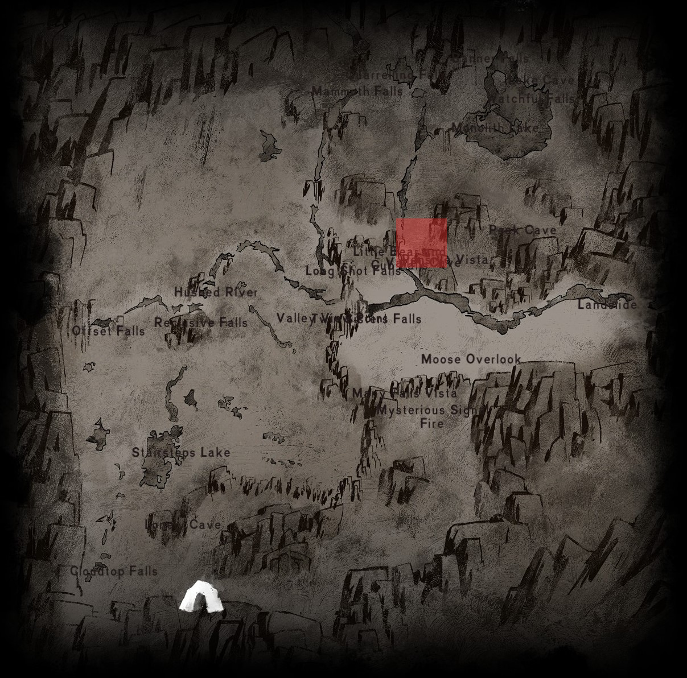

# Pensive Vista

**Categories:** Caves, Locations, Locations in Hushed River Valley, Outdoor locations · **Source:** [Fandom](https://thelongdark.fandom.com/wiki/Pensive_Vista)

**Pensive Vista**

_Pensive\_Vista.jpg_

**Location**

_Pensive\_Vista\_Location.png_

**Region:** [Hushed River Valley](./Hushed%20River%20Valley.md)

**Type:** Outdoors

## Overview

It can be reached climbing two long [climbing ropes](./Rope%20Climbing.md). A small cave can be found just upwards, which can provide useful shelter for weary travellers that have climbed up two long ropes to get here. It is listed as a Vista location, therefore, sketching from there will reveal a large proportion of the region.

A wolf carcass occasionally spawns outside, however the cave itself is safe from predators. This, along with its fairly close proximity to hunting opportunities west of [Monolith Lake](./Monolith%20Lake.md) and close access to the eastern part of the Hushed River Valley, make it a decent safehouse.
