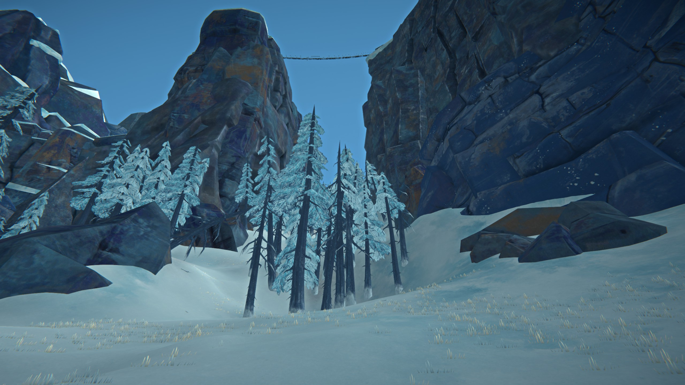

# Perilous Crossing

**Categories:** Locations, Locations in Sundered Pass, Outdoor locations · **Source:** [Fandom](https://thelongdark.fandom.com/wiki/Perilous_Crossing)

**Perilous Crossing**

| Property | Details |
| --- | --- |
|  | [Perilous Crossing](../assets/Perilous_Crossing.jpg) |
| **Location** |  |
|  | [Perilous Crossing Location](../assets/Perilous_Crossing_Location.png) |
| Region | [Sundered Pass](./Sundered%20Pass.md)\|- |
| **General** |  |
|  | Has no shelter **Perilous Crossing** is a location in [Sundered Pass](./Sundered%20Pass.md). |

## Overview

The location appears in the middle of a swinging rope bridge that leads to [Second Pillar](./Second%20Pillar.md) and eventually the [Weather Station](./Weather%20Station.md). The swinging bridge is similar to the ones in [Ash Canyon](./Ash%20Canyon.md) or the [Builder's Bridge](./Builder%27s%20Bridge.md). [Juniper Runoff](./Juniper%20Runoff.md) and [Ogre's Teardrop](./Ogre%27s%20Teardrop.md) can be seen far below, with the bridge serving as a useful landmark in the right weather when in the valley below.

