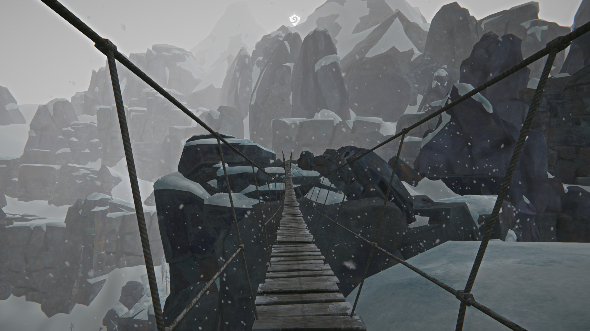
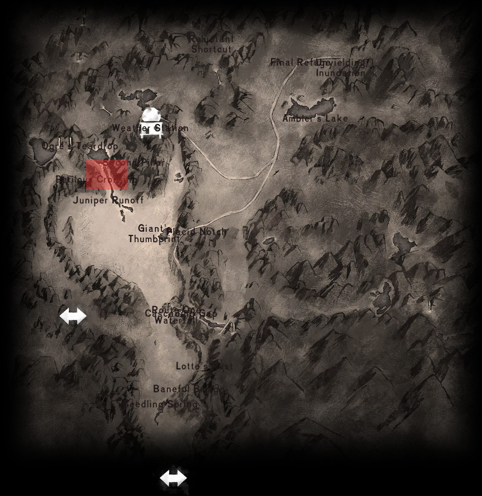

# Perilous Crossing

**Perilous Crossing**

| Property | Details |
| --- | --- |
|  |  / *Perilous\_Crossing.jpg* |
| **Location** |  |
|  |  / *Perilous\_Crossing\_Location.png* |
| Region | [Sundered Pass](./Sundered%20Pass.md)\|- |
| **General** |  |
|  | Has no shelter\|} **Perilous Crossing** is a location in [Sundered Pass](./Sundered%20Pass.md). / ## Overview / The location appears in the middle of a swinging rope bridge that leads to [Second Pillar](./Second%20Pillar.md) and eventually the [Weather Station](./Weather%20Station.md). The swinging bridge is similar to the ones in [Ash Canyon](./Ash%20Canyon.md) or the [Builder's Bridge](./Builder%27s%20Bridge.md). [Juniper Runoff](./Juniper%20Runoff.md) and [Ogre's Teardrop](./Ogre%27s%20Teardrop.md) can be seen far below, with the bridge serving as a useful landmark in the right weather when in the valley below. / \| Column 1 \| / \| --- \| / \|  / *The bridge as seen from Juniper Runoff* \| / **Lua execution error in Module:Navbox function navbox** [ru:Опасный переход](ru:%D0%9E%D0%BF%D0%B0%D1%81%D0%BD%D1%8B%D0%B9_%D0%BF%D0%B5%D1%80%D0%B5%D1%85%D0%BE%D0%B4) |
|  |  / *The bridge as seen from Juniper Runoff* |
