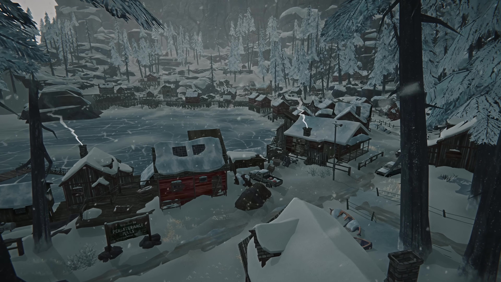
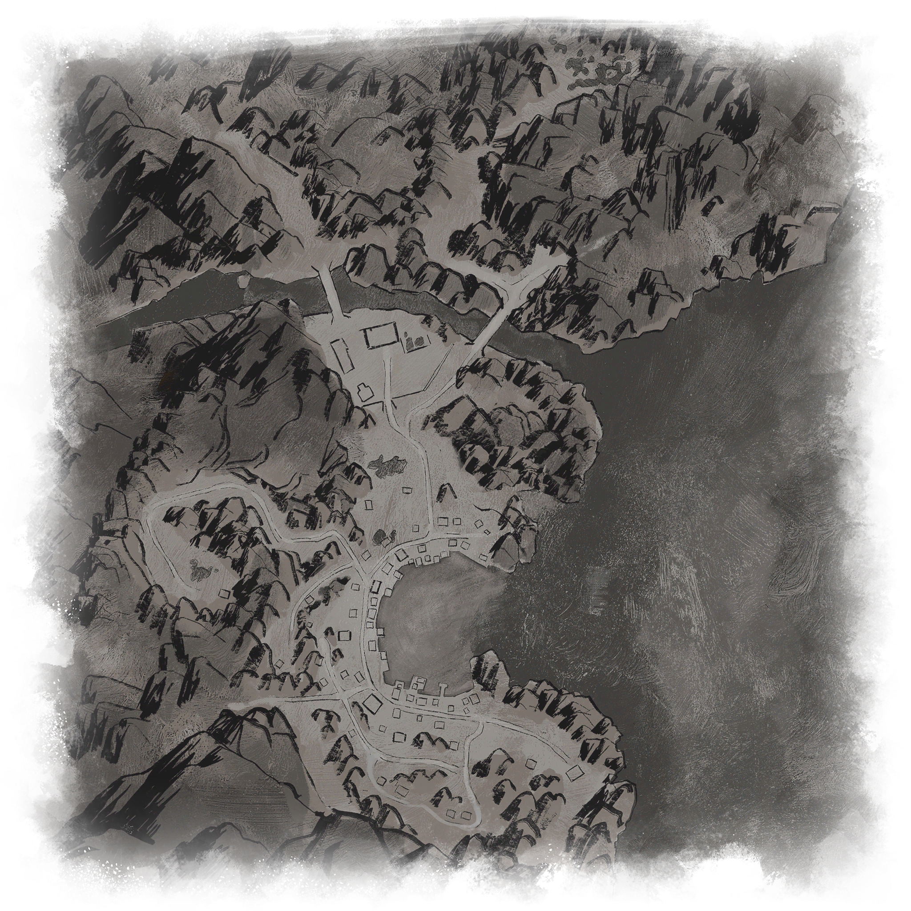
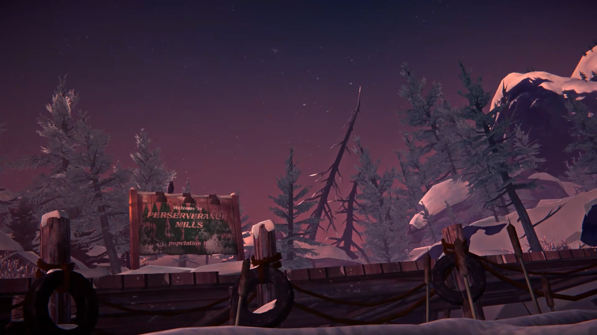
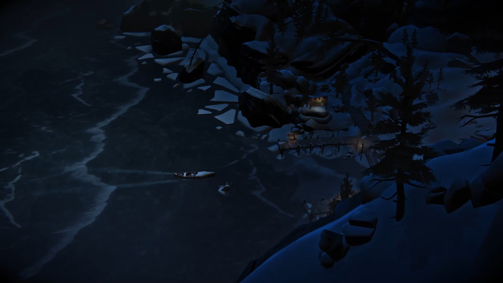
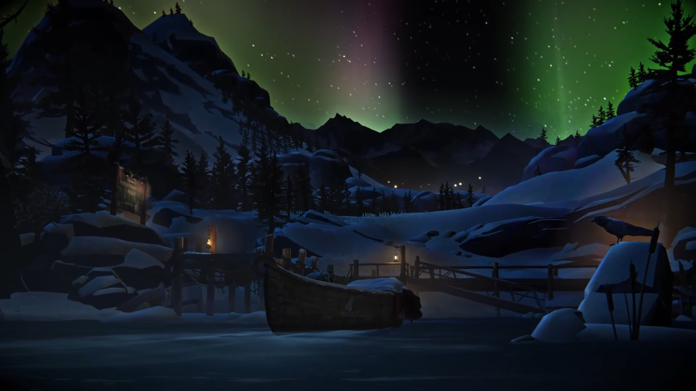
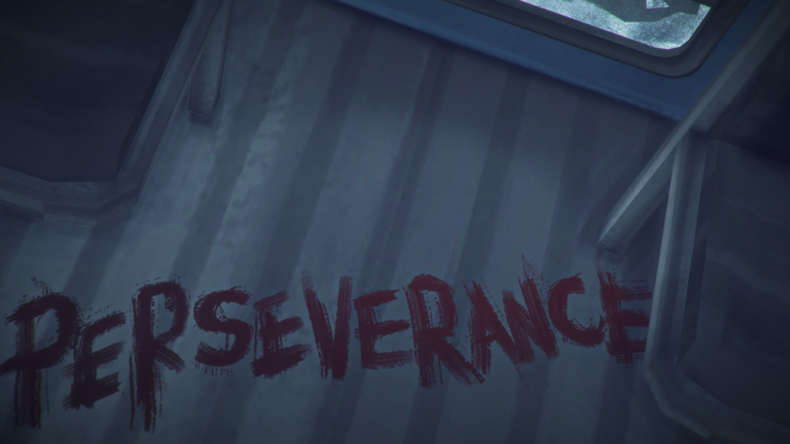
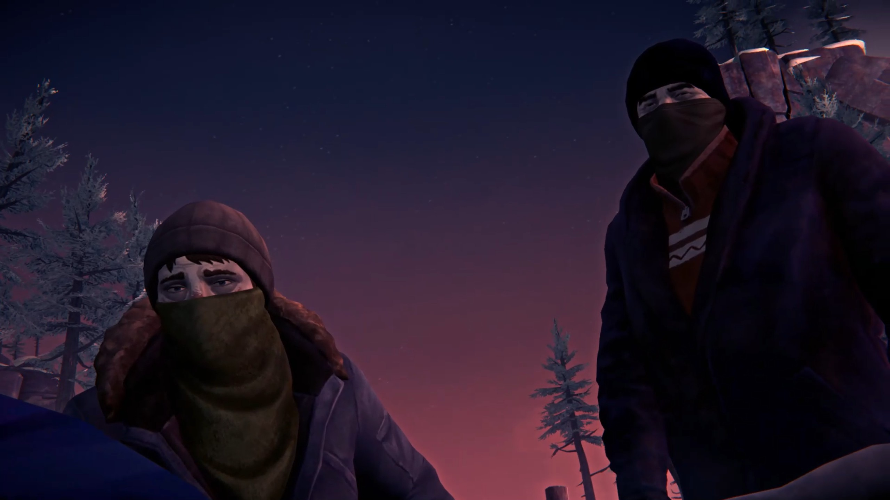
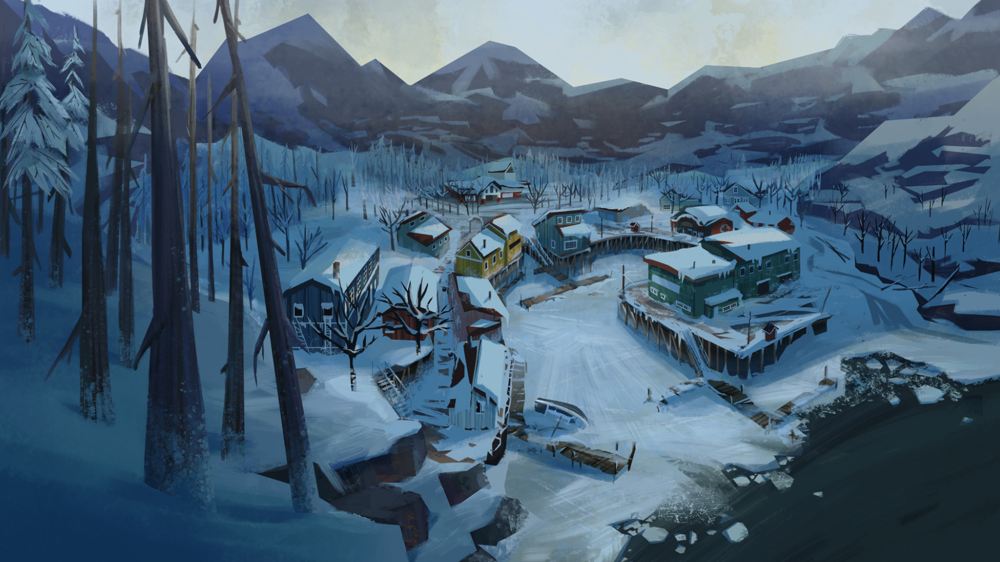
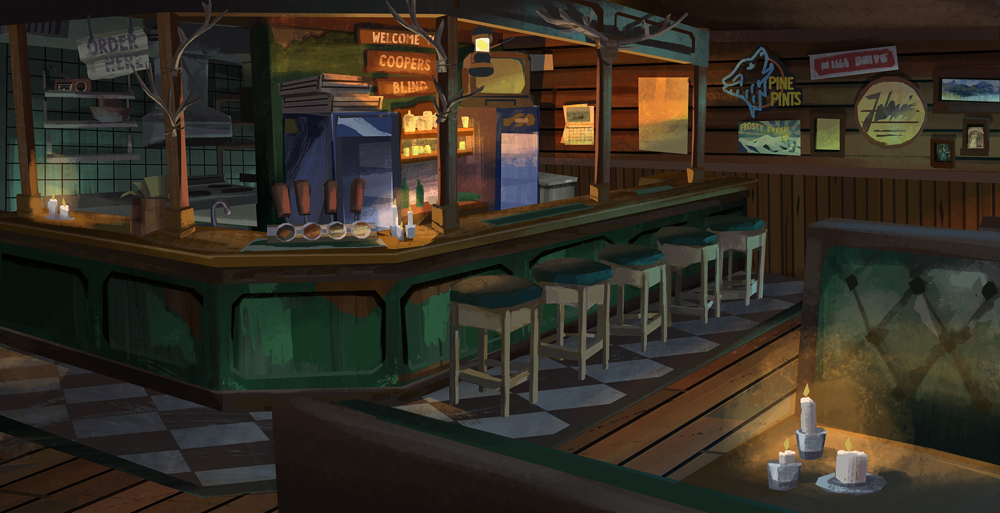
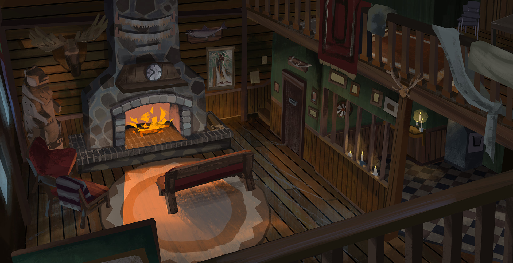

# Perseverance Mills

**Contents**

- [Overview](#overview)
- [Locations](#locations)
- [Wintermute](#wintermute)
- [Episode 1: Do Not Go Gentle](#episode-1-do-not-go-gentle)
- [Episode 2: Luminance Fugue](#episode-2-luminance-fugue)
- [Episode 3: Crossroads Elegy](#episode-3-crossroads-elegy)
- [Episode 4: Fury, Then Silence](#episode-4-fury-then-silence)
- [Episode 5: The Light At The End Of All Things](#episode-5-the-light-at-the-end-of-all-things)
- [Trivia](#trivia)
- [Gallery](#gallery)

**Perseverance Mills**

| Property | Details |
| --- | --- |
|  |  / *Perseverance\_Mills.jpg* |
| **Location on [Great Bear Island](./Great%20Bear%20Island.md)** |  |
|  |  / *No\_picture.png* |
|  |  / *Perseverance\_Mills\_in-game\_map.png* |
| **Details** |  |
| Description | An old, inhabited logging and milling town suffering from a quarantine |
| Connecting Regions | [Desperation Bay](./Desperation%20Bay.md) / [Perseverance Wilds](./Perseverance%20Wilds.md) / [Railway](./Railway.md) (unused) |
| Characters | [Jane Yang](./Jane%20Yang.md) / [Cooper](./Cooper.md) / [Terry](./Terry.md) / Freya / Dr. Larson / Constable Pete / Townsperson One and Two / Mill Worker / Bar Patrons |
| Date Added | 31 March 2026 |

| Column 1 | Column 2 | Column 3 | Column 4 | Column 5 | Column 6 |
| --- | --- | --- | --- | --- | --- |
|  / *2120907963\_TLD-Wintermute-v2.png.de8a285930f6a8f5ad9cf5878754cf5b.png* | **Wintermute-Exclusive content.** / This content only appears in [Wintermute](./Wintermute.md). | \|}{\| style="margin:auto" | “ | **Shit-nothing town, north part of the island? Yeah...I know it.** / [Jeremiah](./Jeremiah.md) | ” |

**Perseverance Mills**is a town and Wintermute exclusive [Region](./Region.md) in *[The Long Dark](./The%20Long%20Dark.md)*. It is mentioned several times throughout [Wintermute](./Wintermute.md) and is the initial centerpiece of [Episode 5](./Episode%205%20-%20The%20Light%20At%20The%20End%20Of%20All%20Things.md).

The region connects to the nearby regions of [Desperation Bay](./Desperation%20Bay.md) and [Perseverance Wilds](./Perseverance%20Wilds.md). The region is currently Wintermute exclusive, and does not appear in [Survival Mode](./Survival%20Mode.md).

## Overview

> “**I seem to recall...a town somewhere up north. Far. What was it called...That's it -- Perseverance Mills**”
>
> — [Grey Mother](./Grey%20Mother.md)

According to the Grey Mother, it is an old milling and logging town, located far to the north of [Milton](./Milton.md) and the [Great Bear Island](./Great%20Bear%20Island.md) coast. Similar to the [Town of Milton](./Town%20of%20Milton.md), Perseverance Mills suffers from economic woes, supply shortages, and a low population. However, the town still has a functioning economy and is in a far better state than Milton, with the nearby Mill providing jobs to the locals and connections to the Mainland being present (including tourism and somewhat regular shipments of food and supplies). The titular Perseverance Mill is stated to be the sole reason for the town's continued economic existence; as without its access to timber and the jobs it provides, no one would have any reason to stay within the area.

The town displays a sign stating that the populations numbers at 101 residents, but most of the houses are boarded up and abandoned, with the resident population being seen actually numbering somewhere around the 20s.

As of [Episode 2](./Episode%202%20-%20Luminance%20Fugue.md) and [Episode 3](./Episode%203%20-%20Crossroads%20Elegy.md), it is hinted that the town is suffering from an outbreak of an unknown illness and is under quarantine, with [Episode 4](./Episode%204%20-%20Fury%2C%20Then%20Silence.md) and [Episode 5](./Episode%205%20-%20The%20Light%20At%20The%20End%20Of%20All%20Things.md) confirming this (with many of the residents wandering out into the sea and drowning themselves or otherwise going missing based on the various missing posters found all over the town).

The town is ultimately burned to the ground by [Mathis](./Mathis.md) and his [Convicts](./Convicts.md) at the end of [Episode 5](./Episode%205%20-%20The%20Light%20At%20The%20End%20Of%20All%20Things.md), with the survivors fleeing to a bunker under the [Suzuki Radio Telescope](./Suzuki%20Radio%20Telescope.md).

## Locations

Despite being the largest town on Great Bear Island, the region has very few locations to explore.

- [Cooper's Blind](./Cooper%27s%20Blind.md)
- Dr. Larsen's [Medical Clinic](./Medical%20Clinic.md)
- [Constable's Office](./Constable%27s%20Office.md)
- [Terry's Radio Shack](./Terry%27s%20Radio%20Shack.md)
- A local [Co-op](./Co-op.md)
- Jane's House

The town has several houses that are not boarded up, but most cannot be entered. Curiously, a church with a locked door can be found, but there is no key to opening it. The Perseverance Mill itself can be seen but cannot be entered.

2 [Coastal Houses](./Coastal%20House.md) can be entered, with one be found close to Jane's House and another close to Cooper's Blind. All other homes are either locked or boarded up.

## Wintermute

### [Episode 1: Do Not Go Gentle](./Episode%201%20-%20Do%20Not%20Go%20Gentle.md)

[Astrid Greenwood](./Astrid%20Greenwood.md) charters a plane from her ex husband [Will Mackenzie](./Will%20Mackenzie.md) at the [Jackrabbit Hangar](./Jackrabbit%20Hangar.md) to deliver her and her Hardcase to the Northern part of Great Bear Island. Their plane crashes after the [First Flare](./First%20Flare.md) and the two become separated. Astrid makes her way to the town of Milton and escapes the town after [Convicts](./Convicts.md) take it over, heading through the tunnel to [Keeper's Pass South](./Keeper%27s%20Pass%20South.md) and eventually passing through before it collapses, but not before leaving a message in her own blood for Mackenzie in the [Crashed Prison Transport Bus](./Crashed%20Prison%20Transport%20Bus.md): "PERSEVERANCE".

A day later, Mackenzie escapes the ravine he was crashed in and finds both her message and Hardcase, with Grey Mother eventually providing him with a way to leave Milton and continue to the Mills.

### [Episode 2: Luminance Fugue](./Episode%202%20-%20Luminance%20Fugue.md)

[Jeremiah](./Jeremiah.md) confirms the location of [Mystery Lake](./Mystery%20Lake%20%28region%29.md) is not on the same road that Astrid took, but Mackenzie is heading the right way regardless. Mackenzie eventually repairs Jeremiah's shortwave radio to send a message out to the Mills, but the radio is destroyed during the Aurora. Jeremiah says the Mills can be reached by taking the road north out of [Pleasant Valley](./Pleasant%20Valley.md), but it would take days to get there on foot.

Jeremiah eventually requests Mackenzie with delivering a message to a person named Atwood, "WINTERMUTE". He also tells Mackenzie that he would need to pass through the [Carter Hydro Dam](./Carter%20Hydro%20Dam.md), the [Winding River](./Winding%20River.md), and send another message to the Mills via [Signal Hill](./Signal%20Hill.md). Mackenzie is eventually captured by [Mathis](./Mathis.md) in the Dam however.

### [Episode 3: Crossroads Elegy](./Episode%203%20-%20Crossroads%20Elegy.md)

Astrid wakes up in [Pleasant Valley](./Pleasant%20Valley.md) and manages to use Signal Hill to contact the Mills, but cannot get a message out. She overhears the same transmission that Mackenzie made in Episode 2, and realizes he is alive. She eventually makes her way to [Coastal Highway](./Coastal%20Highway.md) and takes the coastline to reach the Mills.

A flashback in Episode 3 reveals that an illness is spreading in Perseverance Mills, and that she stole the cure inside the Hardcase before chartering Mackenzie for a plane.

### [Episode 4: Fury, Then Silence](./Episode%204%20-%20Fury%2C%20Then%20Silence.md)

Mackenzie is imprisoned by a group of convicts and must comply with their demands after the Hardcase is confiscated. He eventually makes contact with [Jace](./Jace.md), a woman who has been spending time near the mills at the [Suzuki Radio Telescope](./Suzuki%20Radio%20Telescope.md), along with Atwood. After retrieving the Hardcase, destroying [Blackrock Prison](./Blackrock%20Prison.md), and escaping, Mackenzie and Jace both make their way to Suzuiki.

A post credits cutscene shows Astrid in a canoe arriving by the docks of the town. Jane Yang finds her and rescues her, but questions why Astrid does not have the case. A quarantine is currently afflicting the town.

### [Episode 5: The Light At The End Of All Things](./Episode%205%20-%20The%20Light%20At%20The%20End%20Of%20All%20Things.md)

No spoilers.

## Trivia

- This location has currently taken the longest development time to implement into the game, longer than any other location on Great Bear Island.
  - It has been mentioned as far back as 2017 (with the original release of Episode 1: Do Not Go Gentle. Possibly earlier as shown in the map below) and finally made a cameo in 2021 (with the release of Episode 4: Fury, Then Silence).
  - The town would finally be introduced as a playable location and Region with the release of Episode 5 on March 31st, 2026.
- There is a connection between Perseverance Mills and the [Railway](./Railway.md) behind the sawmill, though it is inaccessible from the Perseverance Mills end and can only be accessed from the Railway by [Mountain Goating](./Mountain%20Goating.md) along a cliff.

## Gallery

| Column 1 | Column 2 | Column 3 | Column 4 |
| --- | --- | --- | --- |
|  / *The docks at the end of Episode 4.* |  / *An aerial view of the docks* |  / *another view of the docks* |  / *The word "Perseverance" written in blood by Astrid in the Prison Bus* |
|  / *Perseverence\_logo.png* |  / *The possible location along the coast (top right) of the Mills, according to an old Hinterland map* |  / *2 inhabitants of the town known only as "Townsperson One" and "Townsperson Two."* |  / *Concept Art of the Mills* |
|  / *Concept art of Cooper's Blind* |  / *Ditto* |  |  |

**Lua execution error in Module:Navbox function navbox** **Lua execution error in Module:Navbox function navbox**
