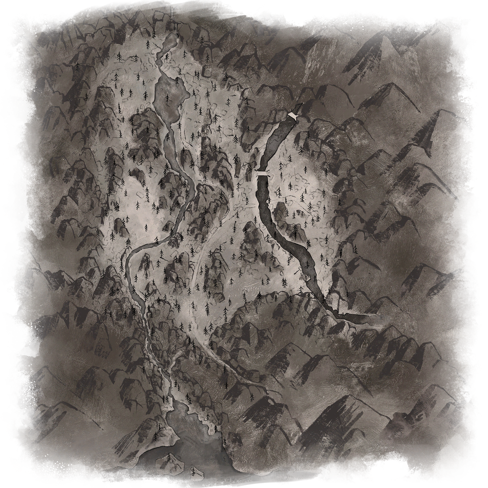

# Perseverance Wilds

<table class="infobox">
<caption>Perseverance Wilds</caption>
<colgroup>
<col style="width: 50%" />
<col style="width: 50%" />
</colgroup>
<tbody>
<tr>
<td colspan="2"><figure>

<figcaption>No_picture.png</figcaption>
</figure></td>
</tr>
<tr>
<td colspan="2" class="section">
<strong>Location on <a href="./Great%20Bear%20Island.md" class="wikilink" title="Great Bear Island">Great Bear Island</a></strong>
</td>
</tr>
<tr>
<td colspan="2"><figure>

<figcaption>No_picture.png</figcaption>
</figure></td>
</tr>
<tr>
<td colspan="2"><figure>

<figcaption>Perseverance_Wilds_In-Game_Map.png</figcaption>
</figure></td>
</tr>
<tr>
<td colspan="2" class="section">
<strong>Details</strong>
</td>
</tr>
<tr>
<td>
Description
</td>
<td>
An empty wilderness near the town of Perseverance Mills with evidence of past logging activity.
</td>
</tr>
<tr>
<td>
Connecting Regions
</td>
<td>
<a href="./Perseverance%20Mills.md" class="wikilink" title="Perseverance Mills">Perseverance Mills</a>
</td>
</tr>
<tr>
<td>
Date Added
</td>
<td>
31 March 2026
</td>
</tr>
</tbody>
</table>

<table>
<colgroup>
<col style="width: 33%" />
<col style="width: 33%" />
<col style="width: 33%" />
</colgroup>
<tbody>
<tr>
<td width="40px"><figure>

<figcaption>2120907963_TLD-Wintermute-v2.png.de8a285930f6a8f5ad9cf5878754cf5b.png</figcaption>
</figure></td>
<td>
<strong>Wintermute-Exclusive content.</strong> 

This content only appears in <a href="./Wintermute.md" class="wikilink" title="Wintermute">Wintermute</a>.

</td>
<td>
|} <strong>Perseverance Wilds</strong> is a <a href="./Wintermute.md" class="wikilink" title="Wintermute">Wintermute</a>-exclusive region, which consists of the wilderness near the town of <a href="./Perseverance%20Mills.md" class="wikilink" title="Perseverance Mills">Perseverance Mills</a>, to which it connects.

<h2 id="Overview">Overview</h2>

The most open region in Episode 5, it consists mainly of empty wilderness, with a couple of shallow caves and two rivers. One of them is unfrozen and must be crossed by using a rickety bridge (Faulty Crossing). The other, smaller river is frozen over and can be safely walked on. At its north end is a lake (Mindful Basin) with a group of cabins (Lake Cabins), a ice fishing hut, a nearby waterfall (Terminal Outflow), and a lookout tower (Forgotten Lookout)to the southeast. The river's southern end ends at a frozen bay, with a cabin (Doubter's Retreat) and a uniquely designed ice fishing hut.

There are many cars with their hoods opened and their <a href="./Car%20Battery.md" class="wikilink" title="Car Batteries">Car Batteries</a> missing. This is later revealed to have been <a href="./Terry.md" class="wikilink" title="Terry&#39;s">Terry's</a> doing. Following the road through the region leads to a collapsed tunnel.

<h2 id="Locations">Locations</h2>

The region has very few named locations:

<ul>
<li><a href="./Doubter%27s%20Retreat.md" class="wikilink" title="Doubter&#39;s Retreat">Doubter's Retreat</a></li>
<li>Faulty Crossing</li>
<li>Forgotten Lookout</li>
<li>Lake Cabins (Perseverance Wilds)</li>
<li>Mindful Basin</li>
<li>Terminal Outflow</li>
</ul>

There are also many unmarked locations:

<ul>
<li>There is a small cabin on the western side of the frozen river, (styled much like <a href="./Bricklayer%27s%20Retreat.md" class="wikilink" title="Bricklayer&#39;s Retreat">Bricklayer's Retreat</a>)</li>
<li>A nearly destroyed cabin to the south of the previously mentioned cabin, along with a dock on the river where the drowned Constable is found</li>
<li>A destroyed cabin on the other side of the lake from the lake cabins</li>
<li>A hay barn in the southeastern part of the map</li>
<li>A burned out trailer near the northeastern edge of the map along the river.</li>
</ul>

<strong>Lua execution error in Module:Navbox function navbox</strong> <strong>Lua execution error in Module:Navbox function navbox</strong>
</td>
</tr>
</tbody>
</table>

