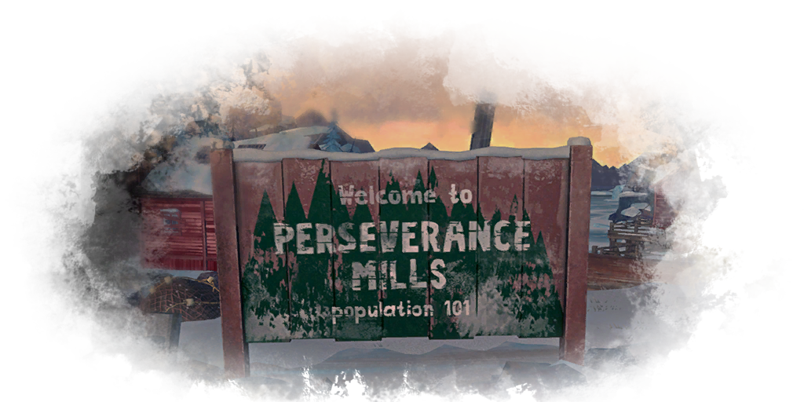

# Perseverance

<table class="infobox">
<caption>Perseverance</caption>
<colgroup>
<col style="width: 50%" />
<col style="width: 50%" />
</colgroup>
<tbody>
<tr>
<td colspan="2"><figure>

<figcaption>Missions_story_ep5_Perseverance.png</figcaption>
</figure></td>
</tr>
<tr>
<td>
Episode
</td>
<td></td>
</tr>
<tr>
<td colspan="2" class="section">
<strong>Missions</strong>
</td>
</tr>
<tr>
<td>
Previous
</td>
<td>
<a href="./Donner%20%28mission%29.md" class="wikilink" title="Donner (mission)">Donner (mission)</a>
</td>
</tr>
<tr>
<td>
Current
</td>
<td>
Perseverance
</td>
</tr>
<tr>
<td>
Next
</td>
<td>
<a href="./To%20Those%20Who%20Are%20Missing.md" class="wikilink" title="To Those Who Are Missing">To Those Who Are Missing</a>
</td>
</tr>
<tr>
<td>
Region
</td>
<td>
<a href="./Perseverance%20Mills.md" class="wikilink" title="Perseverance Mills">Perseverance Mills</a>
</td>
</tr>
<tr>
<td>
Characters
</td>
<td>
<a href="./Astrid%20Greenwood.md" class="wikilink" title="Astrid Greenwood">Astrid Greenwood</a> 
<a href="./Jane%20Yang.md" class="wikilink" title="Jane Yang">Jane Yang</a>
</td>
</tr>
</tbody>
</table>

**Stub:***This article is a stub. You can help by \[//dummy.host/index.php?title=Perseverance&action=edit expanding it\].*

|  |  |  |
|----|----|----|
| “ | A strange illness has taken hold in Perseverance Mils. People are missing. Investigate the town and see what you can find out. | ” |

**Perseverance** is the first mission of Part One: Perseverance in <a href="./Episode%205%20-%20The%20Light%20At%20The%20End%20Of%20All%20Things.md" class="wikilink" title="Episode 5: The Light At The End Of All Things">Episode 5: The Light At The End Of All Things</a> of the <a href="./Wintermute.md" class="wikilink" title="Wintermute">Wintermute</a> story of <a href="./The%20Long%20Dark.md" class="wikilink" title="The Long Dark"><em>The Long Dark</em></a>.

## Objectives

- Investigate Dr Larsen's whereabouts.
- Check out the town's key locations.
  - Find clues at the Clinic \[0/3\].
  - Find clues at the Constable's Office \[0/3\].
  - Find clues at the Clinic's Morgue \[0/1\].
  - Find clues at the Co-op \[0/1\].
  - Check out the Mill.

## Walkthrough

## Trivia

- <a href="./Jane%20Yang.md" class="wikilink" title="Jane Yang&#39;s">Jane Yang's</a> home is the only dwelling to have a <a href="./Mailbox.md" class="wikilink" title="Mailbox">Mailbox</a>, and her Mailbox is also a unique model.

**Lua execution error in Module:Navbox function navbox**

