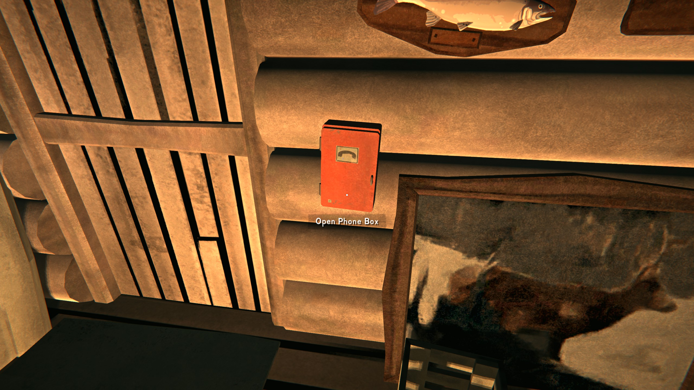

# Phone Box

**Categories:** Interactable Objects, Story items · **Source:** [Fandom](https://thelongdark.fandom.com/wiki/Phone_Box)

**Phone Box**

\[\[File:

250px\]\]

**General**

Item Type

Item

Wintermute

Yes A **Phone Box** is a stationary object found inside the [Hunting Lodge](./Hunting%20Lodge.md) in [Episode 2: Luminance Fugue](./Episode%202%20-%20Luminance%20Fugue.md) in [Wintermute](./Wintermute.md). It a has no functionality when first found, but while exploring the Lodge during the [Aurora](./Aurora.md), the phone will begin ringing. Approaching and opening the cover will cause the phone to stop, leading to no further interaction.
