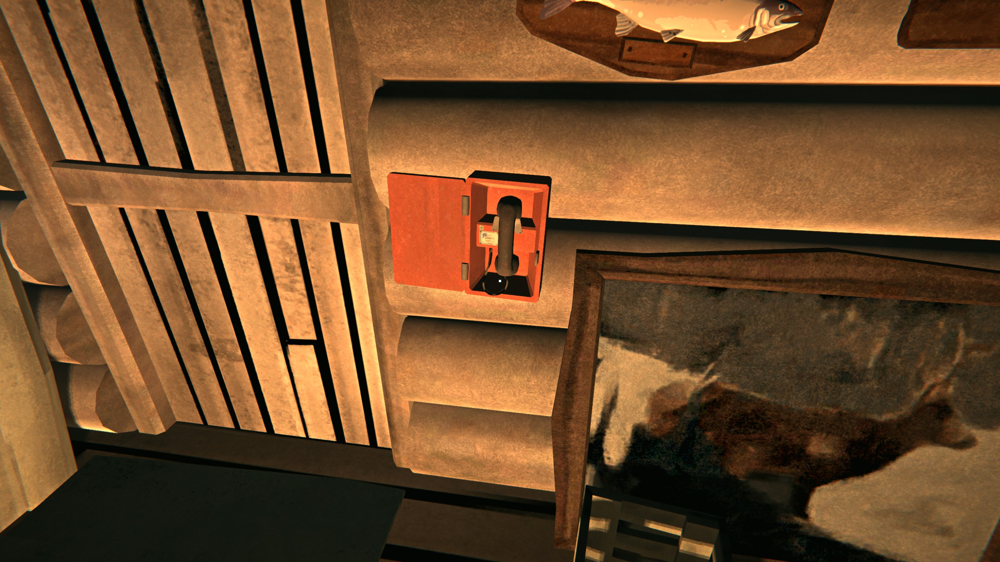

# Phone Box

**Phone Box**

| Property | Details |
| --- | --- |
| \[\[File: / \|  / *Closed* \|  / *Opened* \| / \| --- \| --- \| | 250px\]\] |
|  / *Closed* |  / *Opened* |
| **General** |  |
| Item Type | Item |
| Wintermute | Yes\|} A **Phone Box** is a stationary object found inside the [Hunting Lodge](./Hunting%20Lodge.md) in [Episode 2: Luminance Fugue](./Episode%202%20-%20Luminance%20Fugue.md) in [Wintermute](./Wintermute.md). It a has no functionality when first found, but while exploring the Lodge during the [Aurora](./Aurora.md), the phone will begin ringing. Approaching and opening the cover will cause the phone to stop, leading to no further interaction. / ## Trivia / The phone may be on a party line, and could be foreshadowing [Molly](./Molly.md) and [Astrid Greenwood](./Astrid%20Greenwood.md) speaking to one another in [Episode 3: Crossroads Elegy](./Episode%203%20-%20Crossroads%20Elegy.md). It could also be [Jeremiah](./Jeremiah.md) speaking to someone else, though this is unlikely considering the lack of functioning electronics in his cabin. **Lua execution error in Module:Navbox function navbox** |
