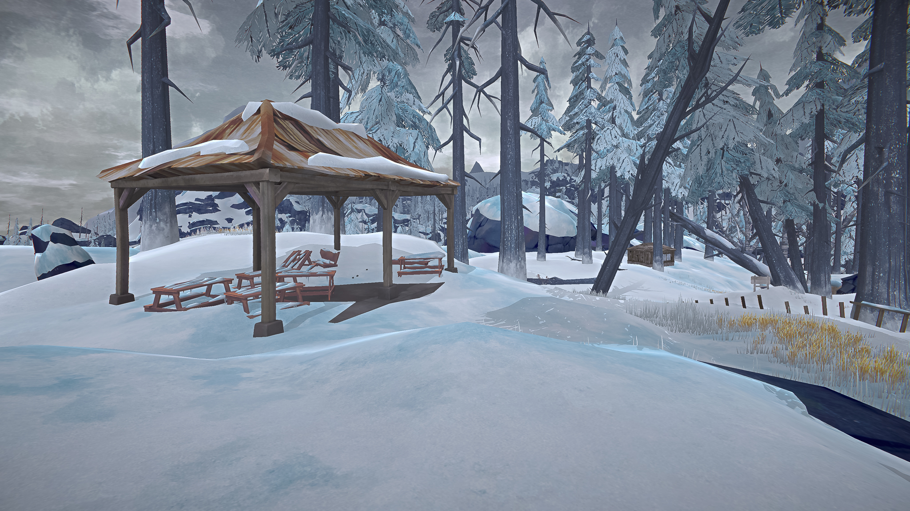

# Picnic Area

**Categories:** Locations, Locations in Mountain Town, Outdoor locations · **Source:** [Fandom](https://thelongdark.fandom.com/wiki/Picnic_Area)

**Picnic Area**

_A 'Climbing Area' signpost for the Picnic Area_

**Location**

_Picnic\_Area\_Location.png_

**Region:** [Mountain Town](./Mountain%20Town.md)

**Description:** A picnic spot and climbing area

**General**

**Type:** Outdoors

## Overview

It is home to a small open pavilion and picnic benches, as well as a [Rope Climbing](./Rope%20Climbing.md) spot marked by a sign, leading to [Mystery Lake](./Mystery%20Lake%20%28region%29.md) (another rope must be climbed). Wildlife in this area is sparse, although a wolf may patrol the area.

In survival mode, the rope will always spawn in that climbing rock. In story mode, a Mountaineering rope can be obtained during [Episode 1](./Episode%201%20-%20Do%20Not%20Go%20Gentle.md), which allows [Will Mackenzie](./Will%20Mackenzie.md) to access a lower unnamed part of the [Mountain Town](./Mountain%20Town.md) region, and eventually a cave to [Mystery Lake](./Mystery%20Lake%20%28region%29.md).

Park office is very close by, in between the benches and [Orca Gas Station](./Orca%20Gas%20Station.md). It provides some shelter from wind, has a [bed](./Bed.md) on the floor and a [pot belly stove](./Pot%20Belly%20Stove.md), as well as some lockers and other containers. The door can't be closed and the windows are broken, thus, providing little shelter, but although counting as outdoors, it does provide a warmth bonus.

## Gallery

_Climbing\_area\_sign.png_

_Park Office is very close by, which can provide some shelter._

_Benches at the Picnic Area, next to a rope climb._
