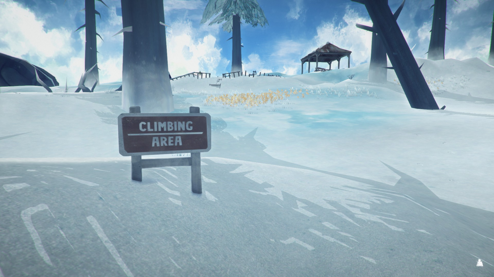
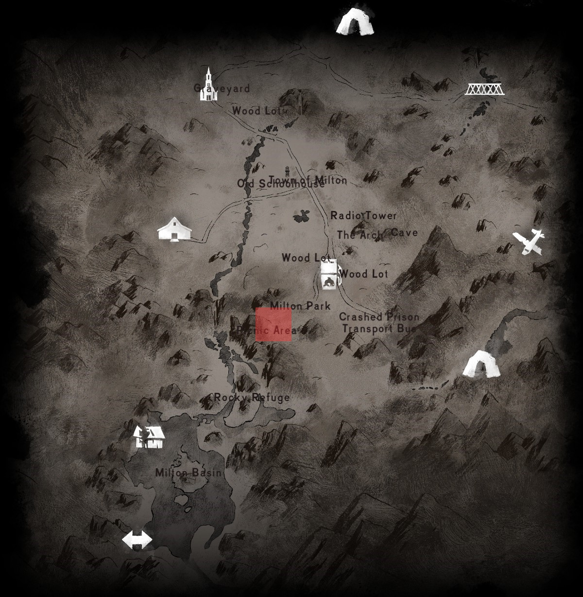

# Picnic Area

**Picnic Area**

| Property | Details |
| --- | --- |
|  |  / *A 'Climbing Area' signpost for the Picnic Area* |
| **Location** |  |
|  |  / *Picnic\_Area\_Location.png* |
| Region | [Mountain Town](./Mountain%20Town.md)\|- |
| Description | A picnic spot and climbing area |
| **General** |  |
| Type | Outdoors\|- |
