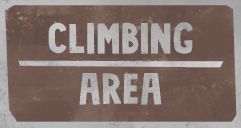
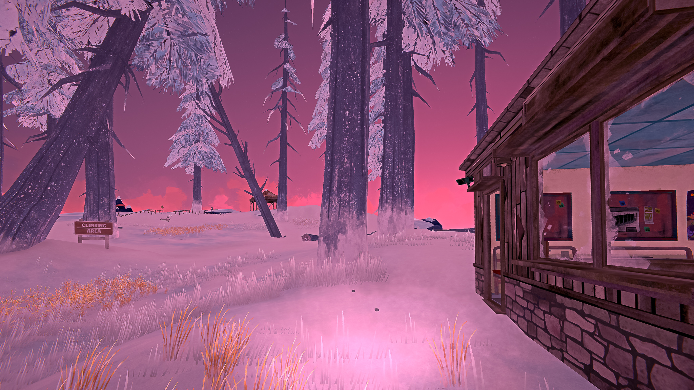

# Picnic Area

**Categories:** Locations, Locations in Mountain Town · **Source:** [Fandom](https://thelongdark.fandom.com/wiki/Picnic_Area)

**Picnic Area**

| Property | Details |
| --- | --- |
|  | [A 'Climbing Area' signpost for the Picnic Area](../assets/Milton_Park_Picnic_Area.jpg) |
| **Location** |  |
|  | [Picnic Area Location](../assets/Picnic_Area_Location.png) |
| Region |  |
| Location | [Milton Park](./Milton%20Park.md) |
| Description | A picnic spot and climbing area |
| **General** |  |
| Type |  |

_Not to be confused with the [Misty Falls Picnic Area](./Misty%20Falls%20Picnic%20Area.md)_

The **Picnic Area** is a location in [Milton Park](./Milton%20Park.md) in the [Mountain Town](./Mountain%20Town.md) region, not far from [Orca Gas Station](./Orca%20Gas%20Station.md).

## Overview

It is home to a small open pavilion and picnic benches, as well as a [Rope Climbing](./Rope%20Climbing.md) spot marked by a sign, leading to [Mystery Lake](./Mystery%20Lake%20%28region%29.md) (another rope must be climbed). Wildlife in this area is sparse, although a wolf may patrol the area.

In survival mode, the rope will always spawn in that climbing rock. In story mode, a Mountaineering rope can be obtained during [Episode 1](./Episode%201%20-%20Do%20Not%20Go%20Gentle.md), which allows [Will Mackenzie](./Will%20Mackenzie.md) to access a lower unnamed part of the [Mountain Town](./Mountain%20Town.md) region, and eventually a cave to [Mystery Lake](./Mystery%20Lake%20%28region%29.md).

Park office is very close by, in between the benches and [Orca Gas Station](./Orca%20Gas%20Station.md). It provides some shelter from wind, has a [bed](./Bed.md) on the floor and a [pot belly stove](./Pot%20Belly%20Stove.md), as well as some lockers and other containers. The door can't be closed and the windows are broken, thus, providing little shelter, but although counting as outdoors, it does provide a warmth bonus.

## Gallery

[ru:Место для пикников](https://ru.wikipedia.org/wiki/%D0%9C%D0%B5%D1%81%D1%82%D0%BE_%D0%B4%D0%BB%D1%8F_%D0%BF%D0%B8%D0%BA%D0%BD%D0%B8%D0%BA%D0%BE%D0%B2) [es:Zona de picnic (Pueblo de montaña)](https://es.wikipedia.org/wiki/Zona_de_picnic_%28Pueblo_de_monta%C3%B1a%29)
