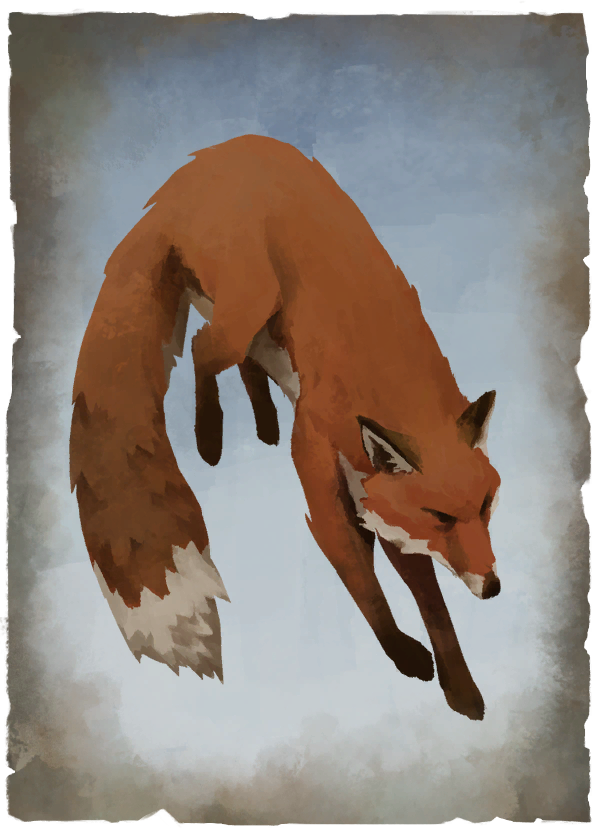

# Pilgrim

<figure>

<figcaption>Pilgrim_icon.png</figcaption>
</figure>

|  |  |  |
|----|----|----|
| “ | Wander the quiet apocalypse to chronicle the passing of an age. This is the poetry of survival. | ” |

**Pilgrim** is the 1st <a href="./Survival%20Mode.md" class="wikilink" title="Survival Mode">Survival Mode</a> Experience in *<a href="./The%20Long%20Dark.md" class="wikilink" title="The Long Dark">The Long Dark</a>*. It is the standard "easy" difficulty setting.

## Overview

Pilgrim's difficulty is comparable to a pleasant walk through a park on a crisp winter day. Hostile <a href="./Wildlife.md" class="wikilink" title="Wildlife">Wildlife</a> always flees in terror from the player, even if provoked or directly attacked. <a href="./Needs.md" class="wikilink" title="Needs">Needs</a> are very manageable. Food and resources are highly abundant and can be easily procured. Overall, the player's survival is almost guaranteed on this Experience, with most dangers coming in the form of the elements, environmental hazards, and generally just poor judgement.

This game mode is best picked if the player is trying to explore and learn the game world and its mechanics, or if they wish to unlock <a href="./The%20Long%20Dark%20%E2%80%94%20Achievements.md" class="wikilink" title="Achievements">Achievements</a>, <a href="./Feats.md" class="wikilink" title="Feats">Feats</a>, or <a href="./Badges.md" class="wikilink" title="Badges">Badges</a> without much difficulty.

## Pilgrim Settings

- <a href="./Great%20Bear%20Island.md" class="wikilink" title="Great Bear Island">Great Bear Island</a> is abundant with items.
  - High-quality and abundant starting supplies.
  - High-quality items may spawn.
  - Firearms may spawn.
- Starting equipment:
  - <a href="./Accelerant.md" class="wikilink" title="Accelerant">Accelerant</a>, <a href="./Tinder%20Plug.md" class="wikilink" title="Tinder Plug">Tinder Plug</a>, 12 <a href="./Wood%20Matches.md" class="wikilink" title="Wood Matches">Wood Matches</a>
  - 6 <a href="./Antibiotics.md" class="wikilink" title="Antibiotics">Antibiotics</a>, <a href="./Antiseptic.md" class="wikilink" title="Antiseptic">Antiseptic</a>, 2 <a href="./Bandage.md" class="wikilink" title="Bandage">Bandage</a>, 6 <a href="./Painkillers.md" class="wikilink" title="Painkillers">Painkillers</a>, 4 <a href="./Water%20Purification%20Tablets.md" class="wikilink" title="Water Purification Tablets">Water Purification Tablets</a>
  - <a href="./Cotton%20Scarf.md" class="wikilink" title="Cotton Scarf">Cotton Scarf</a>, <a href="./Cotton%20Toque.md" class="wikilink" title="Cotton Toque">Cotton Toque</a>, <a href="./Plaid%20Shirt.md" class="wikilink" title="Plaid Shirt">Plaid Shirt</a>, <a href="./Driving%20Gloves.md" class="wikilink" title="Driving Gloves">Driving Gloves</a>, <a href="./Jeans.md" class="wikilink" title="Jeans">Jeans</a>, <a href="./Thermal%20Underwear.md" class="wikilink" title="Thermal Underwear">Thermal Underwear</a>, <a href="./Sports%20Socks.md" class="wikilink" title="Sports Socks">Sports Socks</a>, <a href="./Running%20Shoes.md" class="wikilink" title="Running Shoes">Running Shoes</a>
  - <a href="./Pinnacle%20Peaches.md" class="wikilink" title="Pinnacle Peaches">Pinnacle Peaches</a>, <a href="./Tin%20of%20Sardines.md" class="wikilink" title="Tin of Sardines">Tin of Sardines</a>, 0.50 <a href="./Water%20%28Potable%29.md" class="wikilink" title="Water (Potable)">Water (Potable)</a>
  - <a href="./Bedroll.md" class="wikilink" title="Bedroll">Bedroll</a>, <a href="./Flare.md" class="wikilink" title="Flare">Flare</a>, <a href="./Recycled%20Can.md" class="wikilink" title="Recycled Can">Recycled Can</a>, <a href="./Sewing%20Kit.md" class="wikilink" title="Sewing Kit">Sewing Kit</a>
- <a href="./Needs.md" class="wikilink" title="Needs">Needs</a> erode slowly.
- <a href="./Wildlife.md" class="wikilink" title="Wildlife">Wildlife</a> will not attack unless provoked. (All hostile wildlife can still detect the player and walk towards their position, but will flee once the player is fully detected.)
- Safe starting condition (indoors, during good weather, in hospitable <a href="./Region.md" class="wikilink" title="Region">Region</a>).
- <a href="./Decay.md" class="wikilink" title="Decay">Decay</a> of items is slow.
- All <a href="./Fire.md" class="wikilink" title="Fires">Fires</a> prevent <a href="./Hypothermia.md" class="wikilink" title="freezing">freezing</a> (regardless of ambient temperature).
- Automatically wake from <a href="./Sleep.md" class="wikilink" title="sleep">sleep</a> when <a href="./Hypothermia.md" class="wikilink" title="freezing">freezing</a> IF you are sleeping next to a <a href="./Fire.md" class="wikilink" title="fire">fire</a>.
- The player will automatically wake up once their <a href="./Fatigue.md" class="wikilink" title="Fatigue">Fatigue</a> meter is fully rested, and they cannot go back to sleep until sufficiently tired.
- <a href="./Scurvy.md" class="wikilink" title="Scurvy">Scurvy</a> is disabled and cannot be enabled.
- Cougar is disabled and cannot be enabled (the <a href="./Cougar%20Hide%20Wrap.md" class="wikilink" title="Cougar Hide Wrap">Cougar Hide Wrap</a> Blueprint is also removed from the crafting menu)
- The option to enable the <a href="./Trader.md" class="wikilink" title="Trader">Trader</a> is present.
- Allows five active <a href="./Feats.md" class="wikilink" title="Feats">Feats</a>.

<table>
<thead>
<tr>
<th scope="col">
DIFFICULTY
</th>
<th scope="col">
PILGRIM
</th>
</tr>
</thead>
<tbody>
<tr>
<td colspan="2" style="background-color: rgb(50,50,50)">
GAME START
</td>
</tr>
<tr>
<td>
Baseline resource availability
</td>
<td>
Very High
</td>
</tr>
<tr>
<td>
Starting time of day
</td>
<td>
Noon
</td>
</tr>
<tr>
<td>
Starting weather
</td>
<td>
Clear
</td>
</tr>
<tr>
<td>
Indoor spawns permitted
</td>
<td>
Yes
</td>
</tr>
<tr>
<td>
Survivor monologue
</td>
<td>
Yes
</td>
</tr>
<tr>
<td colspan="2" style="background-color: rgb(50,50,50)">
ENVIRONMENT
</td>
</tr>
<tr>
<td>
Length of day multiplier
</td>
<td>
1x
</td>
</tr>
<tr>
<td>
Weather variability
</td>
<td>
Low
</td>
</tr>
<tr>
<td>
Blizzard frequency
</td>
<td>
Low
</td>
</tr>
<tr>
<td>
World gets colder over time
</td>
<td>
None
</td>
</tr>
<tr>
<td>
Wind variability
</td>
<td>
Medium
</td>
</tr>
<tr>
<td>
Aurora frequency
</td>
<td>
Medium
</td>
</tr>
<tr>
<td>
Fire overcomes ambient air temp
</td>
<td>
Yes
</td>
</tr>
<tr>
<td>
Endless night (v1.83)
</td>
<td>
No
</td>
</tr>
<tr>
<td colspan="2" style="background-color: rgb(50,50,50)">
HEALTH
</td>
</tr>
<tr>
<td>
Calorie burn rate
</td>
<td>
Low
</td>
</tr>
<tr>
<td>
Thirst rate
</td>
<td>
Low
</td>
</tr>
<tr>
<td>
Fatigue rate
</td>
<td>
High
</td>
</tr>
<tr>
<td>
Freezing rate
</td>
<td>
Low
</td>
</tr>
<tr>
<td>
At-rest condition recovery rate
</td>
<td>
High
</td>
</tr>
<tr>
<td>
Condition recovery rate
</td>
<td>
High
</td>
</tr>
<tr>
<td>
Hypothermia recovery time
</td>
<td>
Low
</td>
</tr>
<tr>
<td>
Frostbite rate
</td>
<td>
Low
</td>
</tr>
<tr>
<td>
Cabin fever
</td>
<td>
No
</td>
</tr>
<tr>
<td>
Intestinal parasites
</td>
<td>
No
</td>
</tr>
<tr>
<td>
Dysentery
</td>
<td>
Yes
</td>
</tr>
<tr>
<td>
Sprains
</td>
<td>
Yes
</td>
</tr>
<tr>
<td>
Food poisoning
</td>
<td>
Yes
</td>
</tr>
<tr>
<td>
Broken ribs
</td>
<td>
No
</td>
</tr>
<tr>
<td>
Rest as a resource
</td>
<td>
Yes
</td>
</tr>
<tr>
<td>
Scurvy - Vitamin-C drain rate
</td>
<td>
No
</td>
</tr>
<tr>
<td>
Fires prevent freezing
</td>
<td>
Yes
</td>
</tr>
<tr>
<td>
Wake up player when freezing near a fire
</td>
<td>
Yes
</td>
</tr>
<tr>
<td>
Birch bark tea crafting <strong>(v.1.64)</strong>
</td>
<td>
Yes
</td>
</tr>
<tr>
<td colspan="2" style="background-color: rgb(50,50,50)">
GEAR
</td>
</tr>
<tr>
<td>
Item decay rate
</td>
<td>
Low
</td>
</tr>
<tr>
<td>
Loose item availability
</td>
<td>
Very High
</td>
</tr>
<tr>
<td>
Empty container chance modifier
</td>
<td>
None
</td>
</tr>
<tr>
<td>
Stick, branch, and stone respawn frequency
</td>
<td>
Very High
</td>
</tr>
<tr>
<td>
Starting gear allocation
</td>
<td>
Very High
</td>
</tr>
<tr>
<td>
Rifle availability
</td>
<td>
Yes
</td>
</tr>
<tr>
<td>
Revolver availability <strong>(v.1.64)</strong>
</td>
<td>
Yes
</td>
</tr>
<tr>
<td>
Harvestable plant availability
</td>
<td>
High
</td>
</tr>
<tr>
<td>
Reduce container item density
</td>
<td>
None
</td>
</tr>
<tr>
<td colspan="2" style="background-color: rgb(50,50,50)">
WILDLIFE SPAWNS
</td>
</tr>
<tr>
<td>
Cougar spawn chance
</td>
<td>
None
</td>
</tr>
<tr>
<td>
Wolf spawn chance
</td>
<td>
Low
</td>
</tr>
<tr>
<td>
Timberwolf spawn chance
</td>
<td>
Low
</td>
</tr>
<tr>
<td>
Deer spawn chance
</td>
<td>
Very High
</td>
</tr>
<tr>
<td>
Rabbit spawn chance
</td>
<td>
Very High
</td>
</tr>
<tr>
<td>
Bear spawn chance
</td>
<td>
Low
</td>
</tr>
<tr>
<td>
Moose spawn chance
</td>
<td>
Low
</td>
</tr>
<tr>
<td>
Time to wildlife respawn
</td>
<td>
Medium
</td>
</tr>
<tr>
<td>
Reduce wildlife population over time
</td>
<td>
None
</td>
</tr>
<tr>
<td>
Wolf spawn distance
</td>
<td>
Medium
</td>
</tr>
<tr>
<td>
Predator grace period
</td>
<td>
No
</td>
</tr>
<tr>
<td colspan="2" style="background-color: rgb(50,50,50)">
WILDLIFE BEHAVIOUR
</td>
</tr>
<tr>
<td>
Wildlife smell range
</td>
<td>
Low
</td>
</tr>
<tr>
<td>
Scent increase from Meat/Blood
</td>
<td>
Medium
</td>
</tr>
<tr>
<td>
Passive wildlife
</td>
<td>
Yes
</td>
</tr>
<tr>
<td>
Wildlife attacks during rest
</td>
<td>
No
</td>
</tr>
<tr>
<td>
Wolf fear
</td>
<td>
Medium
</td>
</tr>
<tr>
<td>
Timberwolf morale
</td>
<td>
High
</td>
</tr>
<tr>
<td>
Wildlife detection range
</td>
<td>
Medium
</td>
</tr>
<tr>
<td colspan="2" style="background-color: rgb(50,50,50)">
WILDLIFE STRUGGLE
</td>
</tr>
<tr>
<td>
Struggle bonus
</td>
<td>
High
</td>
</tr>
<tr>
<td>
Struggle condition damage modifier
</td>
<td>
None
</td>
</tr>
<tr>
<td>
Struggle clothing damage modifier
</td>
<td>
Low
</td>
</tr>
<tr>
<td>
Struggle damage severity
</td>
<td>
Low
</td>
</tr>
</tbody>
</table>

**Lua execution error in Module:Navbox function navbox**

