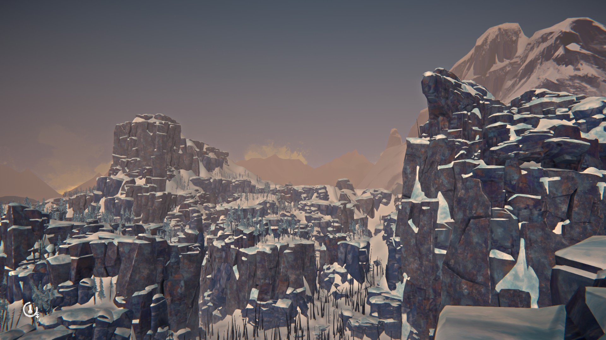
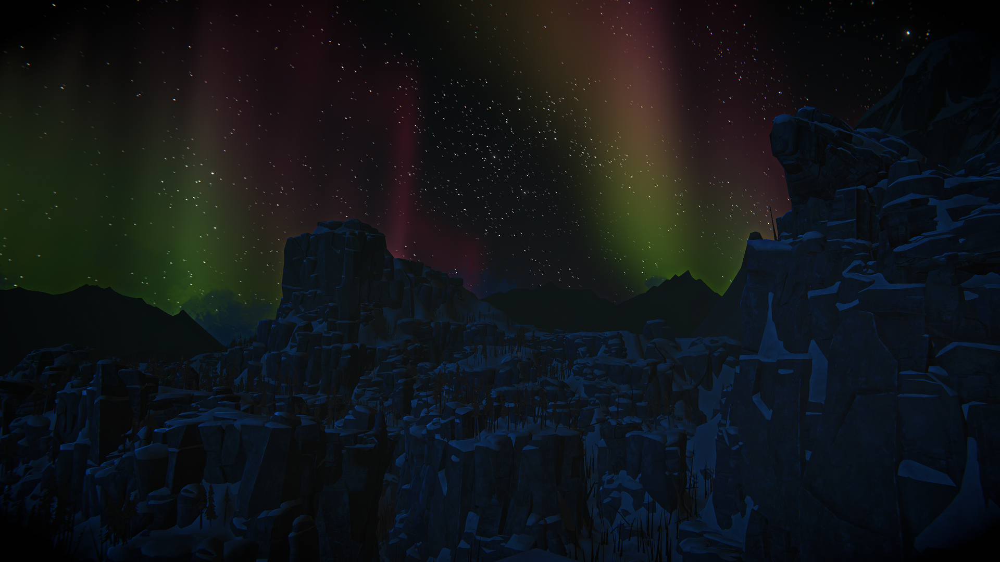

# Pillar's Footrest

**Categories:** Landmarks, Locations, Locations in Ash Canyon, Outdoor locations · **Source:** [Fandom](https://thelongdark.fandom.com/wiki/Pillar's_Footrest)

**Pillar's Footrest**

| Property | Details |
| --- | --- |
|  | [20201212011141 1](../assets/20201212011141_1.jpg) |
| **Location** |  |
|  | [Pillar's Footrest Location](../assets/Pillar%27s_Footrest_Location.png) |
| Region | [Ash Canyon](./Ash%20Canyon.md) |
| **General** |  |
| Type | Landmark |
|  | Has no shelter |

**Pillar's Footrest** is a tall, pillar-shaped mountain located in the southern part of [Ash Canyon](./Ash%20Canyon.md). On a clear day, this mountain can be seen from almost everywhere in the region.

## Overview

Just a mountain with the form of a pillar. Underneath it can be found the cave leading to [Deer Clearing](./Deer%20Clearing.md), located in the region of [Timberwolf Mountain](./Timberwolf%20Mountain.md). It can be used as a landmark for navigation since it's at the southern part of Ash Canyon and is almost always visible.

Up along a path that leads to a higher plateau, two burnt-out campfires can be found. The first may contain several items, including a [Hatchet](./Hatchet.md) and a [Distress Pistol](./Distress%20Pistol.md) (very unlikely), as well as a [Snare](./Snare.md) and a can opener. The second, slightly higher up to the north can contain a hunting rifle (may be broken) and some ammunition and supplies. They are located roughly halfway between the markers for Pillar's footrest and Climber's cave.

The area is rich in natural resources, and a [Rabbit](./Rabbit.md) grove and several potential ravaged [Deer Clearing](./Deer%20Clearing.md) spawns exist in the area, making this a potential hunting/resupply area while transitioning between Timberwolf Mountain and Ash Canyon. A corpse can be found along the west wall of the area.

There is also a tree stump with a [Spray Paint](./Spray%20Paint.md) and 0.50L of [Water (Potable)](./Water%20%28Potable%29.md) when going from the pass towards the "to Timberwolf Mountain" cave. Its on a small rise, near the pass right beneath the pathway leading up the (right) rockface which leads nowhere.

## Gallery

_The [Pillar](./Pillar%27s%20Footrest.md) and the [Wolf's Jaw](./Wolf%27s%20Jaw%20Overlook.md) seen by [Foreman's Retreat](./Foreman%27s%20Retreat.md)_

_Pillar's Footrest (left) and [Wolf's Jaw Overlook](./Wolf%27s%20Jaw%20Overlook.md) (right), from the [Foreman's Retreat](./Foreman%27s%20Retreat.md) during the aurora._
