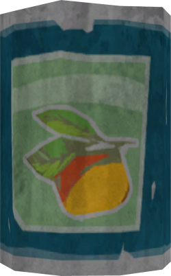

# Pinnacle Peaches

**Categories:** Food And Drink, Pages with update history · **Source:** [Fandom](https://thelongdark.fandom.com/wiki/Pinnacle_Peaches)

**Contents**

- [Overview](#overview)
- [Products](#products)
- [Trivia](#trivia)
- [Gallery](#gallery)
- [Update history](#update-history)

**Pinnacle Peaches**

\[\[File: /  / _Sealed_ /  / _Opened_

250px\]\]

_Sealed_

_Opened_

**Release:** [22 September 2014](./The%20Long%20Dark%20%E2%80%94%20Changelog.md#0.117)

**Wintermute:** No

**Renewable:** Yes (rare [Beachcombing](./Beachcombing.md))

**Properties**

Item type

[Food And Drink](./Food%20And%20Drink.md)\|-

Equipable

**Stackable:** No

**Examine:** High quality peaches, halved.

**Values**

**Calories:** 450 kcal

**Hydration:** 20%

**[Vitamin C](./Scurvy.md):** Moderate (56%)

**Weight:** 0.50 kg (1.1 lbs)

**Decay Rate**

**Inside:** 0.333% per day

**Outside:** 1.667% per day

**Advanced data**

**Item key:** GAMEPLAY\_PinnaclePeaches

**Pinnacle Peaches** is a packaged [food](./Food%20And%20Drink.md) item in _The Long Dark_.

## Overview

Consuming Pinnacle Peaches restores a moderate amount of calories and hydration. It may also be warmed by a [fire](./Fire.md), to make progress in [Cooking](./Cooking.md) [Survival Skill](./Skills.md), and consumed while hot to grant the benefit [Warming Up](./Warming%20Up.md). Pinnacle Peaches have relatively low energy density (on par with that of cooked meats), making them relatively inefficient as a travelling food.

Like other canned foods, Pinnacle Peaches may be opened with a [Can Opener](./Can%20Opener.md) or [bladed tool](./Tools.md), or smashed open (with no tool) but spilling some of its contents. If opened with a tool a [Recycled Can](./Recycled%20Can.md) is received after consuming the contents.

Pinnacle Peaches are relatively common inside homes, usually in cupboards or on shelves. They can also be found in stores.

## Products

## Trivia

- Pinnacle Beaches is packaged as the namesake product "_Pinnacle Peaches"_.
- The side of the can lists "Ingredients: Water, Peaches, Sugar."

## Gallery

_Old model_

## Update history

- UPDATE **1 August 2015 ([Update](./The%20Long%20Dark%20%E2%80%94%20Early%20Access%20Changelog.md#0.256)):**
  - Peaches now lose heat over time once cooked

- UPDATE **22 September 2014 ([Update](./The%20Long%20Dark%20%E2%80%94%20Early%20Access%20Changelog.md#0.117)):**
  - Added to game.
