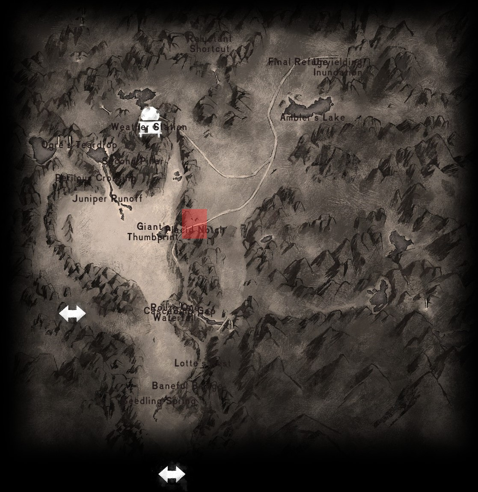

# Placid Notch

**Categories:** Indoor locations, Locations, Locations in Sundered Pass, Residential locations · **Source:** [Fandom](https://thelongdark.fandom.com/wiki/Placid_Notch)

**Placid Notch**

_Refuge\_Cabin\_B\_resized.png_

**Location**

_Placid\_Notch\_Location.png_

**Region:** [Sundered Pass](./Sundered%20Pass.md)

**Description:** A refuge cabin.

**General**

**Type:** Residential

_bed\_icon.png_

Has a bed
