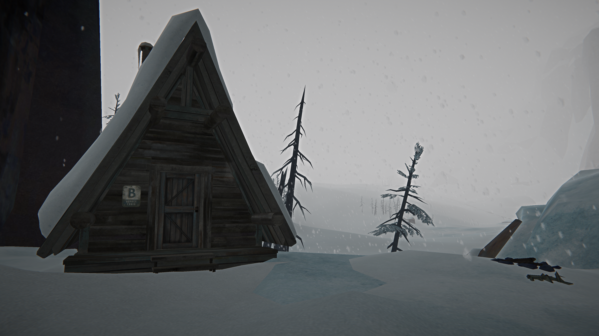
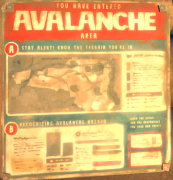
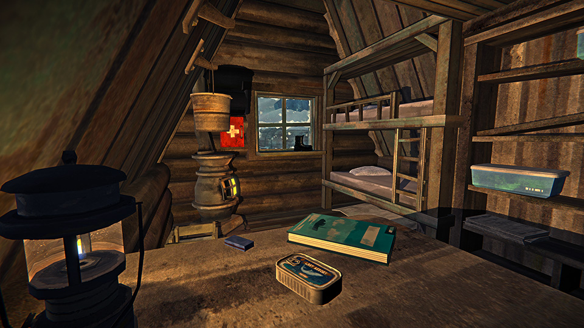

# Placid Notch

<table class="infobox">
<caption>Placid Notch</caption>
<colgroup>
<col style="width: 50%" />
<col style="width: 50%" />
</colgroup>
<tbody>
<tr>
<td colspan="2"><figure>

<figcaption>Refuge_Cabin_B_resized.png</figcaption>
</figure></td>
</tr>
<tr>
<td colspan="2" class="section">
<strong>Location</strong>
</td>
</tr>
<tr>
<td colspan="2"><figure>
[Missing image: Placid_Notch_Location.png]
<figcaption>Placid_Notch_Location.png</figcaption>
</figure></td>
</tr>
<tr>
<td>
Region
</td>
<td>
<a href="./Sundered%20Pass.md" class="wikilink" title="Sundered Pass">Sundered Pass</a>|-
</td>
</tr>
<tr>
<td>
Description
</td>
<td>
A refuge cabin.
</td>
</tr>
<tr>
<td colspan="2" class="section">
<strong>General</strong>
</td>
</tr>
<tr>
<td>
Type
</td>
<td>
Residential|-
</td>
</tr>
<tr>
<td><figure>

<figcaption>bed_icon.png</figcaption>
</figure></td>
<td>
Has a bed
</td>
</tr>
<tr>
<td></td>
<td>
Has an interior|}

<strong>Placid Notch</strong> is a location in <a href="./Sundered%20Pass.md" class="wikilink" title="Sundered Pass">Sundered Pass</a>, and is where Refuge Cabin B is located.

<h2 id="Overview">Overview</h2>

This location consists of the road cutting through the region and a small refuge cabin. The cabin can provide life-saving shelter if the weather conditions turn poor. It offers a small amount of loot and limited storage:

<ul>
<li>A <a href="./Pot%20Belly%20Stove.md" class="wikilink" title="Pot Belly Stove">Pot Belly Stove</a></li>
<li>2 <a href="./Bed.md" class="wikilink" title="Beds">Beds</a> (+2 C°) and 2 <a href="./Pillow.md" class="wikilink" title="Pillows">Pillows</a></li>
<li>A <a href="./Table.md" class="wikilink" title="Table">Table</a></li>
<li>A <a href="./Chair.md" class="wikilink" title="Chair">Chair</a></li>
<li>A <a href="./Crate.md" class="wikilink" title="Crate">Crate</a></li>
<li>A <a href="./Backpack.md" class="wikilink" title="Backpack">Backpack</a></li>
<li>A <a href="./First%20Aid%20Kit.md" class="wikilink" title="First Aid Kit">First Aid Kit</a> on the wall.</li>
<li>Several <a href="./Cardboard%20Box.md" class="wikilink" title="Cardboard Boxes">Cardboard Boxes</a> above the door entrance and under the bunkbed</li>
<li>2 Containers (<a href="./Metal%20Container.md" class="wikilink" title="Metal">Metal</a> and <a href="./Plastic%20Container.md" class="wikilink" title="Plastic">Plastic</a>) on the shelf</li>
</ul>

Following the road east leads to cabins buried by an avalanche (<a href="./Old%20Settlement.md" class="wikilink" title="Old Settlement">Old Settlement</a>). One <a href="./Cabin%20%28Sundered%20Pass%29.md" class="wikilink" title="Cabin">Cabin</a> can be entered through the window (the other buildings have been destroyed).

Heading north will lead to the destroyed bridge leading to the <a href="./Weather%20Station.md" class="wikilink" title="Weather Station">Weather Station</a>. Taking the road south leads to <a href="./Cascading%20Gap.md" class="wikilink" title="Cascading Gap">Cascading Gap</a>.

The area surrounding field is home to multiple large <a href="./Timberwolf.md" class="wikilink" title="Timberwolf">Timberwolf</a> packs, so travelers will want to be well-armed prior to visiting.

<h2 id="Gallery">Gallery</h2>
<table class="gallery">
<colgroup>
<col style="width: 50%" />
<col style="width: 50%" />
</colgroup>
<tbody>
<tr>
<th><figure>

<figcaption>An avalanche warning sign in the cabin</figcaption>
</figure></th>
<td><figure>

<figcaption>Inside the cabin</figcaption>
</figure></td>
</tr>
</tbody>
</table>

<strong>Lua execution error in Module:Navbox function navbox</strong>
</td>
</tr>
</tbody>
</table>

