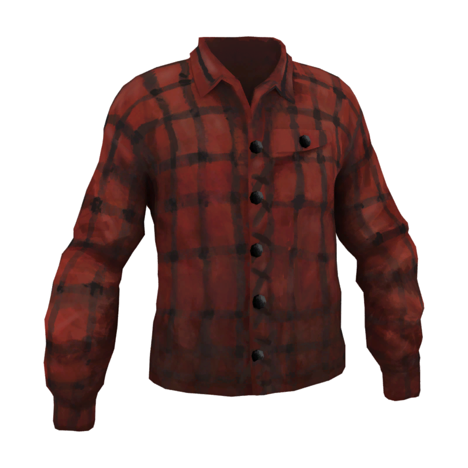
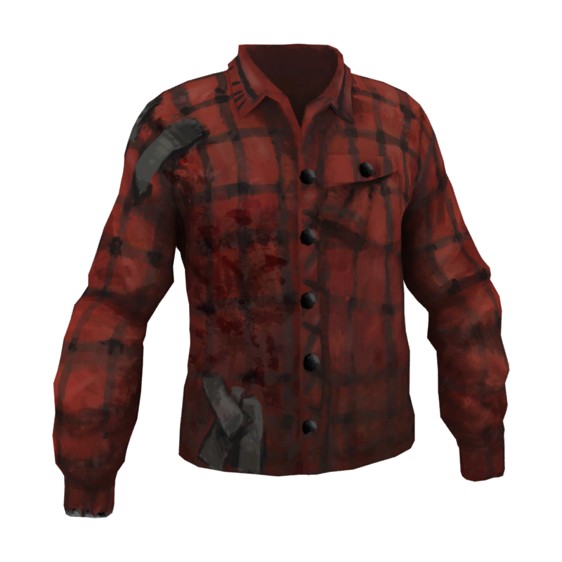

# Plaid Shirt

**Plaid Shirt**

| Property | Details |
| --- | --- |
|  |  / *Plaid\_Shirt\_icon.png* |
| **General** |  |
| Item Type | Clothing\|- |
| Clothing Slot | Inner torso |
| **Statistics** |  |
| Weight | 0.25 kg(0.55 lbs) |
| Warmth bonus | 0.5 °C(0.9 °F) |
| Windproof bonus | 0.5 °C(0.9 °F) |
| Waterproof bonus | 20% |
| Protection | 1% |
| Mobility | 0% |
| Harvest | 1 × [Cloth](./Cloth.md) / 10 minutes |
| Repair | 1 × [Cloth](./Cloth.md) / 30 minutes / 35% condition |

> “**Cotton plaid shirt that will make you feel more Canadian. Warm and cozy.**”
>
> — In-game description

The **Plaid Shirt** is a type of [Clothing](./Clothing.md) in *[The Long Dark](./The%20Long%20Dark.md)*.

## Overview

A low tier inner torso shirt, a Plaid Shirt offers little warmth and windproofing, along with a small waterproof and protection bonus. A Plaid Shirt is a slight upgrade to [Hoodie](./Hoodie.md). It offers 1% less protection than the latter, but is slightly more waterproof, and is somewhat more cost efficient to repair than a hoodie.

| Column 1 | Column 2 |
| --- | --- |
|  / *Clothing model icon* |  / *Clothing model icon damaged* |

## Update history

- UPDATE **19 December 2016 ([Update](./The%20Long%20Dark%20%E2%80%94%20Early%20Access%20Changelog.md#0.386)):**
  - Added to game

**Lua execution error in Module:Navbox function navbox** [ru:Клетчатая рубашка](ru:%D0%9A%D0%BB%D0%B5%D1%82%D1%87%D0%B0%D1%82%D0%B0%D1%8F_%D1%80%D1%83%D0%B1%D0%B0%D1%88%D0%BA%D0%B0)
