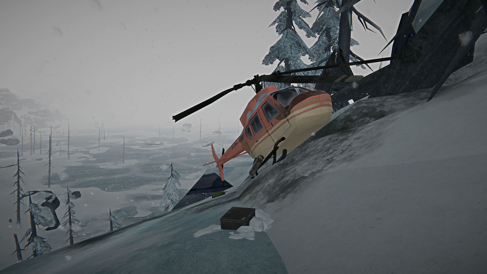
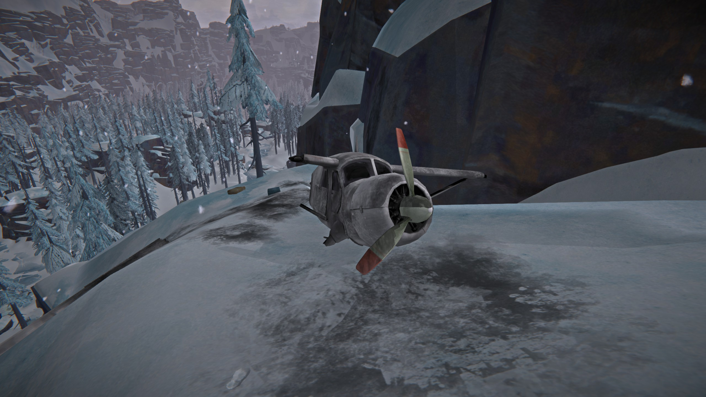
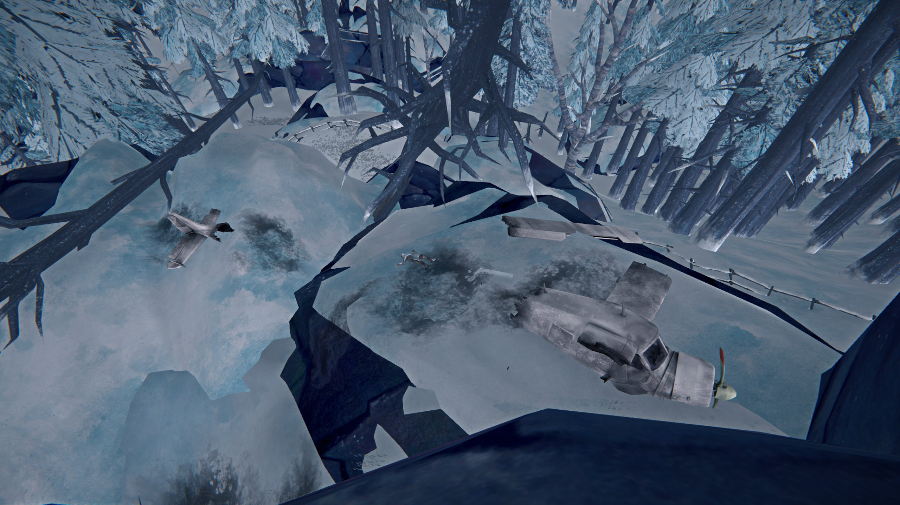
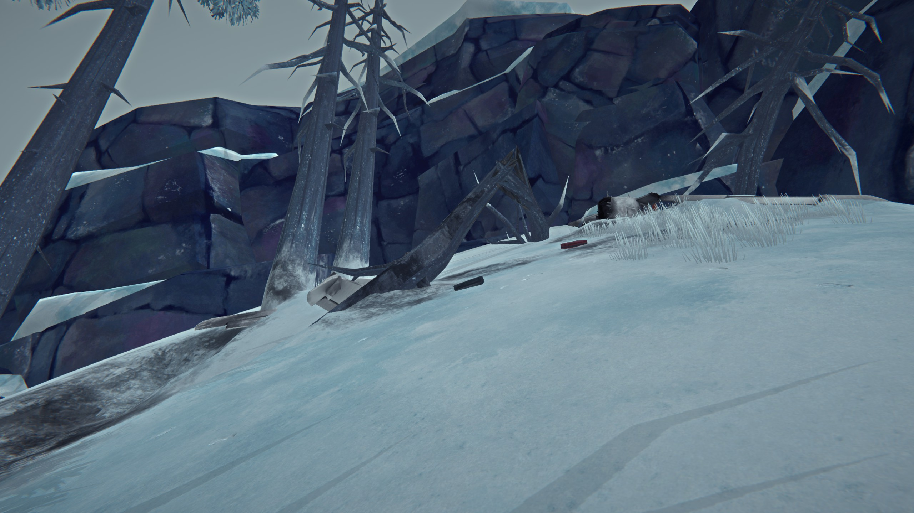
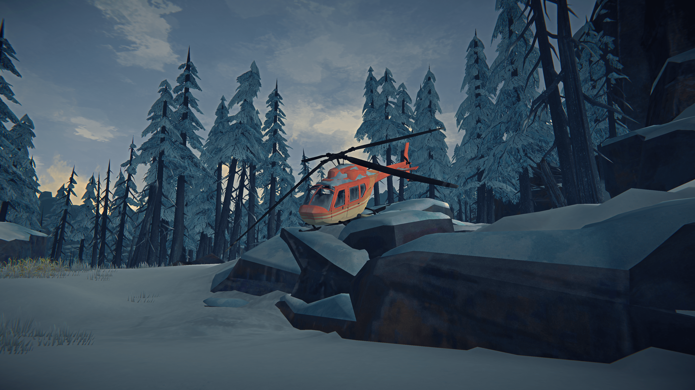
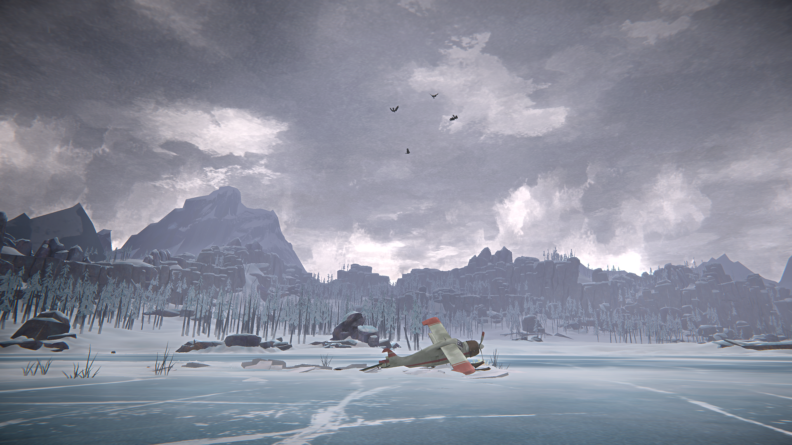
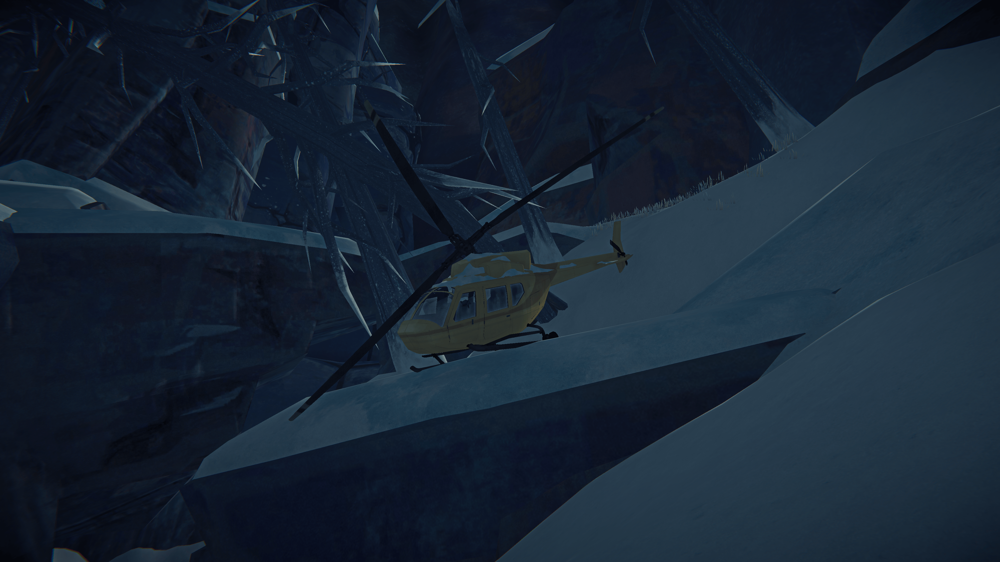

# Plane Crashes

**Source:** [Fandom](https://thelongdark.fandom.com/wiki/Plane_Crashes)

**Contents**

- [Overview](#overview)
- [Possible Locations](#possible-locations)
- [Crashed Plane](#crashed-plane)
- [Crashed Helicopter](#crashed-helicopter)
- [Gallery](#gallery)

**Plane Crashes** are newly generated loot locations introduced in the [Tales from the Far Territory](./Tales%20from%20the%20Far%20Territory.md) Part 2 update in Lower Great Bear (and parts of the Far Territory).

These random smaller air vehicle crashes are not be confused with either [Mackenzie's Crashed Plane](./Mackenzie%27s%20Crashed%20Plane.md), the [Crashed Northern Charters Plane)](./Crash%20Site%20%28Pleasant%20Valley%29.md), or the [plane on the summit of Timberwolf mountain](./Tail%20Section.md).

## Overview

Having fallen out of the sky sometime during the [First Flare](./First%20Flare.md), several air vehicles have landed in very odd, hard to reach locations across [Lower Great Bear](./Great%20Bear%20Island.md).

Crashes can be either a [Helicopter](./Helicopter.md) or a small [Airplane](./Airplane.md), depending on the spawning location. Helicopters and the front section of Airplanes are always intact and can be used as shelters, but airplanes tend to be little more than scrap wreckage by the time the player finds them, so the cockpit can be harder to find.

Crash sites offer decent loot. A frozen corpse or backpack can often be found in the vicinity alongside items like [Tools](./Tools.md), [Clothing](./Clothing.md), [Medicine](./First%20Aid.md), [Food](./Food%20And%20Drink.md), [Flares](./Flare.md), [Scrap Metal](./Scrap%20Metal.md), and [Flare Shells](./Flare%20Shell.md).

## Possible Locations

### Crashed Plane

- A crashed plane on the mountainside between the [Forestry Lookout](./Forestry%20Lookout.md) and [Derailment](./Derailment.md) in [Mystery Lake](./Mystery%20Lake%20%28region%29.md).
- A crashed plane South-East and up-hill from [Coastal Townsite](./Coastal%20Townsite.md) in [Coastal Highway](./Coastal%20Highway.md), past the lone house near the edge of town.
- A crashed plane near [Lonely Cave](./Lonely%20Cave.md) in the [Hushed River Valley](./Hushed%20River%20Valley.md).
- A crashed airplane on [Shoulder Lake](./Shoulder%20Lake.md) in [Forsaken Airfield](./Forsaken%20Airfield.md).

### Crashed Helicopter

- A crashed helicopter east of [Fallow Dugout](./Fallow%20Dugout.md) in [Forsaken Airfield](./Forsaken%20Airfield.md).
- A crashed helicopter near [Muskeg Overlook](./Muskeg%20Overlook.md) in [Forlorn Muskeg](./Forlorn%20Muskeg.md).
- A crashed helicopter uphill from [Old Corral](./Old%20Corral.md) in [Zone of Contamination](./Zone%20of%20Contamination.md).

## Gallery

