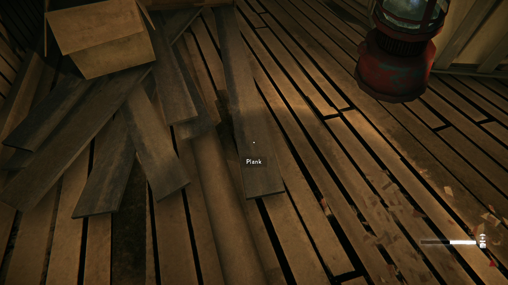

# Plank

**Plank**

| Property | Details |
| --- | --- |
|  |  / *Plank.jpg* |
| **General** |  |
| Item Type | Item |
| Wintermute | No |
| **Statistics** |  |
| Harvest | 2 × [Reclaimed Wood](./Reclaimed%20Wood.md) |

*For the larger bundle of planks, see [Planks](./Planks.md).*

A **Plank** is a single length of wood, and is a harvestable item in *[The Long Dark](./The%20Long%20Dark.md)*. They often, but not always, act as decorations, and can be found commonly in houses or in industrial areas throughout the world. Some planks in the world also serve as passageways while also remaining harvestable, such as those leading to the upper loft in [Old Spence Family Homestead](./Old%20Spence%20Family%20Homestead.md), and as such survivors should be careful of what they choose to harvest.

Planks can also wash up on the coastline as part of the [Beachcombing](./Beachcombing.md) mechanic.

Some notable locations include:

- The [Hunting Lodge](./Hunting%20Lodge.md) in [Broken Railroad](./Broken%20Railroad.md)
- [Maintenance Yard](./Maintenance%20Yard.md)
- Many of the [Milton houses](./Milton%20House.md)
- [Carter Hydro Dam](./Carter%20Hydro%20Dam.md)
- [Old Spence Family Homestead](./Old%20Spence%20Family%20Homestead.md)

Planks yield 2 [Reclaimed Wood](./Reclaimed%20Wood.md), require a [Hatchet](./Hatchet.md) to harvest, and take 9 minutes to harvest.

| Object | Reclaimed Wood | Time | Calories | Condition of Tool |
| --- | --- | --- | --- | --- |
| Plank | 2 | 9 minutes | 27 | -2% Hatchet |
| Plank | 2 | 12 minutes | 35 | -3% Improvised Hatchet |
| Plank | 2 | 14 minutes | 40 | -0.5% Heavy Hammer |

**Lua execution error in Module:Navbox function navbox**
