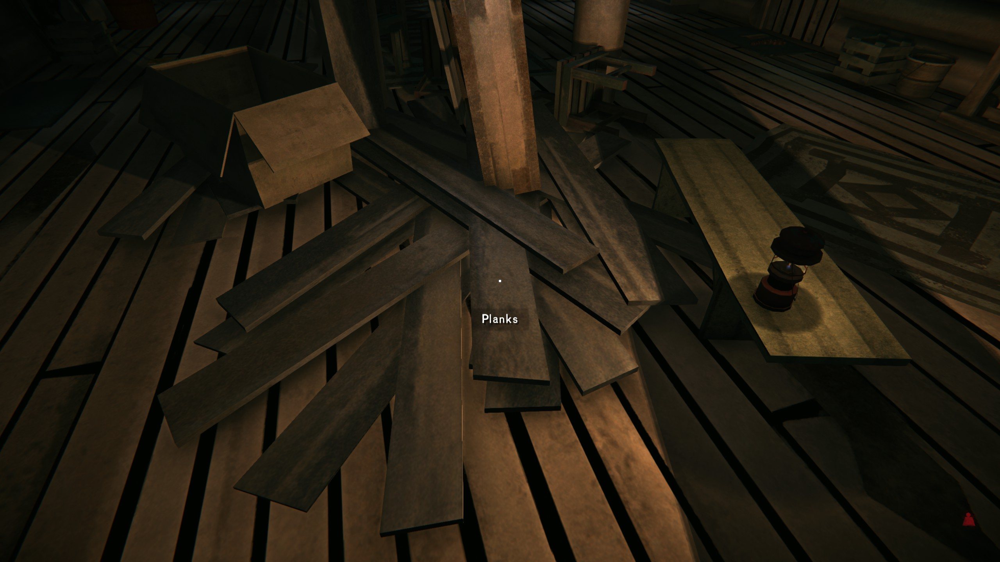

# Planks

**Planks**

| Property | Details |
| --- | --- |
|  |  / *Planks.jpg* |
| **General** |  |
| Item Type | Item |
| Wintermute | No |
| **Statistics** |  |
| Harvest | 6 × [Reclaimed Wood](./Reclaimed%20Wood.md) |

*For a singular plank, see [Plank](./Plank.md).*

**Planks** are wooden boards that can be found in many industrial areas, and can be harvested for 30 minutes with a [Hatchet](./Hatchet.md) to acquire 6 [Reclaimed Wood](./Reclaimed%20Wood.md). Some notable locations that Planks can be found are:

- The [Hunting Lodge](./Hunting%20Lodge.md) in [Broken Railroad](./Broken%20Railroad.md)
- [Maintenance Yard](./Maintenance%20Yard.md)
- Many of the [Milton houses](./Milton%20House.md)
- [Carter Hydro Dam](./Carter%20Hydro%20Dam.md)
- [Old Spence Family Homestead](./Old%20Spence%20Family%20Homestead.md)

| Object | Reclaimed Wood | Time | Calories | Condition of Tool |
| --- | --- | --- | --- | --- |
| Planks | 6 | 30 minutes | 90 | -2% Hatchet |
| Planks | 6 | 39 minutes | 117 | -3% Improvised Hatchet |
| Planks | 6 | 45 minutes | 135 | -0.5% Heavy Hammer |

**Lua execution error in Module:Navbox function navbox**
