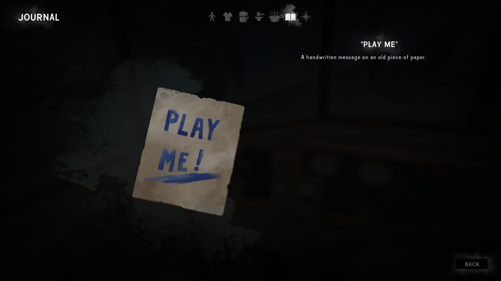

# Play Me

**Categories:** Collectibles, DLC Content · **Source:** [Fandom](https://thelongdark.fandom.com/wiki/Play_Me)

**DLC-Exclusive content.**

This content requires the [Iron Road](./Iron%20Road.md) addon to be installed before it can be seen or used in regular gameplay.

**Play Me**

[Play Me icon](../assets/Play_Me_icon.png)

**Release:** [Iron Road Part 1](./The%20Long%20Dark%20%E2%80%94%20Changelog.md#2.58)

**Properties**

**Item type:** [Collectibles](./Collectibles.md)

**Stackable:** No

**Examine:** A handwritten message on an old piece of paper.

**Values**

**Weight:** 0.00 kg (0 lbs)

**Actions**

**Backpack:** Examine

**On ground:** Take It, Read Text, Leave It

**Play Me** is a [Collectible](./Collectibles.md) in [Survival Mode](./Survival%20Mode.md) as part of the [Iron Road](./Iron%20Road.md) expansion. It is found in [Desolation Point](./Desolation%20Point.md), on the [Fulmar Autopilot Boat](./Fulmar%20Autopilot%20Boat.md), enticing the player to pick up the nearby [Wax Cylinder Player](./Wax%20Cylinder%20Player.md). _The note as seen in game_

## Game history
