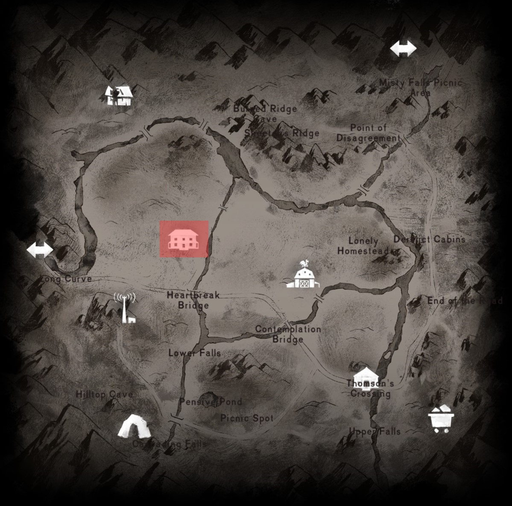
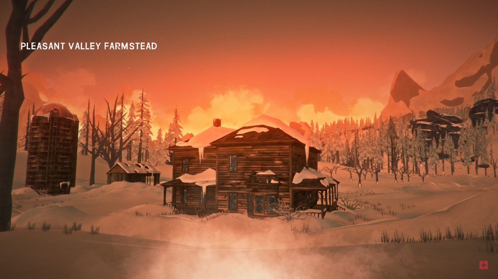

# Pleasant Valley Farmstead

**Categories:** Indoor locations, Locations, Locations in Pleasant Valley, Locations with a workbench, Residential locations · **Source:** [Fandom](https://thelongdark.fandom.com/wiki/Pleasant_Valley_Farmstead)

**Pleasant Valley Farmstead**

**Location**

**Region:** [Pleasant Valley](./Pleasant%20Valley.md)

**General**

**Type:** Residential

Has a bed

Has a workbench

## Overview

The Farmstead is found at the back of a dead orchard, near the side of the river and at the end of a long driveway off the main road (a car and a wooden arch mark the entrance to down the path, which is lined with telephone poles). The location consists of a derelict barn, a grain silo, and a large farmhouse with a basement. The silo cannot be entered. There is also an abandoned [Car](./Car.md) on the property. Some distance behind the farmstead is another broken stable with a chance to spawn a [Hunting Rifle](./Hunting%20Rifle.md), as well as usually having a [Frozen Corpse](./Frozen%20Corpse.md) and a small amount of supplies.

The farmhouse itself has three points of entry, as well as a basement accessed through a bulkhead door on the side of the building, and from a door to the right of the bathroom on the ground floor. The kitchen door is enclosed by a roofed porch that usually contains some loot. The porch is very useful as it is not uncommon for a [Bear](./Bear.md) to spawn directly outside of the house. The bear can be shot and killed from inside the safety of the porch, and this is by far the simplest and safest method of taking it down.

The interior of the farmhouse is quite spacious with two bathrooms, a kitchen, living room, study, and three bedrooms. The kitchen has a stove with six cooking slots, allowing the player to efficiently cook large amounts of food and drink on the cook top, especially if there are one or more [cooking pots](./Cooking%20Pot.md) available.

In the above-ground floors, there are two fire sources (including the stove), a lot of containers for storing surplus tools and supplies, and a [toilet](./Toilet.md) in each bathroom containing a good amount of potable [water](./Water%20%28Potable%29.md). There are several [beds](./Bed.md) to use for warming up and [resting](./Sleep.md). In the basement, there is a [Work Bench](./Work%20Bench.md) for crafting, _Old picture of Pleasant Valley Farmstead_ Several useful tools and supplies can also be found in both the main house and the basement, including two chances for a Hunting Rifle to spawn either in the study, or underneath the bed in the master bedroom. A few rounds of [ammo](./Rifle%20Ammunition.md) can usually be found scattered around the house, as well. A large amount of the furniture can be broken down for a lot of [Reclaimed Wood](./Reclaimed%20Wood.md) and [Cloth](./Cloth.md) when needed.

It is a tactical choice for a base because of the size, the large amount of loot, and the inclusion of beds, fireplaces, and a work bench. However, it is a fair distance away from other buildings, so travel may take longer.

Be wary of bears near this location, as there is a den not very far away and the bear tends to wander. Sometimes, there can be **two** bears patrolling around the area.

## Story Mode

**\*Spoilers\***

The farmstead is home to [Molly](./Molly.md) who once ran the farm with a man (likely her husband). She states the farm often ran on generators, since the power went out frequently. In the office, there is a photograph of a younger, glum-looking Molly with the man--his arm flung around her shoulder.

The man is dead as of Episode 3, and his corpse may be found in the farmstead basement. The man was killed by wolves, according to Molly. She states she did not kill him, but she did not try to save him, either.

In the story, most of the house is locked and inaccessible for much of the game. The basement may be accessed after the initial opening cutscenes, however.

## Trivia

Before the [Episode 3: Crossroads Elegy](./Episode%203%20-%20Crossroads%20Elegy.md) update, the farmhouse held a children's playroom upstairs, complete with a crib, toy blocks, and a toy tractor. This was removed because it most likely conflicted with Molly's backstory.
