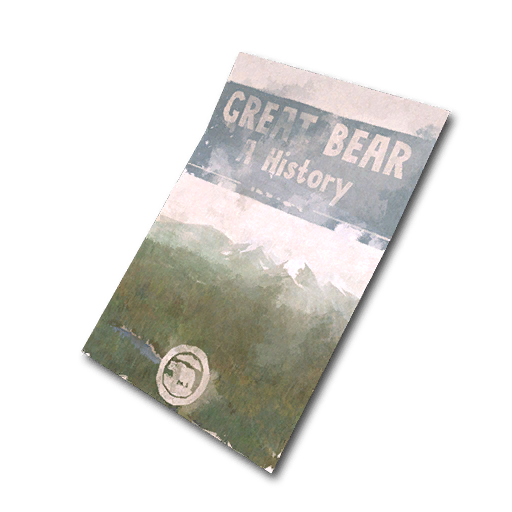

# Pleasant Valley History

**Contents**

- [Transcript](#Transcript)
- [Pleasant Valley History Part One](#Pleasant_Valley_History_Part_One)
- [Pleasant Valley History Part Two](#Pleasant_Valley_History_Part_Two)
- [Pleasant Valley History Part Three](#Pleasant_Valley_History_Part_Three)
- [Update history](#Update_history)

<table class="infobox">
<caption>Pleasant Valley History</caption>
<colgroup>
<col style="width: 50%" />
<col style="width: 50%" />
</colgroup>
<tbody>
<tr>
<td colspan="2"><figure>

<figcaption>Knowledge.png</figcaption>
</figure></td>
</tr>
<tr>
<td>
Wintermute
</td>
<td>
<a href="./Episode%203%20-%20Crossroads%20Elegy.md" class="wikilink" title="Episode 3">Episode 3</a>
</td>
</tr>
<tr>
<td colspan="2" class="section">
<strong>Properties</strong>
</td>
</tr>
<tr>
<td>
Item type
</td>
<td>
<a href="./Collectibles.md" class="wikilink" title="Collectibles">Collectibles</a>|-
</td>
</tr>
<tr>
<td>
Stackable
</td>
<td>
No
</td>
</tr>
<tr>
<td>
Examine
</td>
<td>
Leaflet containing information about Great Bear Island, presented by the Great Bear Historical Society.
</td>
</tr>
<tr>
<td colspan="2" class="section">
<strong>Values</strong>
</td>
</tr>
<tr>
<td>
Weight
</td>
<td>
0.00 kg (0 lbs)
</td>
</tr>
<tr>
<td colspan="2" class="section">
<strong>Actions</strong>
</td>
</tr>
<tr>
<td>
Backpack
</td>
<td>
Examine
</td>
</tr>
<tr>
<td>
On ground
</td>
<td>
Take It, Read Text, Leave It
</td>
</tr>
</tbody>
</table>

**Pleasant Valley History** is 3 separate <a href="./Collectibles.md" class="wikilink" title="Collectibles">Collectibles</a> items found in <a href="./Episode%203%20-%20Crossroads%20Elegy.md" class="wikilink" title="Episode 3">Episode 3</a> of the <a href="./Wintermute.md" class="wikilink" title="Wintermute">Wintermute</a> story mode.

- Part One is found in the Church at <a href="./Thomson%27s%20Crossing.md" class="wikilink" title="Thomson&#39;s Crossing">Thomson's Crossing</a>
- Part Two is found in a cabin near the <a href="./Point%20of%20Disagreement.md" class="wikilink" title="Point of Disagreement">Point of Disagreement</a>
- Part Three is found in the basement of <a href="./Skeeter%27s%20Ridge.md" class="wikilink" title="Skeeter&#39;s Ridge">Skeeter's Ridge</a>

## Transcript

### **Pleasant Valley History Part One**

The following text is transcribed from **Pleasant Valley History Part One**

Pleasant Valley’s harsh and remote location, even for Great Bear Island, has shaped much of its history and the character of its residents. The Valley’s geography -- wide, open fields ringed by jagged mountain ranges -- creates unusually strong weather events. Locals have long told of multi-day storms, high winds, and a deep, endless cold during the Winter months.

But these conditions didn’t keep Great Bear Islanders from settling there. In fact, some saw the Valley’s wild and desolate hills as an ideal place to homestead.

### **Pleasant Valley History Part Two**

The following text is transcribed from **Pleasant Valley History Part Two**

Founded in 1919, Thomson’s Crossing remains the only significant community in Pleasant Valley. With a history tied to the farming and mining concerns of its residents, the isolated town followed its own path along the boom and bust cycle of Great Bear Island industry.

With greater and greater instability due to seismic activity, the workings in the nearby mines proved too dangerous for later generations to exploit. And with the arrival of local activists, determined to keep new industry from taking root in Pleasant Valley, Thomson’s Crossing began its steady decline.

### **Pleasant Valley History Part Three**

The following text is transcribed from **Pleasant Valley History Part Three**

With the onset of The Collapse, Pleasant Valley locals didn’t notice the brunt of change all that quickly. Being so accustomed to remote living already, it took several years before life shifted in any dramatic fashion.

Residents did begin to notice the growing scarcity of the few creature comforts imported to the Island. But connected as they were through regular reports from the regional weather service radio station, their post-Collapse isolation took some years to set in.

## Update history

- UPDATE **22 October 2019 (<a href="./The%20Long%20Dark%20%E2%80%94%20Changelog.md#1.60" class="wikilink" title="Update">Update</a>):**
  - Added to game.

**Lua execution error in Module:Navbox function navbox**

