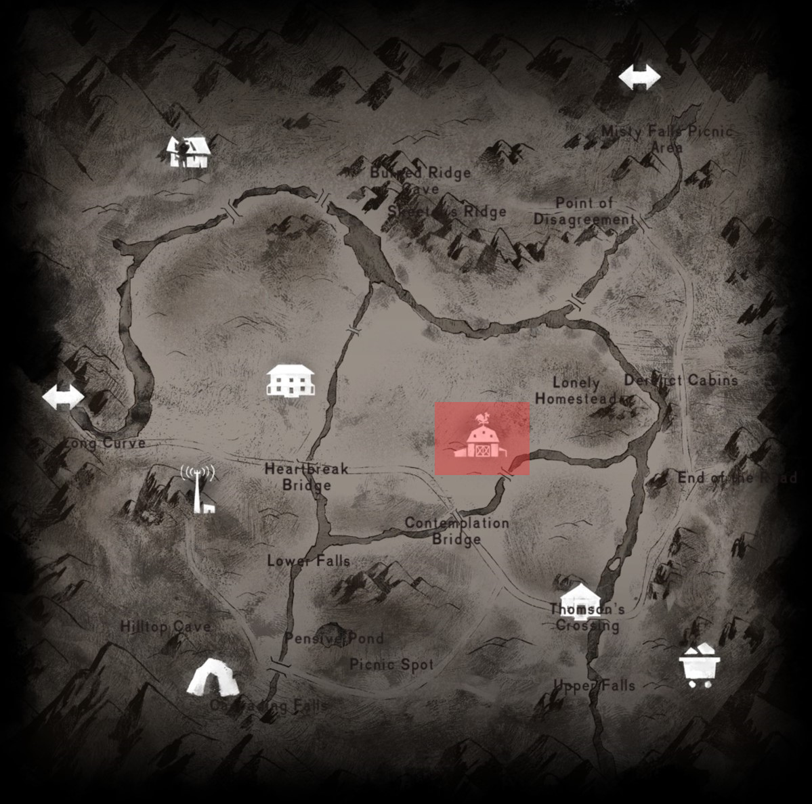

# Pleasant Valley Outbuildings

**Pleasant Valley Outbuildings**

| Property | Details |
| --- | --- |
|  |  / *305620\_20160918104124\_1.png* |
| **Location** |  |
|  |  / *Pleasant\_Valley\_Outbuildings\_Location.png* |
| Region | [Pleasant Valley](./Pleasant%20Valley.md)\|- |
| Firebox | [Fire Barrel](./Fire%20Barrel.md) |
|  / *bed\_icon.png* | Has a bed |
|  / *workbench\_icon\_green.png* | Has a workbench\|- |
