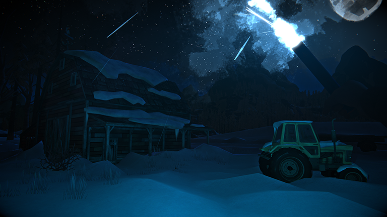

# Pleasant Valley Outbuildings

**Categories:** Indoor locations, Locations, Locations in Pleasant Valley, Locations with a workbench · **Source:** [Fandom](https://thelongdark.fandom.com/wiki/Pleasant_Valley_Outbuildings)

**Pleasant Valley Outbuildings**

[305620 20160918104124 1](../assets/305620_20160918104124_1.png)

**Location**

[Pleasant Valley Outbuildings Location](../assets/Pleasant_Valley_Outbuildings_Location.png)

**Region:** [Pleasant Valley](./Pleasant%20Valley.md)

**Firebox:** [Fire Barrel](./Fire%20Barrel.md)

[Bed icon](../assets/Bed_icon.png)

Has a bed

[Workbench icon green](../assets/Workbench_icon_green.png)

Has a workbench

## Overview

The barn is an important source of supplies and makes for a decent [base](./Safehouse.md). It provides a [Fire Barrel](./Fire%20Barrel.md), a [Work Bench](./Work%20Bench.md), and a [Truck](./Truck.md) that is warm enough to sleep in without a bedroll. However, the overall temperature in the barn is not very warm, so it may be too cold to stay in for players who are wearing poor quality [Clothing](./Clothing.md), unless they light a fire or stay in the truck.

Behind the barn there is also a target with multiple [Simple Arrows](./Simple%20Arrow.md) stuck in it and [Broken Arrows](./Broken%20Arrow.md) lying below it (not there on Interloper).

Two [Tractors](./Tractor.md) can be found around the barn. These tractors may contain low-grade supplies similar to those found in most vehicles, and can serve as a place to sleep if the player catches [Cabin Fever](./Cabin%20Fever.md).

## "Forest Talkers" Side Mission

FOREST TALKERS 2 is past the workbench near a metal container on the upper floor of the barn as part of the [Forest Talkers (side mission)](./Forest%20Talkers%20%28side%20mission%29.md).

