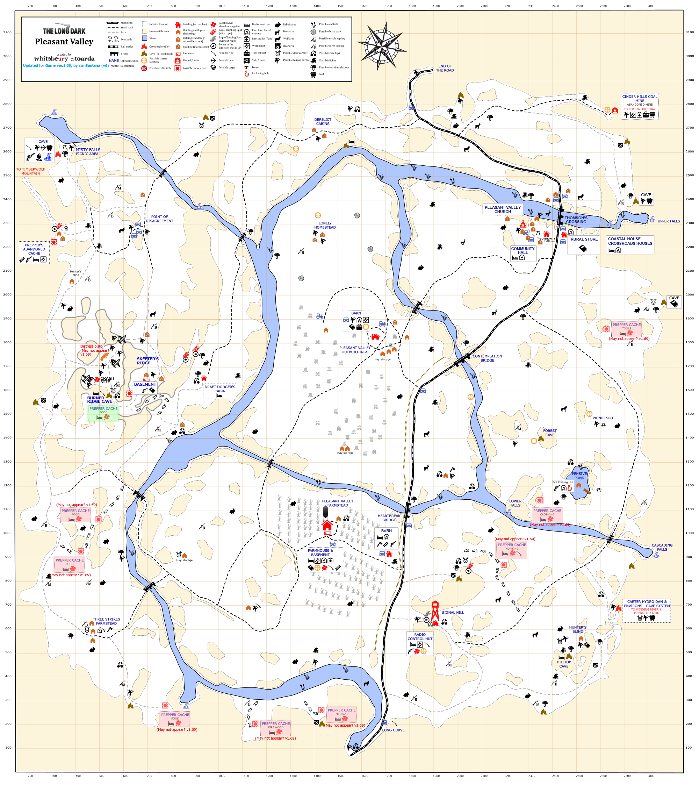

# Pleasant Valley

**Contents**

- [Overview](#Overview)
- [Safehouses](#Safehouses)
- [Locations](#Locations)
- [Gallery](#Gallery)
- [Maps](#Maps)
- [Locations](#Locations_2)

<table class="infobox">
<caption>Pleasant Valley</caption>
<colgroup>
<col style="width: 50%" />
<col style="width: 50%" />
</colgroup>
<tbody>
<tr>
<td colspan="2"><figure>

<figcaption><a href="./Pleasant%20Valley%20Outbuildings.md" class="wikilink" title="Pleasant Valley Outbuildings">Pleasant Valley Outbuildings</a></figcaption>
</figure></td>
</tr>
<tr>
<td colspan="2" class="section">
<strong>Location on <a href="./Great%20Bear%20Island.md" class="wikilink" title="Great Bear Island">Great Bear Island</a></strong>
</td>
</tr>
<tr>
<td colspan="2"><figure>
[Missing image: Pleasant_Valley_Location.png]
<figcaption>Pleasant_Valley_Location.png</figcaption>
</figure></td>
</tr>
<tr>
<td colspan="2"><figure>

<figcaption>Pleasant_valley_map.png</figcaption>
</figure></td>
</tr>
<tr>
<td colspan="2" class="section">
<strong>Details</strong>
</td>
</tr>
<tr>
<td>
Description
</td>
<td>
A large open farmland basin surrounded by mountains on all sides, with a very ironic name.
</td>
</tr>
<tr>
<td>
Connecting Regions
</td>
<td>
<a href="./Timberwolf%20Mountain.md" class="wikilink" title="Timberwolf Mountain">Timberwolf Mountain</a>, 
<a href="./Coastal%20Highway.md" class="wikilink" title="Coastal Highway">Coastal Highway</a>, 
<a href="./Mystery%20Lake%20%28region%29.md" class="wikilink" title="Mystery Lake">Mystery Lake</a> <em>(via <a href="./Winding%20River.md" class="wikilink" title="Winding River">Winding River</a>)</em>, 
<a href="./Blackrock.md" class="wikilink" title="Blackrock">Blackrock</a> <em>(via <a href="./Keeper%27s%20Pass%20South.md" class="wikilink" title="Keeper&#39;s Pass South">Keeper's Pass South</a>)</em>
</td>
</tr>
<tr>
<td>
Difficulty
</td>
<td>
Advanced
</td>
</tr>
<tr>
<td>
Interloper Region Spawn
</td>
<td>
Yes
</td>
</tr>
<tr>
<td>
Locations
</td>
<td>
33
</td>
</tr>
<tr>
<td>
Date Added
</td>
<td>
Feb 2015
</td>
</tr>
</tbody>
</table>

<table>
<colgroup>
<col style="width: 33%" />
<col style="width: 33%" />
<col style="width: 33%" />
</colgroup>
<tbody>
<tr>
<td style="vertical-align: top; font-size: 3em; color: #5d5980; padding-right: 10px">
“
</td>
<td>
For advanced players. A challenging, vast mountain wilderness region with a few key shelters, originally settled by hardy homesteaders.

&#10;

- In game description

</td>
<td style="vertical-align: bottom; font-size: 3em; color: #5d5980; padding-left: 10px">
”
</td>
</tr>
</tbody>
</table>

{\| style="margin:auto" \| style="vertical-align:top; font-size:3em; color:#5d5980; padding-right:10px" \|“ \| You're not from around here, are you? Whoever named this area "Pleasant Valley" had a pretty good sense of humour. We get some of the harshest weather on all of Great Bear.

Father Thomas

\| style="vertical-align:bottom; font-size:3em; color:#5d5980; padding-left:10px" \|” \|} **Pleasant Valley** is the 3rd <a href="./Region.md" class="wikilink" title="Region">Region</a> in *<a href="./The%20Long%20Dark.md" class="wikilink" title="The Long Dark">The Long Dark</a>* and is one of the most central regions of <a href="./Great%20Bear%20Island.md" class="wikilink" title="Great Bear Island">Great Bear Island</a>.

The region is a massive rural agriculture comprised of farmland and orchards, surrounded by forested rolling hills filled with coal mining, caves, waterfalls and the harshest <a href="./Weather.md" class="wikilink" title="Weather">Weather</a> on <a href="./Great%20Bear%20Island.md" class="wikilink" title="Great Bear Island">Great Bear Island</a>. Pleasant Valley is also notable for hosting a large Birch Forest as well as a <a href="./Crash%20Site%20%28Pleasant%20Valley%29.md" class="wikilink" title="Passenger Plane">Passenger Plane</a> downed by the <a href="./First%20Flare.md" class="wikilink" title="Aurora">Aurora</a>.

Pleasant Valley connects to <a href="./Timberwolf%20Mountain.md" class="wikilink" title="Timberwolf Mountain">Timberwolf Mountain</a> via a rope climb near <a href="./Prepper%27s%20Abandoned%20Cache.md" class="wikilink" title="Prepper&#39;s Abandoned Cache">Prepper's Abandoned Cache</a> in the northeast, to <a href="./Coastal%20Highway.md" class="wikilink" title="Coastal Highway">Coastal Highway</a> in the southeast through <a href="./Cinder%20Hills%20Coal%20Mine.md" class="wikilink" title="Cinder Hills Coal Mine">Cinder Hills Coal Mine</a>, to <a href="./Blackrock.md" class="wikilink" title="Blackrock">Blackrock</a> by following the road from <a href="./Long%20Curve.md" class="wikilink" title="Long Curve">Long Curve</a>, which leads through <a href="./Keeper%27s%20Pass%20South.md" class="wikilink" title="Keeper&#39;s Pass South">Keeper's Pass South</a> and <a href="./Keeper%27s%20Pass%20North.md" class="wikilink" title="Keeper&#39;s Pass North">Keeper's Pass North</a>, and to <a href="./Mystery%20Lake%20%28region%29.md" class="wikilink" title="Mystery Lake">Mystery Lake</a> through a cave to the southwest, just west of <a href="./Cascading%20Falls.md" class="wikilink" title="Cascading Falls">Cascading Falls</a> which leads through <a href="./Winding%20River.md" class="wikilink" title="Winding River">Winding River</a> and <a href="./Carter%20Hydro%20Dam.md" class="wikilink" title="Carter Hydro Dam">Carter Hydro Dam</a>.

## Overview

Pleasant Valley is a very large region in <a href="./Great%20Bear%20Island.md" class="wikilink" title="Great Bear Island">Great Bear Island</a>, the largest of Lower Great Bear. It features few shelters outside of Thompson's Crossing to the southeast, so gameplay focuses on surviving the elements and living off the land while navigating between cabins, caves and landmarks.

Frequent high winds and <a href="./Hypothermia.md" class="wikilink" title="low temperatures">low temperatures</a>, <a href="./Weather.md" class="wikilink" title="snow, fog and blizzards">snow, fog and blizzards</a> plague the region, the second coldest in Lower Great Bear after <a href="./Bleak%20Inlet.md" class="wikilink" title="Bleak Inlet">Bleak Inlet</a>. Blizzards can be as cold as -48°C with windchill at -33°C in <a href="./Episode%203%20-%20Crossroads%20Elegy.md" class="wikilink" title="Episode 3">Episode 3</a> (Hardened Survivor). The mix of rolling hills and almost featureless farmland can be disorienting and can make it easy to lose one's way. The landscape also increases the risk of unexpected, close-range wildlife <a href="./Wildlife.md" class="wikilink" title="encounters">encounters</a>.

Players must time expeditions carefully and make preparations for sudden changes in the <a href="./Weather.md" class="wikilink" title="weather">weather</a>, as the rather ironic name of "Pleasant" is misleading considering that Blizzards are more frequent in this region than any other. Noting landmarks and even marking a path can help navigate through the hills and trees, but beware: <a href="./Bear.md" class="wikilink" title="bear">bear</a>, <a href="./Moose.md" class="wikilink" title="moose">moose</a>, and <a href="./Wolf.md" class="wikilink" title="wolves">wolves</a> (and in <a href="./Wintermute.md" class="wikilink" title="Wintermute">Wintermute</a>: <a href="./Timberwolf.md" class="wikilink" title="timberwolves">timberwolves</a>) may wait just around the corner.

## Safehouses

Two central indoor shelters serve as good primary bases:

<a href="./Pleasant%20Valley%20Outbuildings.md" class="wikilink" title="Pleasant Valley Outbuildings">Pleasant Valley Outbuildings</a> features a large barn located near the center of the map. The <a href="./Pleasant%20Valley%20Outbuildings.md" class="wikilink" title="Outbuildings">Outbuildings</a> area also contains several abandoned <a href="./Car.md" class="wikilink" title="vehicles">vehicles</a>, hay trailers, sheds, and tractors around the perimeter.

- The barn possesses several valuable utilities including a fire barrel, a <a href="./Work%20Bench.md" class="wikilink" title="workbench">workbench</a>, lots of storage, a central location, and a <a href="./Bed.md" class="wikilink" title="bed">bed</a> (see bullet point below).
- It is possible to sleep inside the pickup truck's cab by entering it and selecting "Sleep" under "Campcraft" in the <a href="./Radial%20Menu.md" class="wikilink" title="Radial Menu">Radial Menu</a>, including with a <a href="./Bedroll.md" class="wikilink" title="Bedroll">Bedroll</a> or <a href="./Bear%20Skin%20Bedroll.md" class="wikilink" title="Bear Skin Bedroll">Bear Skin Bedroll</a> for a <a href="./Warmth.md" class="wikilink" title="Warmth">Warmth</a> bonus).

<a href="./Pleasant%20Valley%20Farmstead.md" class="wikilink" title="Pleasant Valley Farmstead">Pleasant Valley Farmstead</a> is located about five minutes west of the <a href="./Pleasant%20Valley%20Outbuildings.md" class="wikilink" title="barn">barn</a> through the hay bale field. This location, like the barn, has a few vehicles scattered around the perimeter. The vehicles may contain supplies and offer temporary shelter from weather or predators.

- Like the barn, the Farmstead possesses key resources: a 6-burner stove, fireplace, a fire barrel outside, lots of storage, and an enclosed porch for storing food or safely monitoring conditions outdoors.
- Inside the house also are two beds with different warmth values; a workbench (accessed through the cellar door outside or a door under the stairs from inside); and a large amount of loot.
- It is also located centrally, and <a href="./Deer.md" class="wikilink" title="deer">deer</a> and <a href="./Rabbit.md" class="wikilink" title="rabbit">rabbits</a> may roam nearby (although, so do <a href="./Wildlife.md" class="wikilink" title="predators">predators</a>).
- Nearby, there is also a large shed/small barns that contains a fire barrel and makeshift bed, as well.

The Farmstead is relatively close to the Outbuildings and <a href="./Signal%20Hill.md" class="wikilink" title="Signal Hill">Signal Hill</a>, another useful indoor shelter.

## Locations

There are many accessible locations within Pleasant Valley, including:

<table>
<colgroup>
<col style="width: 50%" />
<col style="width: 50%" />
</colgroup>
<tbody>
<tr>
<td><ul>
<li><a href="./Barn%20%28Molly%27s%29.md" class="wikilink" title="Barn (Molly&#39;s)">Barn (Molly's)</a></li>
<li><a href="./Burned%20Ridge%20Cave.md" class="wikilink" title="Burned Ridge Cave">Burned Ridge Cave</a></li>
<li><a href="./Bunker%20Beta.md" class="wikilink" title="Bunker Beta">Bunker Beta</a></li>
<li><a href="./Cascading%20Falls.md" class="wikilink" title="Cascading Falls">Cascading Falls</a></li>
<li><a href="./Community%20Hall.md" class="wikilink" title="Community Hall">Community Hall</a></li>
<li><a href="./Contemplation%20Bridge.md" class="wikilink" title="Contemplation Bridge">Contemplation Bridge</a></li>
<li><a href="./Crash%20Site%20%28Pleasant%20Valley%29.md" class="wikilink" title="Crash Site (Pleasant Valley)">Crash Site (Pleasant Valley)</a></li>
<li><a href="./Derelict%20Cabins.md" class="wikilink" title="Derelict Cabins">Derelict Cabins</a></li>
<li><a href="./Draft%20Dodger%27s%20Cabin.md" class="wikilink" title="Draft Dodger&#39;s Cabin">Draft Dodger's Cabin</a></li>
<li><a href="./End%20of%20the%20Road.md" class="wikilink" title="End of the Road">End of the Road</a></li>
<li><a href="./Forest%20Cave%20%28Pleasant%20Valley%20location%29.md" class="wikilink" title="Forest Cave">Forest Cave</a></li>
<li><a href="./Heartbreak%20Bridge.md" class="wikilink" title="Heartbreak Bridge">Heartbreak Bridge</a></li>
<li><a href="./Hilltop%20Cave.md" class="wikilink" title="Hilltop Cave">Hilltop Cave</a></li>
<li><a href="./Lonely%20Homestead.md" class="wikilink" title="Lonely Homestead">Lonely Homestead</a></li>
<li><a href="./Long%20Curve.md" class="wikilink" title="Long Curve">Long Curve</a></li>
<li><a href="./Lower%20Falls.md" class="wikilink" title="Lower Falls">Lower Falls</a></li>
<li><a href="./Misty%20Falls%20Picnic%20Area.md" class="wikilink" title="Misty Falls Picnic Area">Misty Falls Picnic Area</a></li>
<li><a href="./Pensive%20Pond.md" class="wikilink" title="Pensive Pond">Pensive Pond</a></li>
</ul></td>
<td data-valign="top" style="width: 50%"><ul>
<li><a href="./Picnic%20Spot.md" class="wikilink" title="Picnic Spot">Picnic Spot</a></li>
<li><a href="./Pleasant%20Valley%20Farmstead.md" class="wikilink" title="Pleasant Valley Farmstead">Pleasant Valley Farmstead</a></li>
<li><a href="./Pleasant%20Valley%20Outbuildings.md" class="wikilink" title="Pleasant Valley Outbuildings">Pleasant Valley Outbuildings</a></li>
<li><a href="./Point%20of%20Disagreement.md" class="wikilink" title="Point of Disagreement">Point of Disagreement</a></li>
<li><a href="./Prepper%27s%20Abandoned%20Cache.md" class="wikilink" title="Prepper&#39;s Abandoned Cache">Prepper's Abandoned Cache</a></li>
<li><a href="./Rural%20Store.md" class="wikilink" title="Rural Store">Rural Store</a></li>
<li><a href="./Signal%20Hill.md" class="wikilink" title="Signal Hill">Signal Hill</a></li>
<li><a href="./Skeeter%27s%20Ridge.md" class="wikilink" title="Skeeter&#39;s Ridge">Skeeter's Ridge</a></li>
<li><a href="./Thomson%27s%20Crossing.md" class="wikilink" title="Thomson&#39;s Crossing">Thomson's Crossing</a></li>
<li><a href="./Three%20Strikes%20Farmstead.md" class="wikilink" title="Three Strikes Farmstead">Three Strikes Farmstead</a></li>
<li>To Abandoned Mine (Transition to <a href="./Cinder%20Hills%20Coal%20Mine.md" class="wikilink" title="Cinder Hills Coal Mine">Cinder Hills Coal Mine</a>)</li>
<li>To Cave System (Transition to <a href="./Winding%20River.md" class="wikilink" title="Winding River">Winding River</a>)</li>
<li>To Keeper's Pass South (Transition to <a href="./Keeper%27s%20Pass%20South.md" class="wikilink" title="Keeper&#39;s Pass South">Keeper's Pass South</a>)</li>
<li>To Timberwolf Mountain (Transition to <a href="./Timberwolf%20Mountain.md" class="wikilink" title="Timberwolf Mountain">Timberwolf Mountain</a>)</li>
<li><a href="./Upper%20Falls.md" class="wikilink" title="Upper Falls">Upper Falls</a></li>
</ul></td>
</tr>
</tbody>
</table>

There is also 1 <a href="./Prepper%20Cache.md" class="wikilink" title="Prepper Cache">Prepper Cache</a> located northwest of the Crash Site.

## Gallery

### Maps

<table class="gallery">
<colgroup>
<col style="width: 25%" />
<col style="width: 25%" />
<col style="width: 25%" />
<col style="width: 25%" />
</colgroup>
<tbody>
<tr>
<td><figure>
[Missing image: PV_map_default.png]
<figcaption>A detailed map of Pleasant Valley v2.35 (spoilers)</figcaption>
</figure></td>
<td><figure>
[Missing image: PV_map_loper.png]
<figcaption>A detailed map of Pleasant Valley v2.35 (Loper/Misery edition, spoilers)</figcaption>
</figure></td>
<td><figure>

<figcaption>1901570789_preview_Map-PleasantValley-EP3-spoil-Fixv162-05.png</figcaption>
</figure></td>
<td><figure>
[Missing image: Pleasant_Valley_map_by_Sniper_Bob.jpg]
<figcaption>Pleasant_Valley_map_by_Sniper_Bob.jpg</figcaption>
</figure></td>
</tr>
<tr>
<td><figure>

<figcaption>Map-PleasantValley-SV-spoil-Fixv169.png</figcaption>
</figure></td>
<td><figure>

<figcaption>Pleasant_valley_map.png</figcaption>
</figure></td>
<td><figure>
[Missing image: MAP-ingame-PV-v160-Eng.jpg]
<figcaption>MAP-ingame-PV-v160-Eng.jpg</figcaption>
</figure></td>
<td></td>
</tr>
</tbody>
</table>

### Locations

<table class="gallery">
<colgroup>
<col style="width: 25%" />
<col style="width: 25%" />
<col style="width: 25%" />
<col style="width: 25%" />
</colgroup>
<tbody>
<tr>
<td><figure>
[Missing image: Pleasant_Valley_landscape.jpg]
<figcaption>A view showing the expansive Pleasant Valley. <a href="./Pleasant%20Valley%20Outbuildings.md" class="wikilink" title="Pleasant Valley outbuildings">Pleasant Valley outbuildings</a> can be seen in the distance.</figcaption>
</figure></td>
<td><figure>
[Missing image: Tractor.jpg]
<figcaption>A snow-covered Tractor found commonly near the farms</figcaption>
</figure></td>
<td><figure>
[Missing image: Pensive_Pond.jpg]
<figcaption>Pensive_Pond.jpg</figcaption>
</figure></td>
<td><figure>
[Missing image: Picnic_Spot.jpg]
<figcaption>Picnic_Spot.jpg</figcaption>
</figure></td>
</tr>
<tr>
<td><figure>
[Missing image: Rural_Crossroads.jpg]
<figcaption>Rural_Crossroads.jpg</figcaption>
</figure></td>
<td><figure>
[Missing image: Cascading_Falls.jpg]
<figcaption>Cascading_Falls.jpg</figcaption>
</figure></td>
<td><figure>
[Missing image: Lower_Falls.jpg]
<figcaption>Lower_Falls.jpg</figcaption>
</figure></td>
<td><figure>
[Missing image: Skeeter's_Ridge.jpg]
<figcaption>Skeeter's_Ridge.jpg</figcaption>
</figure></td>
</tr>
<tr>
<td><figure>
[Missing image: Pleasant_Valley_Outbuildings.jpg]
<figcaption>Pleasant_Valley_Outbuildings.jpg</figcaption>
</figure></td>
<td><figure>
[Missing image: Pleasant_Valley_Farmstead.jpg]
<figcaption>Pleasant_Valley_Farmstead.jpg</figcaption>
</figure></td>
<td><figure>
[Missing image: Heartbreak_Bridge.jpg]
<figcaption>Heartbreak_Bridge.jpg</figcaption>
</figure></td>
<td><figure>
[Missing image: Contemplation_Bridge.jpg]
<figcaption>Contemplation_Bridge.jpg</figcaption>
</figure></td>
</tr>
<tr>
<td><figure>
[Missing image: Derelict_Cabins.jpg]
<figcaption>Derelict_Cabins.jpg</figcaption>
</figure></td>
<td><figure>
[Missing image: End_of_the_Road.jpg]
<figcaption>End_of_the_Road.jpg</figcaption>
</figure></td>
<td><figure>
[Missing image: Draft_Dodger's_Cabin.jpg]
<figcaption>Draft_Dodger's_Cabin.jpg</figcaption>
</figure></td>
<td><figure>
[Missing image: Signal_Hill.jpg]
<figcaption>Signal_Hill.jpg</figcaption>
</figure></td>
</tr>
</tbody>
</table>

**Lua execution error in Module:Navbox function navbox** **Lua execution error in Module:Navbox function navbox** <a href="ru:%D0%9E%D1%82%D1%80%D0%B0%D0%B4%D0%BD%D0%B0%D1%8F_%D0%B4%D0%BE%D0%BB%D0%B8%D0%BD%D0%B0" class="wikilink" title="ru:Отрадная долина">ru:Отрадная долина</a>

<a href="es:Valle_apacible" class="wikilink" title="es:Valle apacible">es:Valle apacible</a> <a href="fr:Vall%C3%A9e_Charmante" class="wikilink" title="fr:Vallée Charmante">fr:Vallée Charmante</a>

