# Pleasant Valley

**Categories:** Regions · **Source:** [Fandom](https://thelongdark.fandom.com/wiki/Pleasant_Valley)

**Contents**

- [Overview](#overview)
- [Safehouses](#safehouses)
- [Locations](#locations)
- [Gallery](#gallery)
- [Maps](#maps)
- [Locations](#locations-1)

**Pleasant Valley**

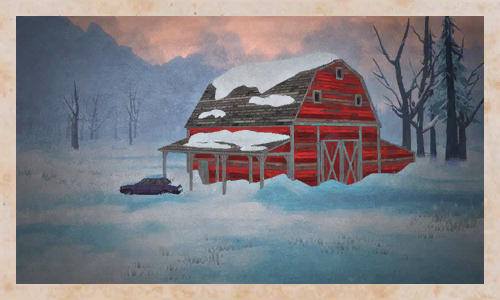

_[Pleasant Valley Outbuildings](./Pleasant%20Valley%20Outbuildings.md)_

**Location on [Great Bear Island](./Great%20Bear%20Island.md)**

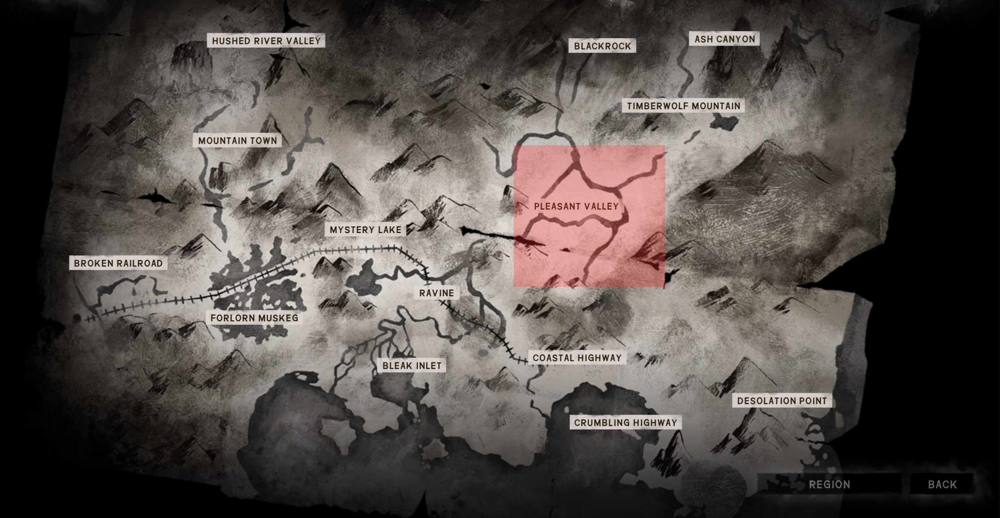

_Pleasant\_Valley\_Location.png_

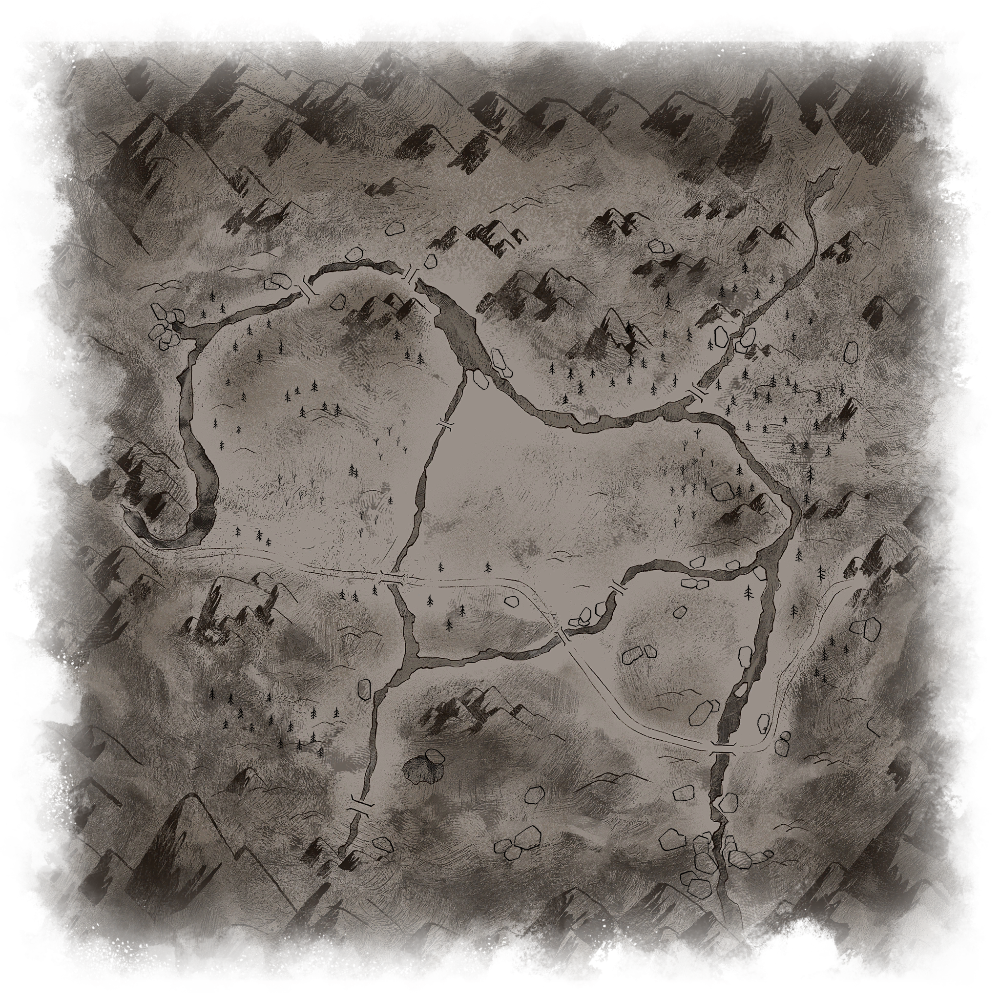

_Pleasant\_valley\_map.png_

**Details**

**Description:** A large open farmland basin surrounded by mountains on all sides, with a very ironic name.

**Connecting Regions:** [Timberwolf Mountain](./Timberwolf%20Mountain.md), / [Coastal Highway](./Coastal%20Highway.md), / [Mystery Lake](./Mystery%20Lake%20%28region%29.md) _(via [Winding River](./Winding%20River.md))_, / [Blackrock](./Blackrock.md) _(via [Keeper's Pass South](./Keeper%27s%20Pass%20South.md))_

**Difficulty:** Advanced

**Interloper Region Spawn:** Yes

**Locations:** 33

**Date Added:** Feb 2015

> “**For advanced players. A challenging, vast mountain wilderness region with a few key shelters, originally settled by hardy homesteaders.**”
>
> — - In game description

> **You're not from around here, are you? Whoever named this area "Pleasant Valley" had a pretty good sense of humour. We get some of the harshest weather on all of Great Bear.**
>
>
> — Father Thomas

**Pleasant Valley** is the 3rd [Region](./Region.md) in _[The Long Dark](./The%20Long%20Dark.md)_ and is one of the most central regions of [Great Bear Island](./Great%20Bear%20Island.md).

The region is a massive rural agriculture comprised of farmland and orchards, surrounded by forested rolling hills filled with coal mining, caves, waterfalls and the harshest [Weather](./Weather.md) on [Great Bear Island](./Great%20Bear%20Island.md). Pleasant Valley is also notable for hosting a large Birch Forest as well as a [Passenger Plane](./Crash%20Site%20%28Pleasant%20Valley%29.md) downed by the [Aurora](./First%20Flare.md).

Pleasant Valley connects to [Timberwolf Mountain](./Timberwolf%20Mountain.md) via a rope climb near [Prepper's Abandoned Cache](./Prepper%27s%20Abandoned%20Cache.md) in the northeast, to [Coastal Highway](./Coastal%20Highway.md) in the southeast through [Cinder Hills Coal Mine](./Cinder%20Hills%20Coal%20Mine.md), to [Blackrock](./Blackrock.md) by following the road from [Long Curve](./Long%20Curve.md), which leads through [Keeper's Pass South](./Keeper%27s%20Pass%20South.md) and [Keeper's Pass North](./Keeper%27s%20Pass%20North.md), and to [Mystery Lake](./Mystery%20Lake%20%28region%29.md) through a cave to the southwest, just west of [Cascading Falls](./Cascading%20Falls.md) which leads through [Winding River](./Winding%20River.md) and [Carter Hydro Dam](./Carter%20Hydro%20Dam.md).

## Overview

Pleasant Valley is a very large region in [Great Bear Island](./Great%20Bear%20Island.md), the largest of Lower Great Bear. It features few shelters outside of Thompson's Crossing to the southeast, so gameplay focuses on surviving the elements and living off the land while navigating between cabins, caves and landmarks.

Frequent high winds and [low temperatures](./Hypothermia.md), [snow, fog and blizzards](./Weather.md) plague the region, the second coldest in Lower Great Bear after [Bleak Inlet](./Bleak%20Inlet.md). Blizzards can be as cold as -48°C with windchill at -33°C in [Episode 3](./Episode%203%20-%20Crossroads%20Elegy.md) (Hardened Survivor). The mix of rolling hills and almost featureless farmland can be disorienting and can make it easy to lose one's way. The landscape also increases the risk of unexpected, close-range wildlife [encounters](./Wildlife.md).

Players must time expeditions carefully and make preparations for sudden changes in the [weather](./Weather.md), as the rather ironic name of "Pleasant" is misleading considering that Blizzards are more frequent in this region than any other. Noting landmarks and even marking a path can help navigate through the hills and trees, but beware: [bear](./Bear.md), [moose](./Moose.md), and [wolves](./Wolf.md) (and in [Wintermute](./Wintermute.md): [timberwolves](./Timberwolf.md)) may wait just around the corner.

## Safehouses

Two central indoor shelters serve as good primary bases:

[Pleasant Valley Outbuildings](./Pleasant%20Valley%20Outbuildings.md) features a large barn located near the center of the map. The [Outbuildings](./Pleasant%20Valley%20Outbuildings.md) area also contains several abandoned [vehicles](./Car.md), hay trailers, sheds, and tractors around the perimeter.

- The barn possesses several valuable utilities including a fire barrel, a [workbench](./Work%20Bench.md), lots of storage, a central location, and a [bed](./Bed.md) (see bullet point below).
- It is possible to sleep inside the pickup truck's cab by entering it and selecting "Sleep" under "Campcraft" in the [Radial Menu](./Radial%20Menu.md), including with a [Bedroll](./Bedroll.md) or [Bear Skin Bedroll](./Bear%20Skin%20Bedroll.md) for a [Warmth](./Warmth.md) bonus).

[Pleasant Valley Farmstead](./Pleasant%20Valley%20Farmstead.md) is located about five minutes west of the [barn](./Pleasant%20Valley%20Outbuildings.md) through the hay bale field. This location, like the barn, has a few vehicles scattered around the perimeter. The vehicles may contain supplies and offer temporary shelter from weather or predators.

- Like the barn, the Farmstead possesses key resources: a 6-burner stove, fireplace, a fire barrel outside, lots of storage, and an enclosed porch for storing food or safely monitoring conditions outdoors.
- Inside the house also are two beds with different warmth values; a workbench (accessed through the cellar door outside or a door under the stairs from inside); and a large amount of loot.
- It is also located centrally, and [deer](./Deer.md) and [rabbits](./Rabbit.md) may roam nearby (although, so do [predators](./Wildlife.md)).
- Nearby, there is also a large shed/small barns that contains a fire barrel and makeshift bed, as well.

The Farmstead is relatively close to the Outbuildings and [Signal Hill](./Signal%20Hill.md), another useful indoor shelter.

## Locations

There are many accessible locations within Pleasant Valley, including:

- [Barn (Molly's)](./Barn%20%28Molly%27s%29.md)
- [Burned Ridge Cave](./Burned%20Ridge%20Cave.md)
- [Bunker Beta](./Bunker%20Beta.md)
- [Cascading Falls](./Cascading%20Falls.md)
- [Community Hall](./Community%20Hall.md)
- [Contemplation Bridge](./Contemplation%20Bridge.md)
- [Crash Site (Pleasant Valley)](./Crash%20Site%20%28Pleasant%20Valley%29.md)
- [Derelict Cabins](./Derelict%20Cabins.md)
- [Draft Dodger's Cabin](./Draft%20Dodger%27s%20Cabin.md)
- [End of the Road](./End%20of%20the%20Road.md)
- [Forest Cave](./Forest%20Cave%20%28Pleasant%20Valley%20location%29.md)
- [Heartbreak Bridge](./Heartbreak%20Bridge.md)
- [Hilltop Cave](./Hilltop%20Cave.md)
- [Lonely Homestead](./Lonely%20Homestead.md)
- [Long Curve](./Long%20Curve.md)
- [Lower Falls](./Lower%20Falls.md)
- [Misty Falls Picnic Area](./Misty%20Falls%20Picnic%20Area.md)
- [Pensive Pond](./Pensive%20Pond.md)

- [Picnic Spot](./Picnic%20Spot.md)
- [Pleasant Valley Farmstead](./Pleasant%20Valley%20Farmstead.md)
- [Pleasant Valley Outbuildings](./Pleasant%20Valley%20Outbuildings.md)
- [Point of Disagreement](./Point%20of%20Disagreement.md)
- [Prepper's Abandoned Cache](./Prepper%27s%20Abandoned%20Cache.md)
- [Rural Store](./Rural%20Store.md)
- [Signal Hill](./Signal%20Hill.md)
- [Skeeter's Ridge](./Skeeter%27s%20Ridge.md)
- [Thomson's Crossing](./Thomson%27s%20Crossing.md)
- [Three Strikes Farmstead](./Three%20Strikes%20Farmstead.md)
- To Abandoned Mine (Transition to [Cinder Hills Coal Mine](./Cinder%20Hills%20Coal%20Mine.md))
- To Cave System (Transition to [Winding River](./Winding%20River.md))
- To Keeper's Pass South (Transition to [Keeper's Pass South](./Keeper%27s%20Pass%20South.md))
- To Timberwolf Mountain (Transition to [Timberwolf Mountain](./Timberwolf%20Mountain.md))
- [Upper Falls](./Upper%20Falls.md)

There is also 1 [Prepper Cache](./Prepper%20Cache.md) located northwest of the Crash Site.

## Gallery

### Maps

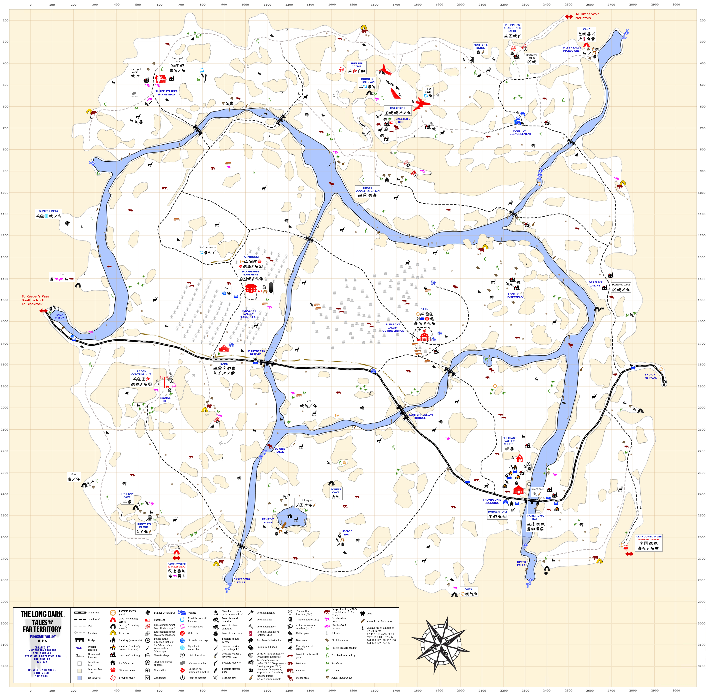

_A detailed map of Pleasant Valley v2.35 (spoilers)_

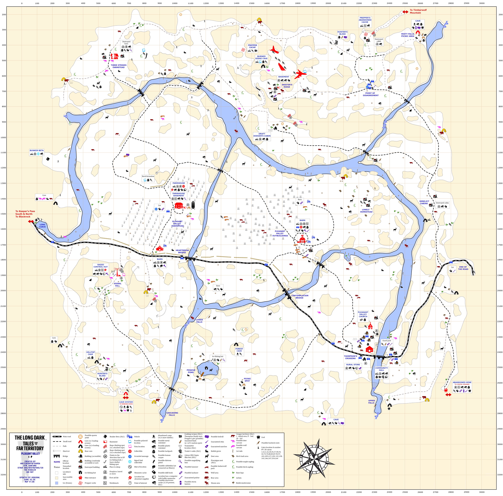

_A detailed map of Pleasant Valley v2.35 (Loper/Misery edition, spoilers)_

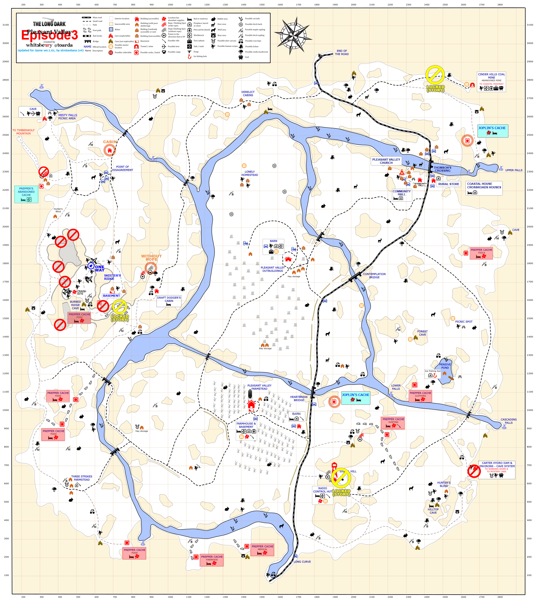

_1901570789\_preview\_Map-PleasantValley-EP3-spoil-Fixv162-05.png_

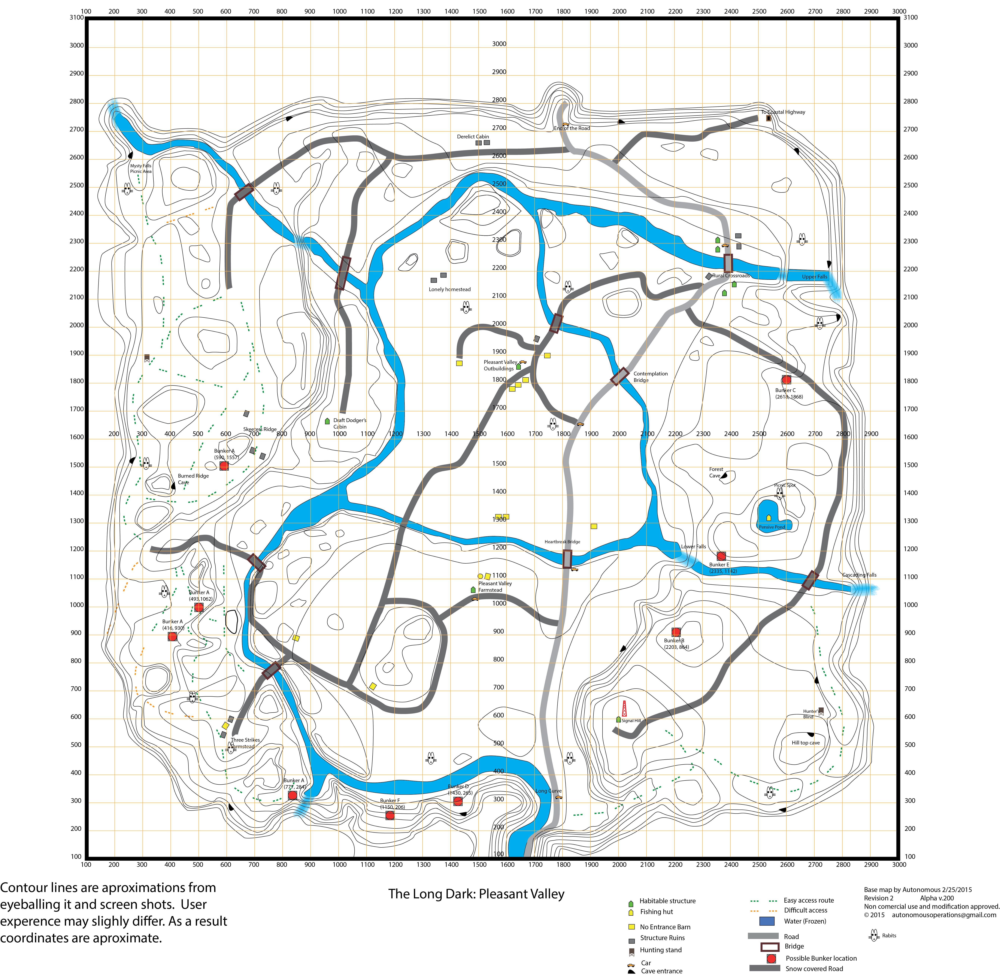

_Pleasant\_Valley\_map\_by\_Sniper\_Bob.jpg_

_Map-PleasantValley-SV-spoil-Fixv169.png_

_Pleasant\_valley\_map.png_

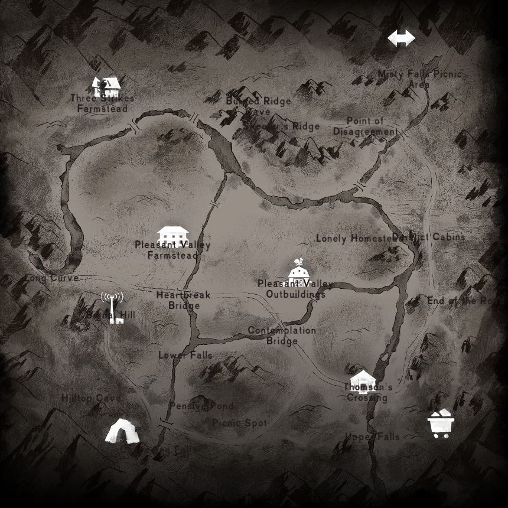

_MAP-ingame-PV-v160-Eng.jpg_

### Locations

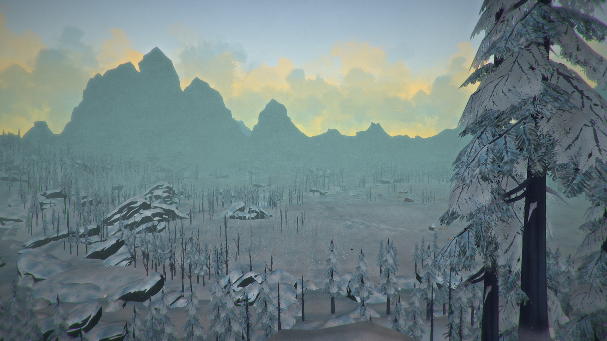

_A view showing the expansive Pleasant Valley. [Pleasant Valley outbuildings](./Pleasant%20Valley%20Outbuildings.md) can be seen in the distance._

_A snow-covered Tractor found commonly near the farms_

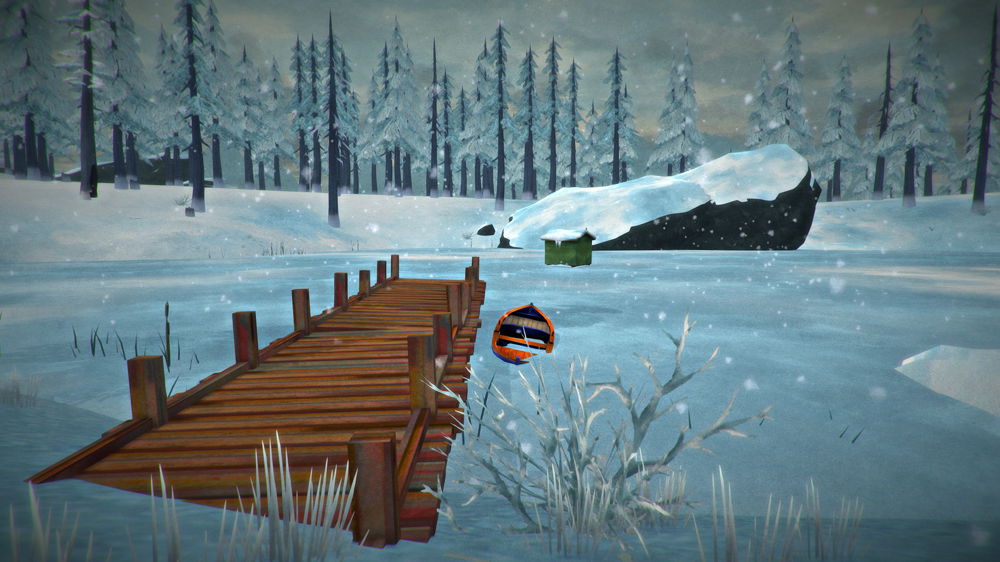

_Pensive\_Pond.jpg_

_Picnic\_Spot.jpg_

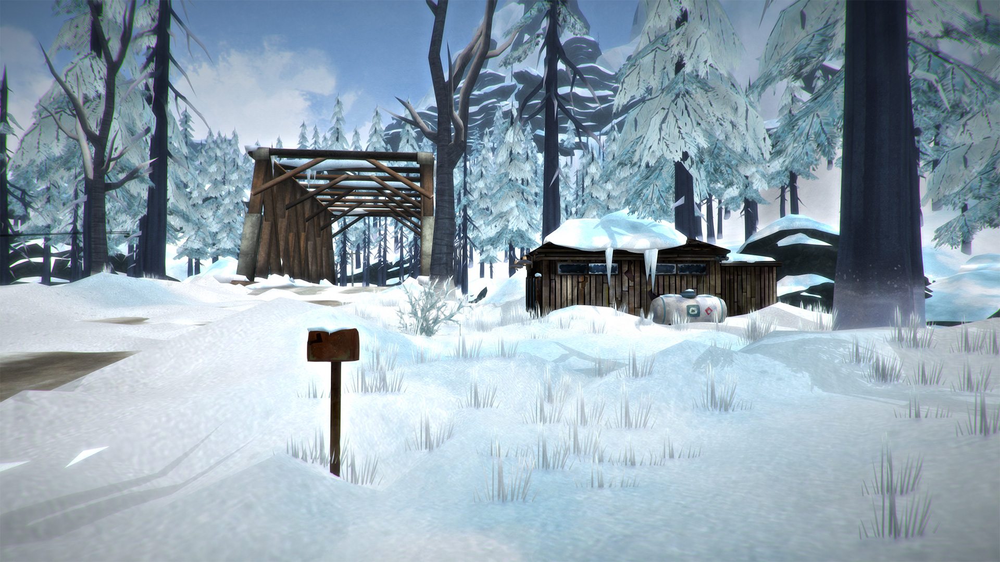

_Rural\_Crossroads.jpg_

_Cascading\_Falls.jpg_

_Lower\_Falls.jpg_

_Skeeter's\_Ridge.jpg_

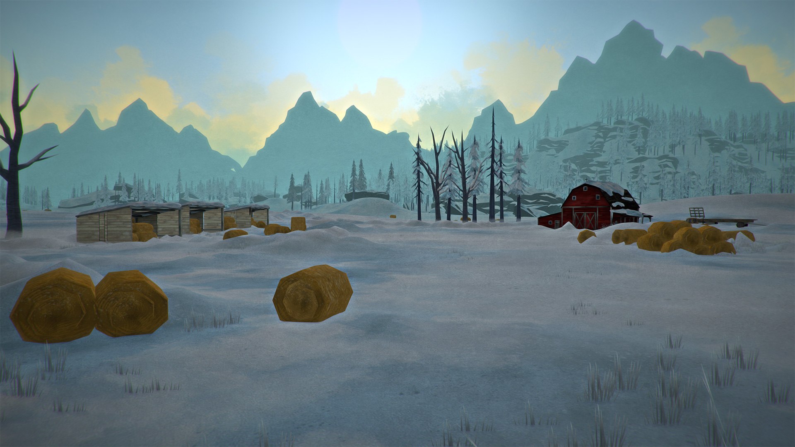

_Pleasant\_Valley\_Outbuildings.jpg_

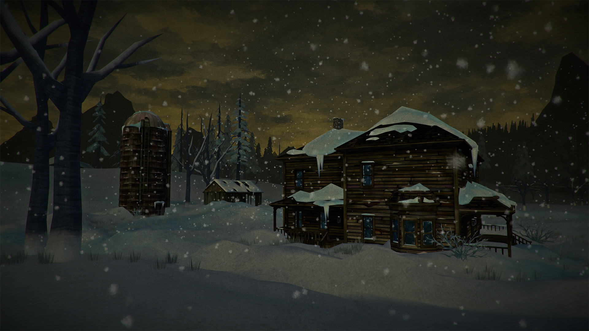

_Pleasant\_Valley\_Farmstead.jpg_

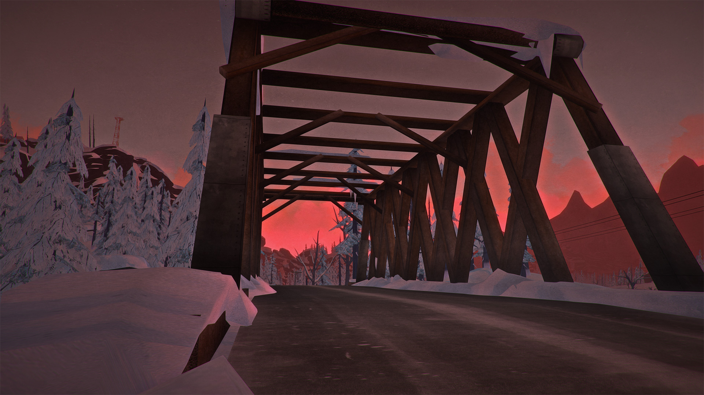

_Heartbreak\_Bridge.jpg_

_Contemplation\_Bridge.jpg_

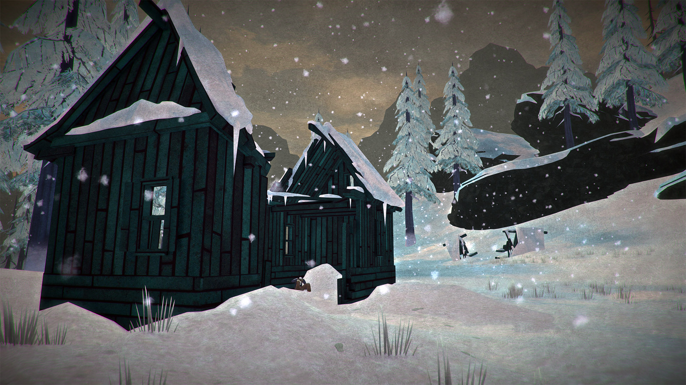

_Derelict\_Cabins.jpg_

_End\_of\_the\_Road.jpg_

_Draft\_Dodger's\_Cabin.jpg_

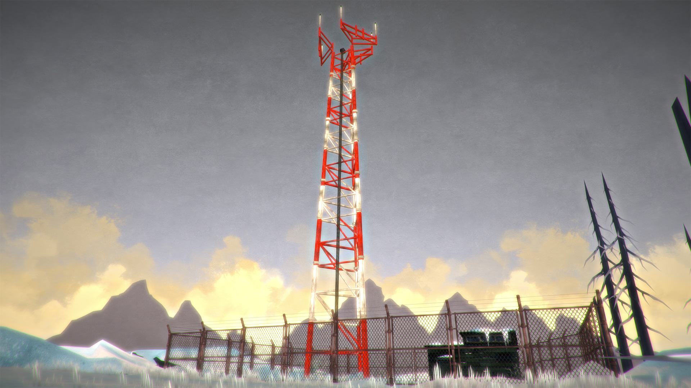

_Signal\_Hill.jpg_
