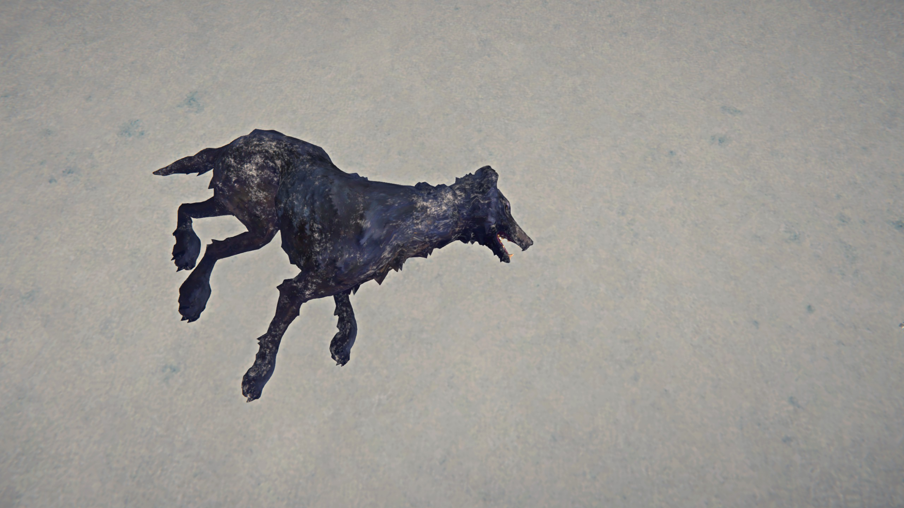
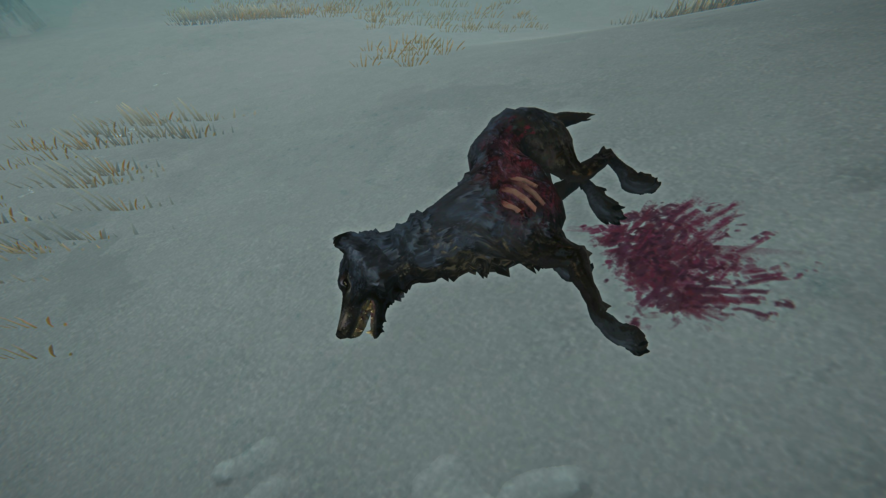

# Poisoned Wolf Carcass

**Categories:** Interactable Objects, Story items · **Source:** [Fandom](https://thelongdark.fandom.com/wiki/Poisoned_Wolf_Carcass)

**Poisoned Wolf Carcass**

[No picture](../assets/No_picture.png)

**General**

**Item Type:** Item

**Wintermute:** Yes A **Poisoned Wolf Carcass** is a harvestable "object" found after [Hunting](./Hunting.md) a [Poisoned Wolf](./Poisoned%20Wolf.md), a creature unique to the [Zone of Contamination](./Zone%20of%20Contamination.md). [Crows](./Crow.md) will fly around a Poisoned Wolf Carcass and always drop 3 [Crow Feathers](./Crow%20Feather.md) around the carcass at a time.

## Drops

Killing a Poisoned Wolf will drop a Fresh Wolf Pelt and 2 Fresh Guts, but due to the extreme malnourishment and contaminated meat of the animal, no harvestable Wolf Meat is present on a carcass.

|  | Item | Quantity | Rarity |
| --- | --- | --- | --- |
| [Wolf Meat (Raw) icon](../assets/Wolf_Meat_%28Raw%29_icon.png) | [Wolf Meat (Raw)](./Wolf%20Meat%20%28Raw%29.md) | 0 | Always[¹](#fn1) |
| [Wolf Quarter icon](../assets/Wolf_Quarter_icon.png) | [Wolf Quarter](./Wolf%20Quarter.md) | 0 | Always[²](#fn2) |
| [Fresh Wolf Pelt icon](../assets/Fresh_Wolf_Pelt_icon.png) | [Fresh Wolf Pelt](./Fresh%20Wolf%20Pelt.md) | 1 | Always |
| [Missing image: Gut\_icon.png] _Gut\_icon.png_ | [Fresh Gut](./Fresh%20Gut.md) | 2 | Always |

## Preplaced Locations

Poisoned Wolf Carcasses are never found preplaced anywhere inside the Zone of Contamination, and thus require a player to hunt a Poisoned Wolf.

## Gallery

## Notes

---

1. If carcass is harvested[↩︎](#fnref1)
2. If carcass is quartered.[↩︎](#fnref2)
