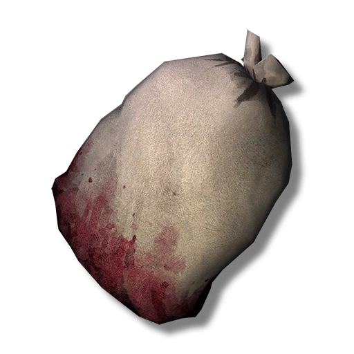

# Poisoned Wolf Carcass

<table class="infobox">
<caption>Poisoned Wolf Carcass</caption>
<colgroup>
<col style="width: 50%" />
<col style="width: 50%" />
</colgroup>
<tbody>
<tr>
<td colspan="2"><figure>

<figcaption>No_picture.png</figcaption>
</figure></td>
</tr>
<tr>
<td colspan="2" class="section">
<strong>General</strong>
</td>
</tr>
<tr>
<td>
Item Type
</td>
<td>
Item
</td>
</tr>
<tr>
<td>
Wintermute
</td>
<td>
Yes|} A <strong>Poisoned Wolf Carcass</strong> is a harvestable "object" found after <a href="./Hunting.md" class="wikilink" title="Hunting">Hunting</a> a <a href="./Poisoned%20Wolf.md" class="wikilink" title="Poisoned Wolf">Poisoned Wolf</a>, a creature unique to the <a href="./Zone%20of%20Contamination.md" class="wikilink" title="Zone of Contamination">Zone of Contamination</a>. <a href="./Crow.md" class="wikilink" title="Crows">Crows</a> will fly around a Poisoned Wolf Carcass and always drop 3 <a href="./Crow%20Feather.md" class="wikilink" title="Crow Feathers">Crow Feathers</a> around the carcass at a time.

<h2 id="Drops">Drops</h2>

Killing a Poisoned Wolf will drop a Fresh Wolf Pelt and 2 Fresh Guts, but due to the extreme malnourishment and contaminated meat of the animal, no harvestable Wolf Meat is present on a carcass.

<table>
<colgroup>
<col style="width: 25%" />
<col style="width: 25%" />
<col style="width: 25%" />
<col style="width: 25%" />
</colgroup>
<thead>
<tr>
<th></th>
<th>
Item
</th>
<th>
Quantity
</th>
<th>
Rarity
</th>
</tr>
</thead>
<tbody>
<tr>
<td><figure>

<figcaption>Wolf_Meat_(Raw)_icon.png</figcaption>
</figure></td>
<td>
<a href="./Wolf%20Meat%20%28Raw%29.md" class="wikilink" title="Wolf Meat (Raw)">Wolf Meat (Raw)</a>
</td>
<td>
0
</td>
<td>
Always<a href="#fn1" class="footnote-ref" id="fnref1" role="doc-noteref">1</a>
</td>
</tr>
<tr>
<td><figure>

<figcaption>Wolf_Quarter_icon.png</figcaption>
</figure></td>
<td>
<a href="./Wolf%20Quarter.md" class="wikilink" title="Wolf Quarter">Wolf Quarter</a>
</td>
<td>
0
</td>
<td>
Always<a href="#fn2" class="footnote-ref" id="fnref2" role="doc-noteref">2</a>
</td>
</tr>
<tr>
<td><figure>

<figcaption>Fresh_Wolf_Pelt_icon.png</figcaption>
</figure></td>
<td>
<a href="./Fresh%20Wolf%20Pelt.md" class="wikilink" title="Fresh Wolf Pelt">Fresh Wolf Pelt</a>
</td>
<td>
1
</td>
<td>
Always
</td>
</tr>
<tr>
<td><figure>
[Missing image: Gut_icon.png]
<figcaption>Gut_icon.png</figcaption>
</figure></td>
<td>
<a href="./Fresh%20Gut.md" class="wikilink" title="Fresh Gut">Fresh Gut</a>
</td>
<td>
2
</td>
<td>
Always
</td>
</tr>
<tr>
<td></td>
<td></td>
<td></td>
<td></td>
</tr>
</tbody>
</table>
<h2 id="Preplaced_Locations">Preplaced Locations</h2>

Poisoned Wolf Carcasses are never found preplaced anywhere inside the Zone of Contamination, and thus require a player to hunt a Poisoned Wolf.

<h2 id="Gallery">Gallery</h2>
<table class="gallery">
<colgroup>
<col style="width: 50%" />
<col style="width: 50%" />
</colgroup>
<tbody>
<tr>
<th><figure>
[Missing image: Poisoned_Wolf_Carcass_Snow.jpg]
<figcaption>A normal Poisoned Wolf Carcass</figcaption>
</figure></th>
<td><figure>
[Missing image: Ravaged_Poisoned_Wolf_Carcass.jpg]
<figcaption>Harvested Carcass</figcaption>
</figure></td>
</tr>
</tbody>
</table>

<strong>Lua execution error in Module:Navbox function navbox</strong> <a href="ru:%D0%A2%D1%83%D1%88%D0%B0_%D0%BE%D1%82%D1%80%D0%B0%D0%B2%D0%BB%D0%B5%D0%BD%D0%BD%D0%BE%D0%B3%D0%BE_%D0%B2%D0%BE%D0%BB%D0%BA%D0%B0" class="wikilink" title="ru:Туша отравленного волка">ru:Туша отравленного волка</a>
</td>
</tr>
</tbody>
</table>
<section id="footnotes" class="footnotes footnotes-end-of-document" role="doc-endnotes">

<ol>
<li id="fn1">If carcass is harvested<a href="#fnref1" class="footnote-back" role="doc-backlink">↩︎</a></li>
<li id="fn2">If carcass is quartered.<a href="#fnref2" class="footnote-back" role="doc-backlink">↩︎</a></li>
</ol>
</section>

## Notes

