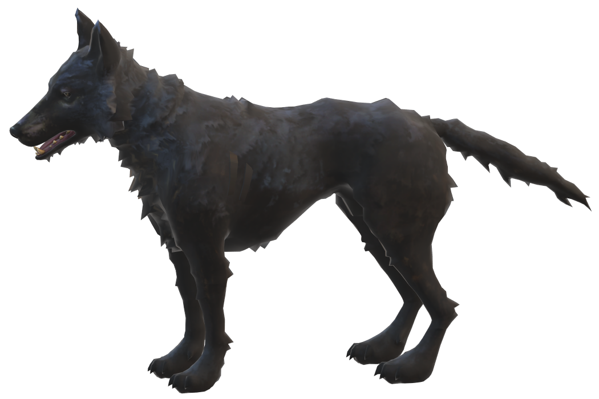
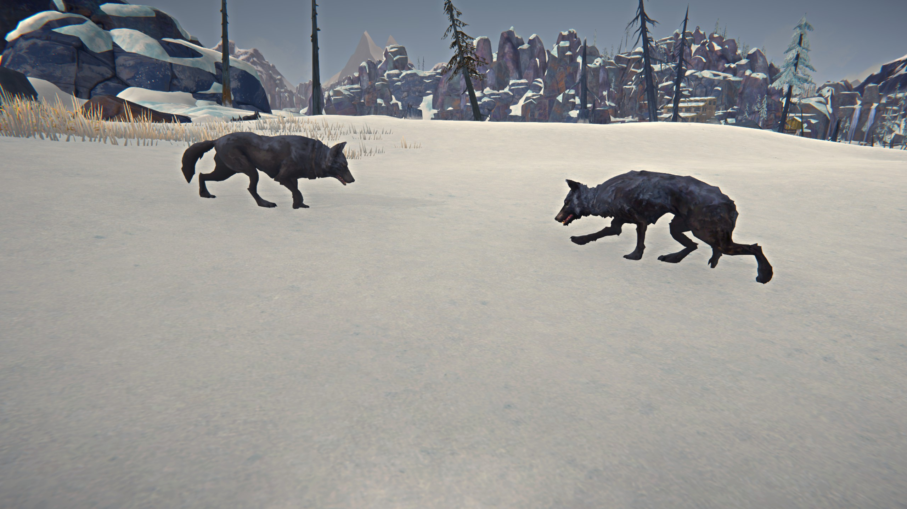
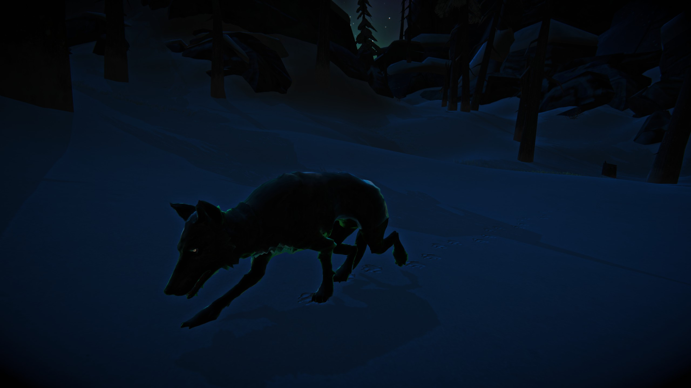
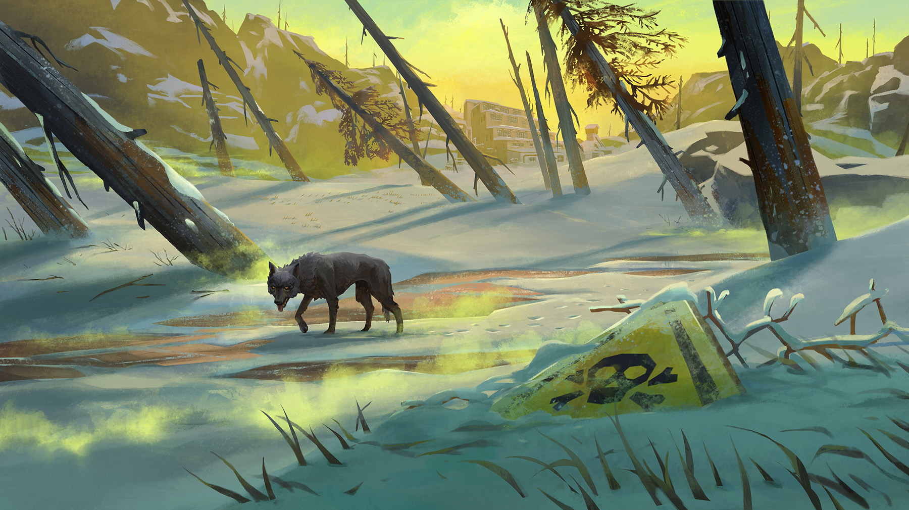
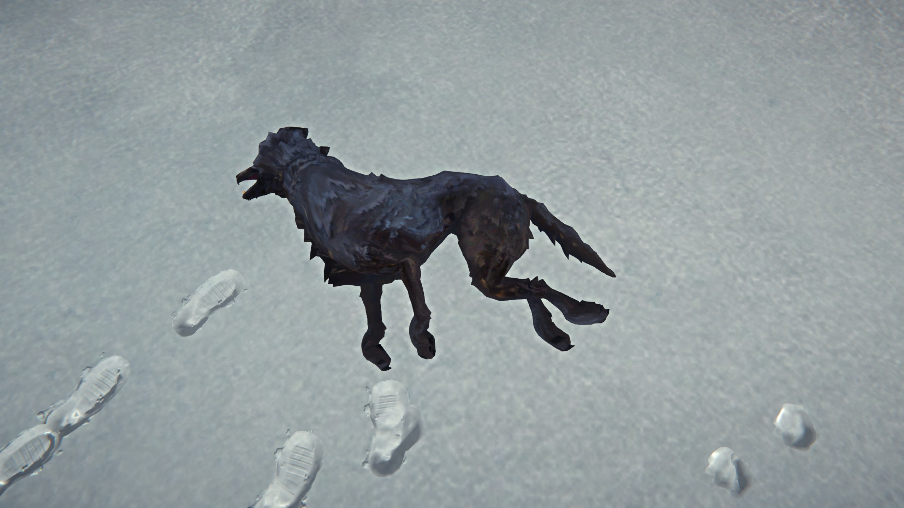
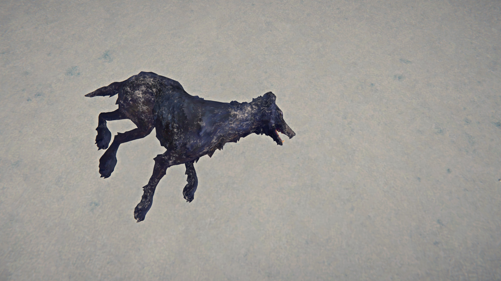
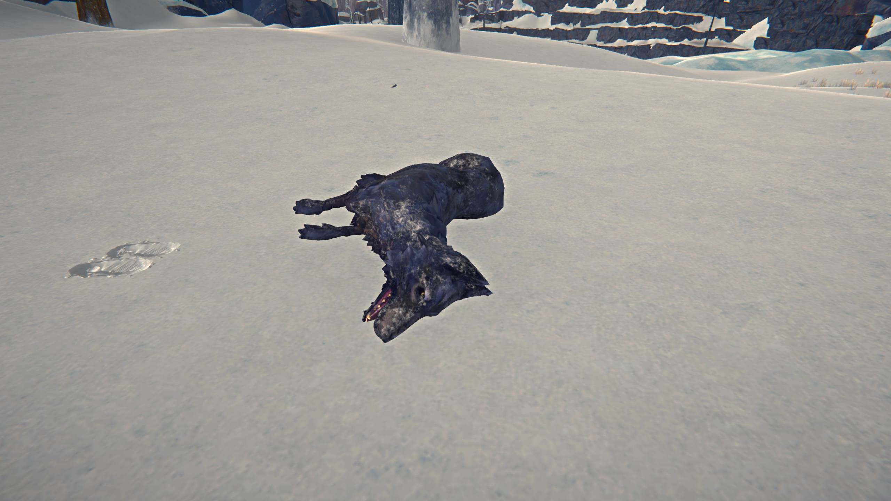
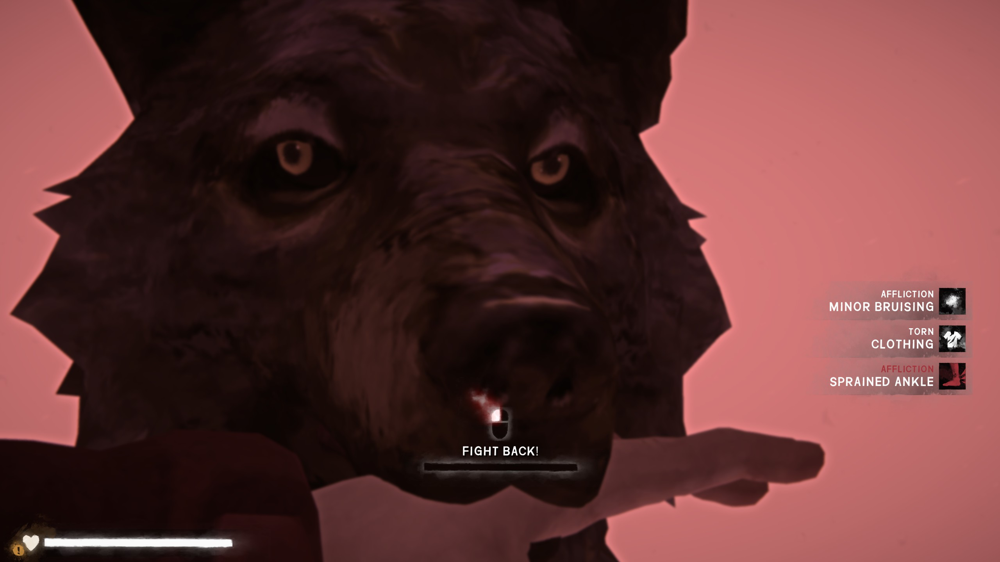

# Poisoned Wolf

**Contents**

- [Overview](#overview)
- [Drops](#drops)
- [Behaviour](#behaviour)
- [Aurora Poisoned Wolf](#aurora-poisoned-wolf)
- [Trivia](#trivia)
- [Gallery](#gallery)

**Poisoned Wolf**

| Property | Details |
| --- | --- |
|  |  / *Poisoned\_Wolf.png* |
| **Basic Information** |  |
| Release | [5 December 2023](./The%20Long%20Dark%20%E2%80%94%20Changelog.md#2.25) |
| Role | Predator |
| **Physical Information** |  |
| Color | Black |
| Size | Medium |

| Column 1 | Column 2 | Column 3 | Column 4 | Column 5 | Column 6 |
| --- | --- | --- | --- | --- | --- |
|  / *Ptarmigan\_icon.png* | **DLC-Exclusive content.** / This content requires the [Tales from the Far Territory](./Tales%20from%20the%20Far%20Territory.md) addon to be installed before it can be seen or used in regular gameplay. | \|}{\| style="margin:auto" | “ | **This mine is a graveyard. Maybe my own too, if I’m not careful. The wolves here are unwell. All this pollution in the ground. Awful.** / [A Page From A Journal](./A%20Page%20From%20A%20Journal.md) | ” |

The **Poisoned Wolf** is a variant of the [Wolf](./Wolf.md) found only in the [Zone of Contamination](./Zone%20of%20Contamination.md). They were introduced in the Part 4 Buried Echoes update for players that purchase the [Tales from the Far Territory](./Tales%20from%20the%20Far%20Territory.md) addon.

## Overview

Suffering from extreme malnutrition from a lack of hunting opportunities owed to the intense pollution present within the Zone, Poisoned Wolves are more ragged in appearance compared to regular Wolves. Their fur is much more messy and matted and their bodies are much more lean in appearance due to a lack of stored body fat. Some of the [Chemicals](./Chemical%20Hazard.md) from the Zone can also be seen around their faces and necks when viewed up close, which are transmitted to the player should they attack them in a Struggle.

They are easily identifiable from a distance due to how they carry their heads much lower to the ground than a regular, healthy Wolf. They are also the only Wolf variant inside the Zone of Contamination. *A Wolf (left) and Poisoned Wolf. Notice the weakened stance of the Poisoned Wolf.*

## Drops

A [Poisoned Wolf Carcass](./Poisoned%20Wolf%20Carcass.md) will drop a Wolf Pelt and 2 Fresh Guts, but due to the extreme malnourishment and contaminated meat of the animal, no harvestable Wolf Meat is present on a carcass.

|  | Item | Quantity | Rarity |
| --- | --- | --- | --- |
|  / *Wolf\_Meat\_(Raw)\_icon.png* | [Wolf Meat (Raw)](./Wolf%20Meat%20%28Raw%29.md) | 0.00 kg | Always[¹](#fn1) |
|  / *Wolf\_Quarter\_icon.png* | [Wolf Quarter](./Wolf%20Quarter.md) | 0.00 kg | Always[²](#fn2) |
|  / *Fresh\_Wolf\_Pelt\_icon.png* | [Fresh Wolf Pelt](./Fresh%20Wolf%20Pelt.md) | 1 | Always |
| \[Missing image: Gut\_icon.png\] / *Gut\_icon.png* | [Fresh Gut](./Fresh%20Gut.md) | 2 | Always |

## Behaviour

Poisoned Wolves behave mechanically the same to that of regular Wolves, forming small packs, barking, growling, and stalking any prey they manage to find, aside from a few key differences:

- Unlike regular Wolves, Poisoned Wolves seem to have a keener sense of smell and awareness of their surroundings due to intense starvation, resulting in them spotting and smelling prey from further distances than normal Wolves would.
- Confrontations are far more shambolic when they are aware of a player:
  - They do not show as much fear to lit [Torches](./Torch.md) or [Flares](./Flare.md). This makes it impossible to simply outwalk Poisoned Wolves without consequence in some cases.
  - After scaring a Poisoned Wolf into fleeing, there is a 50% chance that they will continue fleeing or turn back around and begin stalking/attacking the player again.
  - If they do flee from the player, Poisoned Wolves only flee a quarter the distance that normal Wolves do, and most often turn straight back around and begin stalking the player again due to their close proximity.
- Poisoned Wolves will refuse to willingly enter contaminated [Chemical Hazard](./Chemical%20Hazard.md) areas in order to attack the player or any prey animal, despite already being contaminated themselves.
  - Poisoned Wolves will stand their ground and growl at the player if they remain in the Hazard, and will eventually run away in fear.
  - If the player enters and exits a Chemical Hazard while still being stalked, there is a chance that the Poisoned Wolf will charge the player unprovoked. The odds of this happening increase the higher the player's [Scent](./Scent.md) value is. A unique running animation will play when this happens, with the Wolf's ears pinned back as they charge (this animation will be different from a normal provoked charge).
- Poisoned Wolves have less health, due to their emaciated condition reducing their overall constitution.
  - 1 good Hunting Rifle/Revolver/Survival Bow shot to the head or body is all that it takes to kill a Poisoned Wolf, showing how much weaker they are than normal wolves.
- Being attacked in a [Struggle](./Struggle.md) by a Poisoned Wolf slowly builds up [Chemical Poisoning Risk](./Chemical%20Poisoning%20Risk.md) upon the player, and can result in an Affliction if the player's Poisoning levels are already too high.
  - A bite that results in [Blood Loss](./Blood%20Loss.md) results in an immediate 20% addition to the Chemical Poisoning Risk bar.
- A [Poisoned Wolf Carcass](./Poisoned%20Wolf%20Carcass.md) has no harvestable meat.

*An Aurora Poisoned Wolf*

### Aurora Poisoned Wolf

Like all predators, Poisoned Wolves glow green and become a more aggressive Aurora Predator when the [Aurora](./Aurora.md) is active. [Campfires](./Campfire.md) and a working [Flashlight](./Flashlight.md) will still force a Poisoned Wolf to keep its distance from a player.

- They have slightly more health than normal, but still die fairly easily (Revolvers no longer one shot them to the head/body).
- Aurora Poisoned Wolves do not fear [Flares](./Flare.md), [Marine Flares](./Marine%20Flare.md), or lit [Torches](./Torch.md).
- They fear active street lights, and will stand and growl at the player if they pass near the boundary of one. After enough time, they will run away in fear if they cannot reach the player.
- They will also charge the survivor at longer distances.
- Aurora Poisoned Wolves will still refuse to willingly enter Contaminated [Chemical Hazard](./Chemical%20Hazard.md) areas in order to attack the player or any prey animal.
- They fear [Flashlight](./Flashlight.md) high beams and will temporarily stop a charge as long as they are on.
- They will stay away from lit [Campfires](./Campfire.md), but will still stay close by to stalk the player.
- Gunshots are still effective at frightening aurora wolves, provided they are not charging.

## Trivia

- Despite the Zone of Contamination containing only Poisoned Wolves, several ordinary [Ravaged Wolf Carcasses](./Wolf%20Carcass.md) can be found in the Zone, with edible meat that can be harvested on the body.

## Gallery

| Column 1 | Column 2 | Column 3 | Column 4 |
| --- | --- | --- | --- |
|  / *Concept art of a Poisoned Wolf in the Zone* |  / *The carcass of a Poisoned Wolf* |  / *A carcass that has been in the snow for some time* |  / *ditto.* |
|  / *A Poisoned Wolf Struggle* |  |  |  |

**Lua execution error in Module:Navbox function navbox** [ru:Отравленный волк](ru:%D0%9E%D1%82%D1%80%D0%B0%D0%B2%D0%BB%D0%B5%D0%BD%D0%BD%D1%8B%D0%B9_%D0%B2%D0%BE%D0%BB%D0%BA)

## Notes

---

1. If carcass is harvested[↩︎](#fnref1)
2. If carcass is quartered.[↩︎](#fnref2)
