# Polaroids

**Contents**

- [Vista Polaroids](#Vista_Polaroids)
- [Tales Polaroids](#Tales_Polaroids)
- [Examine Text](#Examine_Text)
- [Gallery](#Gallery)
- [References](#References)

\[Missing image: Hqdefault.jpg\] Polaroids are collectible items that were added in the [Fearless Navigator](https://hinterlandforums.com/forums/topic/36987-the-long-dark-updated-fearless-navigator-176/) update. They are polaroid photographs with an inscription on the back informing the player which region each Polaroid belongs to. They are most commonly found on bodies or in backpacks of past survivors.

Polaroids are purely used for surveying. After collecting a Polaroid, an icon will appear on the player's map to show where the Vista the Polaroid corresponds to is located. If the player stands at the Vista location shown in the Polaroid and surveys the location with <a href="./Charcoal.md" class="wikilink" title="Charcoal">Charcoal</a> (provided that the weather is clear), a large area of the <a href="./Map.md" class="wikilink" title="Map">Map</a> will be revealed.

\- Note that the only regions without Polaroids are <a href="./Broken%20Railroad.md" class="wikilink" title="Broken Railroad">Broken Railroad</a>, <a href="./Desolation%20Point.md" class="wikilink" title="Desolation Point">Desolation Point</a>, <a href="./Transfer%20Pass.md" class="wikilink" title="Transfer Pass">Transfer Pass</a>, and <a href="./Region.md#Transition_Zones" class="wikilink" title="Transition Regions">Transition Regions</a>, likely due to their small sizes. There are a total of 27 Polaroids:

- Vista Polaroid: Some regions (Some have 2 Polaroids, instead of 1).
- Tales Polaroids: Some are part of <a href="./Tales.md" class="wikilink" title="Tales">Tales</a> progression Collectibles.

## **Vista** **Polaroids**

There are currently a total of 21 Vista Polaroids. In many regions, the locations of where you find the vista polaroids are linked to which <a href="./Loot%20Table.md" class="wikilink" title="Loot Table">Loot Table</a> your game is on. So if you find a polaroid linked to Loot Table 4 (e.g. the polaroid at the end of <a href="./Secret%20Mountain%20Path.md" class="wikilink" title="Secret Mountain Path">Secret Mountain Path</a>), you will find polaroids in other regions in their Loot Table 4 spawn positions.

<table>
<colgroup>
<col style="width: 25%" />
<col style="width: 25%" />
<col style="width: 25%" />
<col style="width: 25%" />
</colgroup>
<thead>
<tr>
<th>
Polaroid
</th>
<th>
Region
</th>
<th>
Locations
</th>
<th>
Vista
</th>
</tr>
</thead>
<tbody>
<tr>
<td>
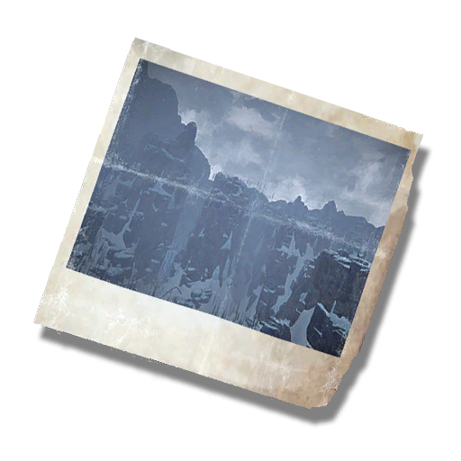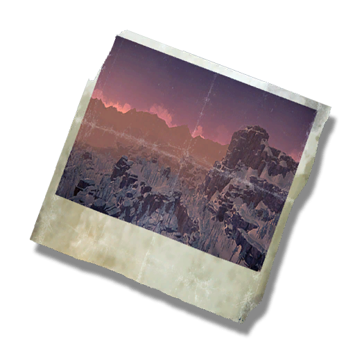
</td>
<td>
Ash Canyon
</td>
<td>
 
*<em>Loot Table 1</em>: In a Plastic Container south of <a href="./Miner%27s%20Folly.md" class="wikilink" title="Miner&#39;s Folly">Miner's Folly</a> and east of <a href="./Foreman%27s%20Retreat.md" class="wikilink" title="Foreman&#39;s Retreat">Foreman's Retreat</a>, in an open ended cave with a pine bed.

<ul>
<li><em>Loot Table 1</em>: In Trunk at the southern edge of the map, right in the middle. To get there you need to jump down from the plateau on the way to the <a href="./Prepper%20Cache.md" class="wikilink" title="Prepper Cache">Prepper Cache</a>.</li>
<li><em>Loot Table 2</em>: In a Plastic Container south of <a href="./Stone%20Shelf%20Cave.md" class="wikilink" title="Stone Shelf Cave">Stone Shelf Cave</a>, across a fallen tree bridge on the western side of the map.</li>
<li><em>Loot Table 2</em>: In a Plastic Container northwest of <a href="./Fire%20Overlook.md" class="wikilink" title="Fire Overlook">Fire Overlook</a>, in the dead-end behind the birch saplings.</li>
<li><em>Loot Table 3</em>: West of Shattered Cove, after heading down a one-way drop, just before a log bridge a metal container containing a polaroid may spawn.</li>
<li><em>Loot Table 3</em>: In a Plastic Container north of Wolf's Jaw Overlook, where the path takes a sharp turn west, next to the wooden sign.</li>
<li><em>Loot Table 4</em>: In a Hidden Cache located next to the rope rock holding first of three ropes leading up to the Gold Mine, in the northwest part of the map.</li>
<li><em>Loot Table 4</em>: In a Metal Container where you head north along the mountain wall from the <a href="./Climber%27s%20Cave.md" class="wikilink" title="Climber&#39;s Cave">Climber's Cave</a> and hit a cliff. Under the cliff is the area where the Angler's Den is located.</li>
</ul></td>
<td>
<a href="./High%20Meadow.md" class="wikilink" title="High Meadow">High Meadow</a>, <a href="./Wolf%27s%20Jaw%20Overlook.md" class="wikilink" title="Wolf&#39;s Jaw Overlook">Wolf's Jaw Overlook</a>
</td>
</tr>
<tr>
<td>
[Missing image: BR_Polaroid2.png][Missing image: BR_Polaroid_1.png]
</td>
<td>
Blackrock
</td>
<td><ul>
<li>Attached to the large sign just outside of the Blackrock Penitentiary entrance.</li>
<li>Inside the <a href="./Whistling%20Perch.md" class="wikilink" title="Whistling Perch">Whistling Perch</a> hunter's blind</li>
</ul></td>
<td>
Ledge overlooking the ravine on the path to <a href="./Last%20Prospect.md" class="wikilink" title="Last Prospect Mine">Last Prospect Mine</a>,

Pylon southeast of the <a href="./Blackrock%20Prison.md" class="wikilink" title="Prison">Prison</a>
</td>
</tr>
<tr>
<td><figure>
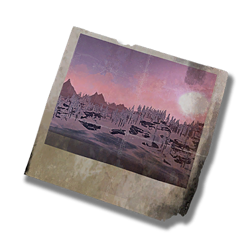
<figcaption>Ico_GearItem_PostCard_BI_EchoOne_RadioTower-resources.assets-381.png</figcaption>
</figure></td>
<td>
Bleak Inlet
</td>
<td><ul>
<li><em>Loot Table 1</em>: In a green box hidden amongst scrub brushes surrounded by large rocks, east of the rope climb.</li>
<li><em>Loot Table 2</em>: In the southwestern Hunter's Blind, west of <a href="./Washed%20Out%20Trailers.md" class="wikilink" title="Washed Out Trailers">Washed Out Trailers</a>.</li>
<li><em>Loot Table 3</em>: Plastic container, rear base of island with Fallen Lighthouse.</li>
<li><em>Loot Table 4</em>: At the end of the <a href="./Secret%20Mountain%20Path.md" class="wikilink" title="Secret Mountain Path">Secret Mountain Path</a>.</li>
</ul></td>
<td>
<a href="./Echo%20One%20Radio%20Tower.md" class="wikilink" title="Echo One Radio Tower">Echo One Radio Tower</a>
</td>
</tr>
<tr>
<td><figure>
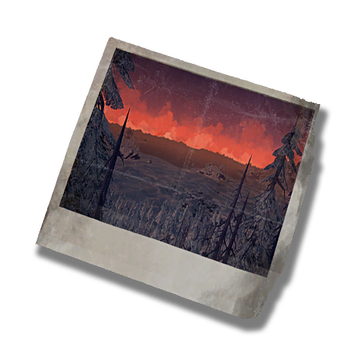
<figcaption>Ico_GearItem_PostCard_CR_AbandonedLookout-resources.assets-734.png</figcaption>
</figure></td>
<td>
Coastal Highway
</td>
<td><ul>
<li><em>Loot Table 1</em>: On a body next to a fallen tree north of <a href="./Fishing%20Camp.md" class="wikilink" title="Fishing Camp">Fishing Camp</a></li>
<li><em>Loot Table 2</em>: In a backpack near the cabin northwest of <a href="./The%20Tooth.md" class="wikilink" title="The Tooth">The Tooth</a></li>
<li><em>Loot Table 3</em>: In a backpack between <a href="./Misanthrope%27s%20Homestead.md" class="wikilink" title="Misanthrope&#39;s Homestead">Misanthrope's Homestead</a> and <a href="./Jackrabbit%20Island.md" class="wikilink" title="Jackrabbit Island">Jackrabbit Island</a></li>
<li><em>Loot Table 4</em>: In a backpack next to <a href="./The%20Tooth.md" class="wikilink" title="The Tooth">The Tooth</a></li>
</ul></td>
<td>
<a href="./Abandoned%20Lookout.md" class="wikilink" title="Abandoned Lookout">Abandoned Lookout</a>
</td>
</tr>
<tr>
<td>
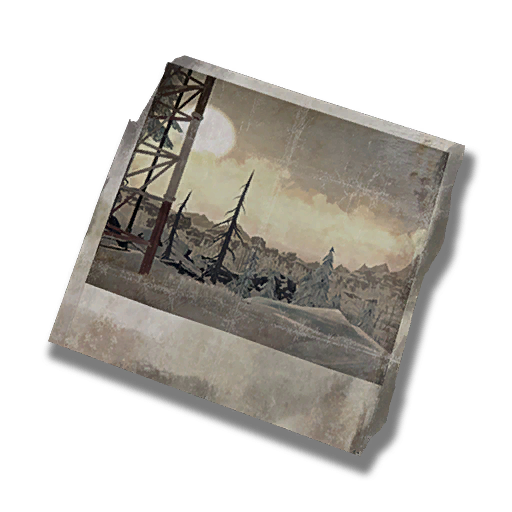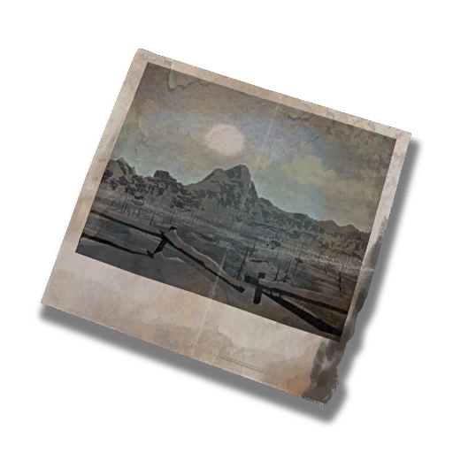
</td>
<td>
Forlorn Muskeg
</td>
<td><ul>
<li><em>Loot Table 1</em>: On a dead body north of <a href="./Old%20Spence%20Family%20Homestead.md" class="wikilink" title="Old Spence Family Homestead">Old Spence Family Homestead</a>, around the storage room with barrel</li>
<li><em>Loot Table 1</em>: In the shallow cave in <a href="./Marsh%20Ridge.md" class="wikilink" title="Marsh Ridge">Marsh Ridge</a></li>
<li><em>Loot Table 2</em>: In the <a href="./Low%20Blind.md" class="wikilink" title="Low Blind">Low Blind</a>, near where the <a href="./Abandoned%20Camp.md" class="wikilink" title="Abandoned Camp">Abandoned Camp</a> sometimes spawns</li>
<li><em>Loot Table 2</em>: In a briefcase near the <a href="./Bunkhouses.md" class="wikilink" title="Bunkhouses">Bunkhouses</a></li>
<li><em>Loot Table 3</em>: At the <a href="./High%20Blind.md" class="wikilink" title="High Blind">High Blind</a></li>
<li><em>Loot Table 3</em>: Plastic container up the hill south of and overlooking <a href="./Old%20Spence%20Family%20Homestead.md" class="wikilink" title="Old Spence Family Homestead">Old Spence Family Homestead</a> (down in a dip, difficult to see unless next to the rocks)</li>
<li><em>Loot Table 4</em>: In Metal Container in a Cave west of <a href="./Old%20Spence%20Family%20Homestead.md" class="wikilink" title="Old Spence Family Homestead">Old Spence Family Homestead</a></li>
<li><em>Loot Table 4</em>: In a Bear Cave south of the <a href="./Broken%20Railroad.md" class="wikilink" title="Broken Railroad">Broken Railroad</a> entrance</li>
</ul></td>
<td>
<a href="./Shortwave%20Tower.md" class="wikilink" title="Shortwave Tower">Shortwave Tower</a>, <a href="./Muskeg%20Overlook.md" class="wikilink" title="Muskeg Overlook">Muskeg Overlook</a>
</td>
</tr>
<tr>
<td>
[Missing image: FA_Polaroid.png]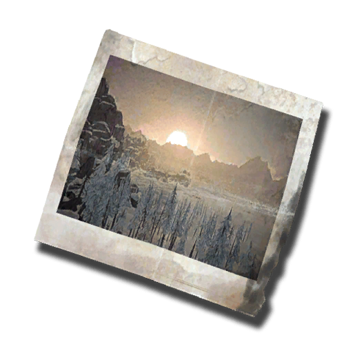
</td>
<td>
Forsaken Airfield
</td>
<td><ul>
<li>On a table in <a href="./Island%20Cottage.md" class="wikilink" title="Island Cottage">Island Cottage</a></li>
<li>In a car's visor near <a href="./Junker%27s%20Paddock.md" class="wikilink" title="Junker&#39;s Paddock">Junker's Paddock</a></li>
</ul></td>
<td>
Cliffside south of <a href="./Field%2031.md" class="wikilink" title="Field 31">Field 31</a>,<a href="./Mindful%20Cabin.md" class="wikilink" title="Mindful Cabin">Mindful Cabin</a>
</td>
</tr>
<tr>
<td><figure>
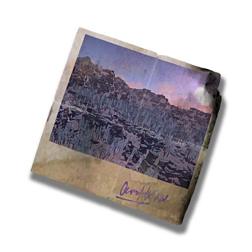
<figcaption>Ico_GearItem_PostCard_RV_Pensive-resources.assets-766.png</figcaption>
</figure></td>
<td>
Hushed River Valley
</td>
<td><ul>
<li><em>Loot Table 1</em>: In a plastic container on a hill between the bear cave and ice cave in the northwest region of the map</li>
<li><em>Loot Table 2</em>: In a metal container near the <a href="./Landslide%20%28Hushed%20River%20Valley%29.md" class="wikilink" title="Landslide">Landslide</a></li>
<li><em>Loot Table 3</em>: In a briefcase on ledge across a fallen tree in southeastern corner of the map, south of southern <a href="./Mysterious%20Signal%20Fire.md" class="wikilink" title="Mysterious Signal Fire">Mysterious Signal Fire</a></li>
<li><em>Loot Table 4</em>: In a plastic container on the <a href="./Valley%20View%20Point.md" class="wikilink" title="Valley View Point">Valley View Point</a> hill</li>
</ul></td>
<td>
<a href="./Pensive%20Vista.md" class="wikilink" title="Pensive Vista">Pensive Vista</a>
</td>
</tr>
<tr>
<td><figure>
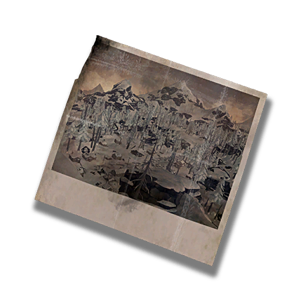
<figcaption>Ico_GearItem_PostCard_MT_RadioTower-resources.assets-689.png</figcaption>
</figure></td>
<td>
Mountain Town
</td>
<td><ul>
<li><em>Loot Table 1</em>: In the car across from the Bear cave east of the <a href="./Spruce%20Falls%20Bridge.md" class="wikilink" title="Spruce Falls Bridge">Spruce Falls Bridge</a></li>
<li><em>Loot Table 2</em>: Next to a backpack at <a href="./Rocky%20Refuge.md" class="wikilink" title="Rocky Refuge">Rocky Refuge</a></li>
<li><em>Loot Table 3</em>: In a backpack next to a body, on a small hill about 100 meters north of the <a href="./Paradise%20Meadows%20Farm.md" class="wikilink" title="Paradise Meadows Farm">Paradise Meadows Farm</a></li>
<li><em>Loot Table 4</em>: In a briefcase by the cave below the <a href="./Mackenzie%27s%20Crashed%20Plane.md" class="wikilink" title="Crashed Plane">Crashed Plane</a></li>
</ul></td>
<td>
<a href="./Radio%20Tower.md" class="wikilink" title="Radio Tower">Radio Tower</a>
</td>
</tr>
<tr>
<td>
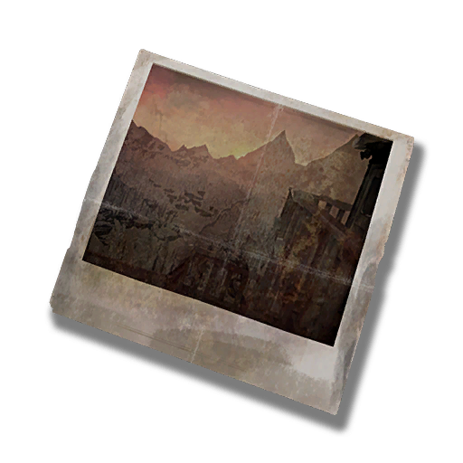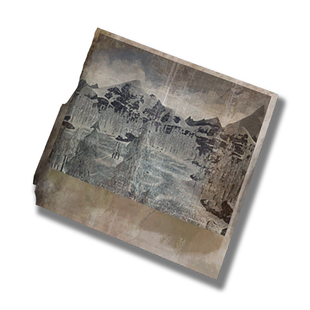 

</td>
<td>
Mystery Lake
</td>
<td><ul>
<li><em>Loot Table 1</em>: On the steps leading up to the <a href="./Destroyed%20Lookout.md" class="wikilink" title="Destroyed Lookout">Destroyed Lookout</a></li>
<li><em>Loot Table 1</em>: In a backpack in the bear's den on <a href="./Mystery%20Lake%20%28disambiguation%29.md" class="wikilink" title="Mystery Lake">Mystery Lake</a> north of the <a href="./Lone%20Lake%20Cabin.md" class="wikilink" title="Lone Lake Cabin">Lone Lake Cabin</a></li>
<li><em>Loot Table 2</em>: In the cave at the plateau with <a href="./Lake%20Overlook.md" class="wikilink" title="Lake Overlook">Lake Overlook</a></li>
<li><em>Loot Table 2</em>: On a body Northwest of <a href="./Clearcut.md" class="wikilink" title="Clearcut">Clearcut</a></li>
<li><em>Loot Table 3</em>: On a body Northeast of <a href="./Logging%20Camp.md" class="wikilink" title="Logging Camp">Logging Camp</a></li>
<li><em>Loot Table 3</em>: On a body north of the isolated cabin south of the <a href="./Clearcut.md" class="wikilink" title="Clearcut">Clearcut</a> and north of the <a href="./Unnamed%20Pond.md" class="wikilink" title="Unnamed Pond">Unnamed Pond</a></li>
<li><em>Loot Table 4</em>: Under the door of the Isolated Cabin north of <a href="./Unnamed%20Pond.md" class="wikilink" title="Unnamed Pond">Unnamed Pond</a></li>
<li><em>Loot Table 4</em>: In a backpack in the cave near the top of the Mystery Lake (Western Access) mountaineering rope</li>
</ul></td>
<td>
<a href="./Forestry%20Lookout.md" class="wikilink" title="Forestry Lookout">Forestry Lookout</a>, <a href="./Lake%20Overlook.md" class="wikilink" title="Lake Overlook">Lake Overlook</a>
</td>
</tr>
<tr>
<td><figure>
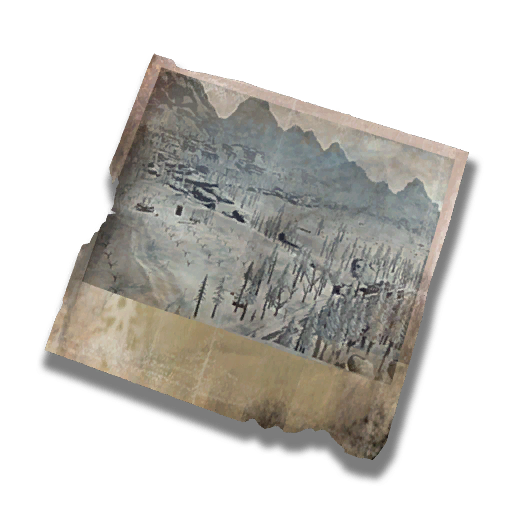
<figcaption>Ico_GearItem_PostCard_PV_SignalHill-resources.assets-935.png</figcaption>
</figure></td>
<td>
Pleasant Valley
</td>
<td><ul>
<li><em>Loot Table 1</em>: In a backpack surrounded by the large rocks near the <a href="./Pleasant%20Valley%20Farmstead.md" class="wikilink" title="Pleasant Valley Farmstead">Pleasant Valley Farmstead</a></li>
<li><em>Loot Table 2</em>: Under a chair in the front section of the plane at the <a href="./Crash%20Site%20%28Pleasant%20Valley%29.md" class="wikilink" title="Crash Site">Crash Site</a></li>
<li><em>Loot Table 3</em>: On a dead body east of <a href="./Three%20Strikes%20Farmstead.md" class="wikilink" title="Three Strikes Farmstead">Three Strikes Farmstead</a></li>
<li><em>Loot Table 4</em>: Next to a backpack In the <a href="./Burned%20Ridge%20Cave.md" class="wikilink" title="Burned Ridge Cave">Burned Ridge Cave</a></li>
</ul></td>
<td>
<a href="./Signal%20Hill.md" class="wikilink" title="Signal Hill">Signal Hill</a>
</td>
</tr>
<tr>
<td>
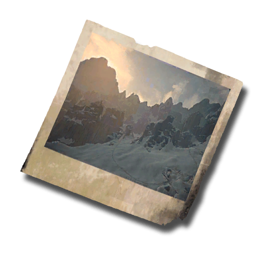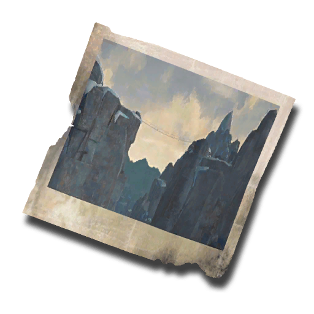
</td>
<td>
Sundered Pass
</td>
<td><ul>
<li>On the bunk/shelf of <a href="./Final%20Refuge.md" class="wikilink" title="Final Refuge">Final Refuge</a></li>
<li><a href="./Cabin%20%28Sundered%20Pass%29.md" class="wikilink" title="Cabin (Sundered Pass)">Cabin (Sundered Pass)</a> at Old Settlement, partially hidden beneath two paintings on the upstairs.</li>
<li><a href="./Cabin%20%28Sundered%20Pass%29.md" class="wikilink" title="Cabin (Sundered Pass)">Cabin (Sundered Pass)</a> at Old Settlement, leaning against a painting on a shelf downstairs.</li>
<li>On a Frozen Corpse close to the ruined <a href="./Basement%20%28Sundered%20Pass%29.md" class="wikilink" title="Basement (Sundered Pass)">Basement (Sundered Pass)</a> building at the Old Settlement</li>
</ul></td>
<td>
Cliff near <a href="./Prayerful%20Window.md" class="wikilink" title="Prayerful Window">Prayerful Window</a> overlooking the <a href="./Old%20Settlement.md" class="wikilink" title="Old Settlement">Old Settlement</a>,

Cliff overlooking <a href="./Perilous%20Crossing.md" class="wikilink" title="Perilous Crossing">Perilous Crossing</a> and <a href="./Ogre%27s%20Teardrop.md" class="wikilink" title="Ogre&#39;s Teardrop">Ogre's Teardrop</a>
</td>
</tr>
<tr>
<td>
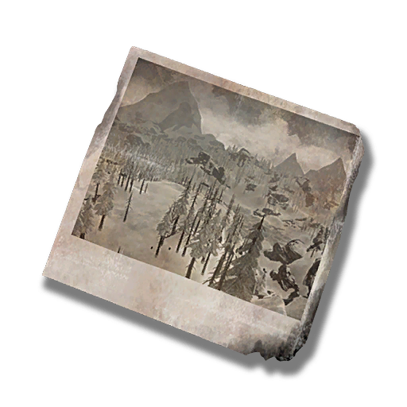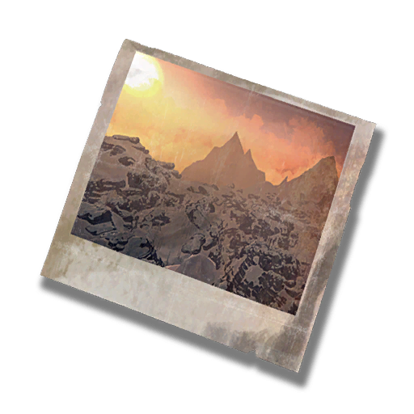 

</td>
<td>
Timberwolf Mountain
</td>
<td><ul>
<li><em>Loot Table 1</em>: In a cave at the <a href="./Summit.md" class="wikilink" title="Summit">Summit</a>, on a frozen corpse or in a plastic container.</li>
<li><em>Loot Table 1</em>: In a backpack on <a href="./Echo%20Peak%20West.md" class="wikilink" title="Echo Peak West">Echo Peak West</a></li>
<li><em>Loot Table 2</em>: On a corpse, South of <a href="./Eric%27s%20Falls.md" class="wikilink" title="Eric&#39;s Falls">Eric's Falls</a> and just North of the falls with no rope</li>
<li><em>Loot Table 2</em>: On a hill north of <a href="./Forest%20Cave%20%28Timberwolf%20Mountain%20location%29.md" class="wikilink" title="Forest Cave">Forest Cave</a>, east of the <a href="./Wing.md" class="wikilink" title="Wing">Wing</a> in a backpack</li>
<li><em>Loot Table 3</em>: In a cave on the eastern edge of the map, to the north across the fallen tree over the transition to <a href="./Ash%20Canyon.md" class="wikilink" title="Ash Canyon">Ash Canyon</a>. Two spawns exist here, one in a briefcase, another in a backpack. (Both polaroids spawn here on this loot table.)</li>
<li><em>Loot Table 4</em>: In a plastic container on <a href="./Andre%27s%20Peak.md" class="wikilink" title="Andre&#39;s Peak">Andre's Peak</a></li>
<li><em>Loot Table 4</em>: In a plastic container on <a href="./Echo%20Peak%20East.md" class="wikilink" title="Echo Peak East">Echo Peak East</a></li>
</ul></td>
<td>
<a href="./Andre%27s%20Peak.md" class="wikilink" title="Andre&#39;s Peak">Andre's Peak</a>, <a href="./Summit.md" class="wikilink" title="Summit">Summit</a>
</td>
</tr>
<tr>
<td>
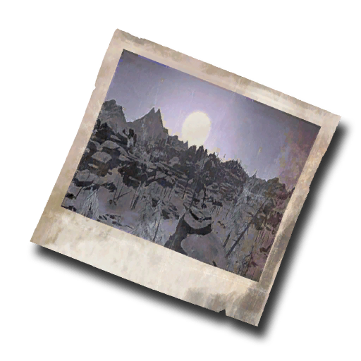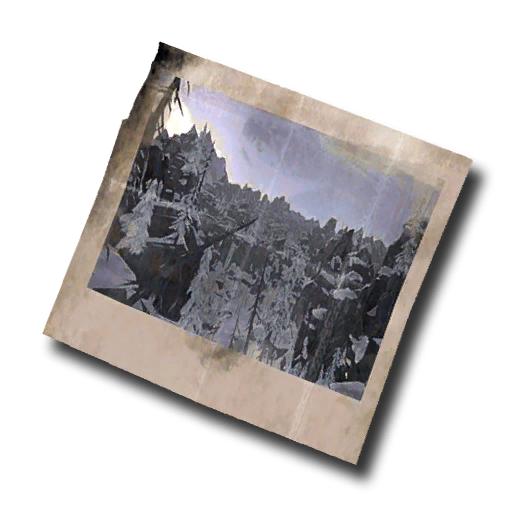
</td>
<td>
Zone of Contamination
</td>
<td><ul>
<li>On the train station office corkboard in <a href="./Indolent%20Hoppers.md" class="wikilink" title="Indolent Hoppers">Indolent Hoppers</a></li>
<li>On the dashboard of an <a href="./Haul%20Truck.md" class="wikilink" title="Haul Truck">Haul Truck</a> parked in the mining pit.</li>
</ul></td>
<td>
Cliff near <a href="./Boss%27s%20Settlement.md" class="wikilink" title="Boss&#39;s Settlement">Boss's Settlement</a>, Cliff near <a href="./Welkin%27s%20Window.md" class="wikilink" title="Welkin&#39;s Window">Welkin's Window</a>
</td>
</tr>
<tr>
<td></td>
<td></td>
<td></td>
<td></td>
</tr>
</tbody>
</table>

## Tales Polaroids

The following items are photos found while progressing the <a href="./Tales.md" class="wikilink" title="Tales">Tales</a> in <a href="./Tales%20from%20the%20Far%20Territory.md" class="wikilink" title="Tales from the Far Territory">Tales from the Far Territory</a>. They do not give a Polaroid Vista but instead are a hint meant to lead the player to a location. They are stored in the Polaroids Collections menu when found.

<table>
<colgroup>
<col style="width: 25%" />
<col style="width: 25%" />
<col style="width: 25%" />
<col style="width: 25%" />
</colgroup>
<thead>
<tr>
<th>
Photo
</th>
<th>
Name
</th>
<th>
Location
</th>
<th>
Leads to
</th>
</tr>
</thead>
<tbody>
<tr>
<td><figure>
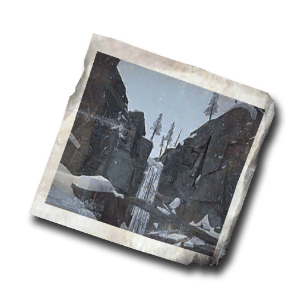
<figcaption>Faded_Photograph_icon.png</figcaption>
</figure></td>
<td>
<a href="./Faded%20Photograph.md" class="wikilink" title="Faded Photograph">Faded Photograph</a>
</td>
<td><ul>
<li>Found inside <a href="./Security%20Chief%27s%20Log%20%28illegible%29.md" class="wikilink" title="Security Chief&#39;s Log (illegible)">Security Chief's Log (illegible)</a></li>
</ul></td>
<td>
Leads to <a href="./Enduring%20Waterfall.md" class="wikilink" title="Enduring Waterfall">Enduring Waterfall</a>
</td>
</tr>
<tr>
<td><figure>

<figcaption>Foreman's_Polaroid_1_icon.png</figcaption>
</figure></td>
<td>
<a href="./Foreman%27s%20Polaroid%201.md" class="wikilink" title="Foreman&#39;s Polaroid 1">Foreman's Polaroid 1</a>
</td>
<td><ul>
<li>Found inside <a href="./Foreman%27s%20Technical%20Log%201.md" class="wikilink" title="Foreman&#39;s Technical Log 1">Foreman's Technical Log 1</a></li>
</ul></td>
<td>
Leads to <a href="./Last%20Lonely%20House.md" class="wikilink" title="Last Lonely House">Last Lonely House</a>
</td>
</tr>
<tr>
<td><figure>

<figcaption>Foreman's_Polaroid_2_icon.png</figcaption>
</figure></td>
<td>
<a href="./Foreman%27s%20Polaroid%202.md" class="wikilink" title="Foreman&#39;s Polaroid 2">Foreman's Polaroid 2</a>
</td>
<td><ul>
<li>Found inside <a href="./Foreman%27s%20Technical%20Log%202.md" class="wikilink" title="Foreman&#39;s Technical Log 2">Foreman's Technical Log 2</a></li>
</ul></td>
<td>
Leads to a ruined building housing <a href="./Basement%20%28Sundered%20Pass%29.md" class="wikilink" title="Basement (Sundered Pass)">Basement (Sundered Pass)</a>
</td>
</tr>
<tr>
<td><figure>

<figcaption>Foreman's_Polaroid_3_icon.png</figcaption>
</figure></td>
<td>
<a href="./Foreman%27s%20Polaroid%203.md" class="wikilink" title="Foreman&#39;s Polaroid 3">Foreman's Polaroid 3</a>
</td>
<td><ul>
<li>Found inside <a href="./Foreman%27s%20Technical%20Log%203.md" class="wikilink" title="Foreman&#39;s Technical Log 3">Foreman's Technical Log 3</a></li>
</ul></td>
<td>
Leads to a closet in <a href="./Bunker%20Omega.md" class="wikilink" title="Bunker Omega">Bunker Omega</a>
</td>
</tr>
<tr>
<td><figure>

<figcaption>Foreman's_Polaroid_4_icon.png</figcaption>
</figure></td>
<td>
<a href="./Foreman%27s%20Polaroid%204.md" class="wikilink" title="Foreman&#39;s Polaroid 4">Foreman's Polaroid 4</a>
</td>
<td><ul>
<li>Found inside <a href="./Foreman%27s%20Technical%20Log%204.md" class="wikilink" title="Foreman&#39;s Technical Log 4">Foreman's Technical Log 4</a></li>
</ul></td>
<td>
Just a Collectible
</td>
</tr>
<tr>
<td><figure>

<figcaption>Foreman's_Polaroid_5_icon.png</figcaption>
</figure></td>
<td>
<a href="./Foreman%27s%20Polaroid%205.md" class="wikilink" title="Foreman&#39;s Polaroid 5">Foreman's Polaroid 5</a>
</td>
<td><ul>
<li>Found inside <a href="./Basement%20%28Sundered%20Pass%29.md" class="wikilink" title="Basement (Sundered Pass)">Basement (Sundered Pass)</a></li>
</ul></td>
<td>
Leads to the stairs near <a href="./Roamer%27s%20Cave.md" class="wikilink" title="Roamer&#39;s Cave">Roamer's Cave</a>
</td>
</tr>
</tbody>
</table>

## Examine Text

<table>
<colgroup>
<col style="width: 25%" />
<col style="width: 25%" />
<col style="width: 25%" />
<col style="width: 25%" />
</colgroup>
<thead>
<tr>
<th>
Photo
</th>
<th>
Item Name
</th>
<th>
Item Text
</th>
<th>
Examine Text
</th>
</tr>
</thead>
<tbody>
<tr>
<td><figure>

<figcaption>Ico_GearItem_PostCard_AC_CentralSpire.png</figcaption>
</figure></td>
<td>
PostCard AC CentralSpire
</td>
<td>
An old Polaroid photo. There is text scribbled on the back with details of a Great Bear Island Vista location.
</td>
<td>
All the way up this high plateau. Only to spot a half dozen more more towers to climb! What a day!
</td>
</tr>
<tr>
<td><figure>

<figcaption>Ico_GearItem_PostCard_AC_TopShelf.png</figcaption>
</figure></td>
<td>
PostCard AC TopShelf
</td>
<td>
An old Polaroid photo. There is text scribbled on the back with details of a Great Bear Island Vista location.
</td>
<td>
Can't believe I have to go BACK over that dang bridge. View was worth it!
</td>
</tr>
<tr>
<td><figure>
[Missing image: BR_Polaroid2.png]
<figcaption>BR_Polaroid2.png</figcaption>
</figure></td>
<td>
PostCard BR Canyon
</td>
<td>
An old Polaroid photo. There is text scribbled on the back with details of a Blackrock Vista location.
</td>
<td>
Had a nice look at Mule Bridge and the falls, but from the other side. What a climb.
</td>
</tr>
<tr>
<td><figure>
[Missing image: BR_Polaroid_1.png]
<figcaption>BR_Polaroid_1.png</figcaption>
</figure></td>
<td>
PostCard BR Prison
</td>
<td>
An old Polaroid photo. There is text scribbled on the back with details of a Blackrock Vista location.
</td>
<td>
Found a higher spot to get a shot of the prison for you. Tried to make it scenic. Are power lines scenic?
</td>
</tr>
<tr>
<td><figure>

<figcaption>Ico_GearItem_PostCard_BI_EchoOne_RadioTower-resources.assets-381.png</figcaption>
</figure></td>
<td>
BI EchoOne RadioTower
</td>
<td>
An old Polaroid photo. There is text scribbled on the back with details of a Bleak Inlet Vista location.
</td>
<td>
Snapped a pic, thought you might like one. Hard to believe how long we stuck it out in that damn fish biz. I swear I can still smell it sometimes!

- J.
</td>
</tr>
<tr>
<td><figure>

<figcaption>Ico_GearItem_PostCard_CR_AbandonedLookout-resources.assets-734.png</figcaption>
</figure></td>
<td>
PostCard CR AbandonedLookout
</td>
<td>
An old Polaroid photo. There is text scribbled on the back with details of a Great Bear Island Vista location.
</td>
<td>
WAAA-HOOOO
</td>
</tr>
<tr>
<td><figure>
[Missing image: FA_Polaroid.png]
<figcaption>FA_Polaroid.png</figcaption>
</figure></td>
<td>
PostCard AF Plateau
</td>
<td>
An old Polaroid photo. There is text scribbled on the back with details of a Great Bear Island Vista location.
</td>
<td>
Bleak, desolate, sublime. A memory I [...smugged...]
</td>
</tr>
<tr>
<td><figure>

<figcaption>FA_Polaroid2.png</figcaption>
</figure></td>
<td>
PostCard AF Cabin
</td>
<td>
An old Polaroid photo. There is text scribbled on the back with details of a Great Bear Island Vista location.
</td>
<td>
What a shot, can't believe we got up there!
</td>
</tr>
<tr>
<td><figure>

<figcaption>Ico_GearItem_PostCard_FM_ShortwaveTower-resources.assets-661.png</figcaption>
</figure></td>
<td>
PostCard FM ShortwaveTower
</td>
<td>
An old Polaroid photo. There is text scribbled on the back with details of a Timberwolf Mountain Vista location.
</td>
<td>
These lousy towers keep me so busy that I snapped a pic just for you. This is what keeps me away from home all these weeks! But I'm almost done. - L.
</td>
</tr>
<tr>
<td><figure>

<figcaption>Ico_GearItem_PostCard_FM_MuskegOverlook-resources.assets-711.png</figcaption>
</figure></td>
<td>
PostCard FM MuskegOverlook
</td>
<td>
An old Polaroid photo. There is text scribbled on the back with details of a Timberwolf Mountain Vista location.
</td>
<td>
Some wandering soul last winter took me to the strangest, most desolate part of Great Bear. Looking out over this broken marshland, I couldn't help but think of you. What a time we had! - C.
</td>
</tr>
<tr>
<td><figure>

<figcaption>Ico_GearItem_PostCard_RV_Pensive-resources.assets-766.png</figcaption>
</figure></td>
<td>
PostCard RV Pensive
</td>
<td>
An old Polaroid photo. There is text scribbled on the back with details of a Hushed River Valley Vista location.
</td>
<td>
Look at this spot! Had to climb like hell to get all the way up there, but it was worth it. Even saw a rainbow. :)

- N.
</td>
</tr>
<tr>
<td><figure>

<figcaption>Ico_GearItem_PostCard_MT_RadioTower-resources.assets-689.png</figcaption>
</figure></td>
<td>
PostCard MT RadioTower
</td>
<td>
An old Polaroid photo. There is text scribbled on the back with details of a Mountain Town Vista location.
</td>
<td>
Hey bud! I was up and about the other day finally. Got all the way up above Milton, near the tower up there. Leg's feeling great! - Dad
</td>
</tr>
<tr>
<td>
 

</td>
<td>
PostCard ML ForestryLookout
</td>
<td>
An old Polaroid photo. There is text scribbled on the back with details of a Mystery Lake Vista location.
</td>
<td>
A ranger let me into this old Forestry Lookout near Mystery Lake. Didn't stay long. The wind sure howls up there at night! - H.
</td>
</tr>
<tr>
<td><figure>

<figcaption>Ico_GearItem_PostCard_ML_LakeOverlook-resources.assets-905.png</figcaption>
</figure></td>
<td>
PostCard ML LakeOverlook
</td>
<td>
An old Polaroid photo. There is text scribbled on the back with details of a Mystery Lake Vista location.
</td>
<td>
The view up here is amazing! You can see the entire Lake region almost. A tough climb up all those ropes, but so worth it. I'll show you the spot next time we are out here. - B.
</td>
</tr>
<tr>
<td><figure>

<figcaption>Ico_GearItem_PostCard_PV_SignalHill-resources.assets-935.png</figcaption>
</figure></td>
<td>
PostCard PV SignalHill
</td>
<td>
An old Polaroid photo. There is text scribbled on the back with details of a Pleasant Valley Vista location.
</td>
<td>
This is what I see every day at work! Weather service radio, with a touch of music when I get the chance. Who needs the Mainland?

- S.
</td>
</tr>
<tr>
<td><figure>

<figcaption>Ico_GearItem_PostCard_MP_BrokenRoad.png</figcaption>
</figure></td>
<td>
PostCard MP BrokenRoad
</td>
<td>
An old Polaroid photo. There is text scribbled on the back with details of a Great Bear Island Vista location.
</td>
<td>
Incredible to see the high snowfield from up here -- and the avalanches!
</td>
</tr>
<tr>
<td><figure>

<figcaption>Ico_GearItem_PostCard_MP_OgresTeardrop.png</figcaption>
</figure></td>
<td>
PostCard MP OgresTeardrop
</td>
<td>
An old Polaroid photo. There is text scribbled on the back with details of a Great Bear Island Vista location.
</td>
<td>
Scouting a new approach to the Teardrop - - what a view!
</td>
</tr>
<tr>
<td>
 

</td>
<td>
PostCard TM AndresPeak
</td>
<td>
An old Polaroid photo. There is text scribbled on the back with details of a Timberwolf Mountain Vista location.
</td>
<td>
I found a special place today. It's not the highest peak near Timberwolf, but it might have the sweetest view of Crystal Lake I've found up there. Just stunning. - L.
</td>
</tr>
<tr>
<td><figure>

<figcaption>Ico_GearItem_PostCard_TM_TailSection-resources.assets-553.png</figcaption>
</figure></td>
<td>
PostCard TM TailSection
</td>
<td>
An old Polaroid photo. There is text scribbled on the back with details of a Timberwolf Mountain Vista location.
</td>
<td>
You wouldn't believe it if I told you where I've been today
</td>
</tr>
<tr>
<td><figure>

<figcaption>Ico_GearItem_PostCard_MR_Settlement.png</figcaption>
</figure></td>
<td>
PostCard MR Settlement
</td>
<td>
An old Polaroid photo. There is text scribbled on the back with details of a Great Bear Island Vista location.
</td>
<td>
Just past these old, rotting foundations up there, near the edge. One hell of a view. - H
</td>
</tr>
<tr>
<td><figure>

<figcaption>Ico_GearItem_PostCard_MR_Window.png</figcaption>
</figure></td>
<td>
PostCard MR Window
</td>
<td>
An old Polaroid photo. There is text scribbled on the back with details of a Great Bear Island Vista location.
</td>
<td>
Took a wrong turn after leaving the Airfield. Found myself a little spot little cave with a distant waterfall in sight. Peaceful. - S
</td>
</tr>
</tbody>
</table>

## Gallery

<table class="gallery">
<colgroup>
<col style="width: 33%" />
<col style="width: 33%" />
<col style="width: 33%" />
</colgroup>
<tbody>
<tr>
<td><figure>
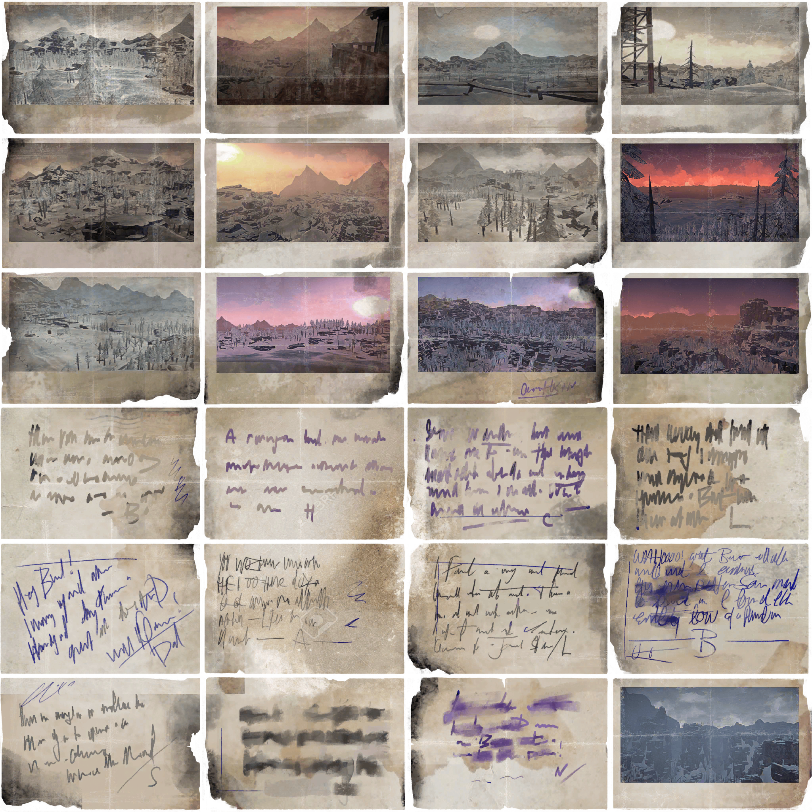
<figcaption>The front and back of several Polaroids</figcaption>
</figure></td>
<td><figure>

<figcaption>ditto</figcaption>
</figure></td>
<td><figure>

<figcaption>Ditto</figcaption>
</figure></td>
</tr>
</tbody>
</table>

**Lua execution error in Module:Navbox function navboxLua execution error in Module:Navbox function navbox**

- 

## References

- [Bashrobe. 2023. All Polaroid Locations - The Long Dark](https://www.youtube.com/watch?v=MT7tQx8doq8) (for loot table based locations)

<a href="ru:%D0%A4%D0%BE%D1%82%D0%BE%D1%81%D0%BD%D0%B8%D0%BC%D0%BA%D0%B8" class="wikilink" title="ru:Фотоснимки">ru:Фотоснимки</a>

